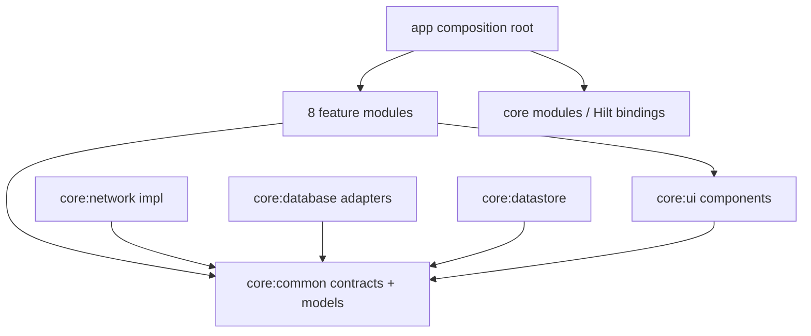

# Code Walkthrough — MyQuizApp

Tài liệu onboarding và tra cứu theo **tính năng → wiring → logic → dữ liệu → tests**. Đọc đường nhanh trước; chỉ mở chương chi tiết khi cần lần theo một hành vi. Đây là mô tả source hiện hữu, không phải thiết kế thay thế hay xác nhận release-ready.

## quick-start

**A. Đường đọc nhanh 10–15 phút**

### Revision, phạm vi và mức bằng chứng

| Thành phần | Revision đã đối chiếu | Giới hạn |
|---|---|---|
| Android local `main` | `346230b` — single-choice submission / review feedback | Đọc source/config/tests bằng ref, không checkout. Không build, chạy unit/instrumentation, render Preview hoặc E2E trong lượt viết này. |
| Docs / working branch | `daab369` (`HEAD -> docs`, `origin/docs`) trước khi thêm file này | Working tree sạch ở đầu lượt. Các trạng thái canonical được giữ nguyên; không cập nhật gate. |
| Backend mirror `server/myquizz` | `0c5908f906e1604336002f32bdbbde41458c41e7`, local `main`, working tree sạch lúc kiểm tra | Đã đọc service/socket/mode/config/schema liên quan. Không fetch; local `origin/main` không chứng minh upstream hiện tại hoặc bản đang deploy. |

**N44 vẫn PARTIAL; N46 vẫn WIP.** Classic, final Host/Player, local preview và bốn mode self-paced đã có polish trên main; điều này không đóng backend/privacy/session/token/deployment, BUG-13, max-streak hay release gates. Evidence test lịch sử và user duyệt UI không được nâng thành PASS tại revision này. Xem [checkpoint UI](N46_UI_PROGRESS.md), [handoff N46](N46_HANDOFF_PROMPT.md), [N44 report](N44_E2E_REPORT.md).

**Cách đọc path khi hai nhánh tách nhau:** mọi link source bên dưới là repo-relative, được đối chiếu trên `main@346230b`; doc link thuộc `docs@daab369`. Trên checkout `docs`, file Kotlin có thể không hiện hữu. Đó không phải source bị mất. Dùng `git show main:<path>` để đọc, hoặc tự chuyển branch khi phù hợp; không copy source sang docs chỉ để link mở ở working tree. Backend link trỏ mirror local, không phải cam kết submodule/upstream revision.

### Mục lục

- [Bản đồ tính năng](#feature-map) · [Module và quy ước mũi tên](#layers)
- [Boot / navigation / session](#boot) · [Auth và reset](#auth)
- [Home / Search / Discover](#browse) · [Library](#library) · [Quiz Detail / delete](#detail)
- [Editor và media](#editor) · [Tạo phòng / mode config](#create-room) · [Join guest / account](#join)
- [Lobby / start / countdown](#lobby) · [Classic Player / Host](#classic)
- [Self-paced Player](#self-paced) · [Host monitoring](#host-monitor)
- [Final / online review / recovery](#final) · [Hoạt động / lịch sử / answer sheet](#history)
- [Chơi thử local](#preview) · [Profile / avatar](#profile) · [Account security](#security)
- [Cross-cutting và lookup](#cross-cutting) · [Pitfalls / gates](#pitfalls)
- [Checklist bảo trì](#maintenance) · [Coverage tài liệu → source](#coverage)

### Muốn hiểu / sửa X: bắt đầu ở đâu?

| Nhu cầu | Mở trước | Rồi lần theo |
|---|---|---|
| App vào Home, không bắt login ngay | `SplashViewModel` / `AppNavGraph` | [boot](#boot): refresh session, auth gate, tab stack |
| Login / Google / OTP sai | `LoginViewModel` / `OtpVerificationViewModel` | [auth](#auth): use case, API naming, ticket |
| Search không append / Discover thiếu item | `SearchViewModel` / `DiscoverScreen` | [browse](#browse): cursor, generation, captured snapshot |
| Library stale sau edit/delete | `QuizManageListViewModel` | [library](#library): refresh generation và delete target |
| Detail lộ đáp án / quyền sửa | `QuizDetailPresentation` / `GetQuizWithOwnershipUseCase` | [detail](#detail): projection UI khác payload backend |
| Sửa option / time / ảnh quiz | `QuestionDraft` / `QuizEditorValidator` | [editor](#editor): index mapping → asset use cases |
| Tạo hai phòng sau retry | `CreateRoomViewModel.requestHostToken` | [create-room](#create-room): `pendingSession` |
| Join nhầm guest / không nhận event sau mạng lại | `JoinRoomViewModel.resolveSession` / lobby `onEvent` | [join](#join), [lobby](#lobby): identity khác reconnect membership |
| Single chọn xong không gửi / gửi hai lần | `GameViewModel.selectOption` / `submit` | [classic](#classic), [self-paced](#self-paced): ACK khác next |
| Sai điểm / streak sau reconnect | reducers Classic, `restore`, backend `personalResult` | [classic](#classic): private grading, 0 khác missing |
| Host bốn mode hiển thị sai tiến độ | `HostSelfPacedPresentation` | [host-monitor](#host-monitor): không dùng Classic question loop |
| Review online thừa / thiếu caption | `OnlineReviewPresentation.toOnlineReviewCardUi` | [final](#final): question type RAM, không suy loại từ key |
| History tài khoản cũ tràn sang account mới | `ActivityViewModel.load` / detail `accepts` | [history](#history): identity + epoch + request ID |
| Đổi avatar timeout / account logout race | `UpdateAvatarUseCase` / `SessionRepositoryImpl` | [profile](#profile), [cross-cutting](#cross-cutting) |

Tên file ở bảng nhanh là chỉ dẫn; link đầy đủ và symbol nằm ở bảng từng chương.

### 12 entry points nên đọc theo thứ tự

1. [app/src/main/java/android/kma/myquizzapp/MyQuizzApplication.kt](app/src/main/java/android/kma/myquizzapp/MyQuizzApplication.kt) — Hilt application và logging khởi động; không tìm business flow ở Application.
2. [app/src/main/java/android/kma/myquizzapp/MainActivity.kt](app/src/main/java/android/kma/myquizzapp/MainActivity.kt) — setContent/theme, nhận deep link reset và đưa vào app graph.
3. [app/src/main/java/android/kma/myquizzapp/navigation/AppNavGraph.kt](app/src/main/java/android/kma/myquizzapp/navigation/AppNavGraph.kt) — Scaffold ngoài NavHost, auth gate, offline banner, tập hợp graphs.
4. [app/src/main/java/android/kma/myquizzapp/navigation/Routes.kt](app/src/main/java/android/kma/myquizzapp/navigation/Routes.kt) — Typed route và tham số giữa màn; token route là dữ liệu nhạy cảm, không log.
5. [app/src/main/java/android/kma/myquizzapp/navigation/MainScaffold.kt](app/src/main/java/android/kma/myquizzapp/navigation/MainScaffold.kt) — Bốn tab và navigateToTab save/restore back stack.
6. [app/src/main/java/android/kma/myquizzapp/presentation/splash/SplashViewModel.kt](app/src/main/java/android/kma/myquizzapp/presentation/splash/SplashViewModel.kt) — Browse-first: phát refresh rồi Ready, không chờ request để vào Home.
7. [core/network/src/main/java/android/kma/myquizzapp/core/network/repository/SessionRepositoryImpl.kt](core/network/src/main/java/android/kma/myquizzapp/core/network/repository/SessionRepositoryImpl.kt) — SSOT Unknown/Guest/LoggedIn; revision/generation và gộp refresh.
8. [core/network/src/main/java/android/kma/myquizzapp/core/network/di/NetworkModule.kt](core/network/src/main/java/android/kma/myquizzapp/core/network/di/NetworkModule.kt) — Retrofit, JSON qualifiers, cookie client, public client và raw upload client.
9. [feature/quiz-manage/src/main/java/android/kma/myquizzapp/feature/quiz_manage/presentation/quizdetail/QuizDetailViewModel.kt](feature/quiz-manage/src/main/java/android/kma/myquizzapp/feature/quiz_manage/presentation/quizdetail/QuizDetailViewModel.kt) — Một REST flow nhỏ có loading, ownership, missing resource và delete guards.
10. [app/src/main/java/android/kma/myquizzapp/navigation/GameNavGraph.kt](app/src/main/java/android/kma/myquizzapp/navigation/GameNavGraph.kt) — Callback navigation từ lobby → gameplay → final; Host final ở ngay HostGame.
11. [core/network/src/main/java/android/kma/myquizzapp/core/network/socket/GameSocketClient.kt](core/network/src/main/java/android/kma/myquizzapp/core/network/socket/GameSocketClient.kt) — Cold Flow, handshake /game, emit/ACK, reconnect và awaitClose cleanup.
12. [feature/game-player/src/main/java/android/kma/myquizzapp/feature/game_player/presentation/GameViewModel.kt](feature/game-player/src/main/java/android/kma/myquizzapp/feature/game_player/presentation/GameViewModel.kt) — Runtime reducer Player, private/common results, snapshot, ACK và final handoff.

## layers

**Dependency build-time không đồng nghĩa runtime call.** `:app` là composition root, ghép feature bằng callback. `core:common` chứa domain contracts/model/Result; `core:network` triển khai REST/socket; `core:database` triển khai Room adapters; `core:datastore` giữ preferences/guest identity; `core:ui` giữ theme/component/config form dùng chung.



Mũi tên trên là **dependency chủ đích**, không phải báo cáo “mọi Gradle hiện đã sạch”. Source có debt ở bảng dưới. Runtime chuẩn:

```text
callback/Intent ↑ UI → ViewModel → UseCase → repository interface
                                            ↓ dispatch qua DI
                                     impl → API/socket/DAO
Flow/event/state ↓                    mapper → domain Result/event
Effect → Screen wrapper → callback → app navigation (không gọi feature khác)
```

- `→ call`: gọi hàm; `collect/observe`: subscription Flow; `callback/nav`: wiring route; `@Binds/@Provides`: resolve implementation, không phải API call.
- Full path ở mỗi bảng là từ repo root. Sau lần đầu có thể dùng basename khi không mơ hồ; `GameViewModel` là Player, `HostGameViewModel` là Host. Kotlin package dùng `game_player/game_host/quiz_manage/quiz_preview`, module dùng dấu `-`.
- 14 Android modules thực tế = app + 5 core + 8 feature; `build-logic` là included build riêng. Không lấy số module trong note N1–N5 làm inventory hiện tại.
- **Debt xác minh:** nhiều feature Gradle vẫn khai báo network/datastore, leaderboard còn database; `feature/home` phụ thuộc `feature/auth` để dùng auth use cases. HostGame/lobby, JoinRoom và FinalResult vẫn có repository trực tiếp trong ViewModel. Không mô tả rằng “tất cả VM đã qua use case” hoặc “không có feature→feature”. Chi tiết [pitfalls](#pitfalls).

## feature-map

**B. Danh mục tính năng có trong code**

| Nhóm | Route / entry screen | Owner | Transport / nguồn | Walkthrough |
|---|---|---|---|---|
| Boot, browse-first, tabs, auth gate | Splash → Home; MyQuizzes / Activity / Profile | app | session Flow + users/me | [boot](#boot) |
| Login/register/Google/logout | AuthGraph; Login / Register / Profile | auth + app | cookie REST + Credential Manager ở wrapper | [auth](#auth) |
| Forgot/OTP/reset/deep link | ForgotPassword → OtpVerification → ResetPassword | auth | REST verify/ticket/complete | [auth](#auth) |
| Home/Search/Discover/filter/Paging | Home → Search hoặc Discover → QuizDetail | home | REST home/search/feed; cursor | [browse](#browse) |
| Library/filter/sort/delete | MyQuizzes → Detail hoặc Create/Edit | quiz-manage | REST /quizzes/me + Paging | [library](#library) |
| Detail/owner actions/delete | QuizDetail | quiz-manage | REST detail + cache fallback | [detail](#detail) |
| Create/Edit quiz, media | CreateQuiz / EditQuiz | quiz-manage | REST + storage presign/raw PUT | [editor](#editor) |
| Create room/mode config | QuizDetail → CreateRoom → HostLobby | quiz-manage + core:ui/gameconfig | REST descriptors/create/token | [create-room](#create-room) |
| Join account/guest | Home slot JoinRoomCard → GuestNickname? → PlayerLobby | lobby | REST lookup/join + guest DataStore | [join](#join) |
| Host/Player lobby, config/start | HostLobby / PlayerLobby | lobby | socket lobby events/ACK + REST descriptor/token | [lobby](#lobby) |
| Classic gameplay | GamePlay / HostGame | game-player / game-host | socket host-paced | [classic](#classic) |
| Solo/Survival/Marathon/Practice Player | GamePlay (cùng route/VM) | game-player | socket self-paced online | [self-paced](#self-paced) |
| Host monitoring bốn mode | HostGame Content branch | game-host | host progress/leaderboard/snapshot | [host-monitor](#host-monitor) |
| Player/Host final, standings, stats | FinalResult / HostGame finished Content | leaderboard / game-host | socket-first; REST recovery-only | [final](#final) |
| Online personal review | Inline final Player | leaderboard | REST x-socket-token + review gate | [final](#final) |
| History/summary/my answers | Activity → GameHistoryDetail(sessionId) | app + leaderboard | cookie hoặc guest header REST | [history](#history) |
| Chơi thử local | QuizDetail → QuizPreview | quiz-preview | load detail rồi chấm/timer local; không game mutation | [preview](#preview) |
| Profile/edit/avatar/security | Profile → edit dialog / AccountSecurity | app | session Flow + REST users/storage | [profile](#profile), [security](#security) |
| Offline/errors/cache/theme/shared UI/DI | AppNavGraph + core components | app + core | Connectivity VALIDATED / Room / DataStore / Hilt | [cross-cutting](#cross-cutting) |

**Không gộp vào tính năng đã hoàn tất:** local GameHistory DAO không cấp dữ liệu history UI; settings DataStore không chứng minh có đủ màn settings; Room cache không phải offline-first; “Lưu & xuất bản” chỉ là label theo `isPublic`, không có draft/publish workflow riêng. Không có tab Join/Create độc lập, kick/QR/share native thật trong lobby, hoặc bốn route Host monitor riêng. Các release gates vẫn nằm trong canonical docs.

**C. Walkthrough theo nhóm**

## boot

**Boot, navigation, tabs và nguồn sự thật session**

### 1. Điểm vào và điểm kết thúc
`MainActivity` dựng theme/app graph; `Route.Splash` phát refresh rồi luôn vào MainGraph/Home. Bốn destination cấp cao nhất là Trang chủ / Thư viện / Hoạt động / Hồ sơ; màn con và game không hiện bottom bar. Profile guest là empty state có nút login, không phải cả tab bị chặn.

### 2. Chuỗi thực thi
`MyQuizzApplication` (Hilt) → `MainActivity.setContent` → `AppNavGraph` (**callback/nav** tới graphs). `SplashScreen` collect `SplashViewModel.uiState`; Ready gọi callback. `CurrentUserViewModel` **observe** session use case → `SessionRepository.state`; refresh **call** AuthRepository → users/me. `SessionNavigation.resetMainGraphAfterSessionEnd` chỉ dọn tab stacks/điều hướng sau khi cleanup đã xong.

### 3. File và symbol cần đọc
| File | Symbol / block | Trách nhiệm | Nhận từ → gọi / cấp cho |
|---|---|---|---|
| [app/src/main/java/android/kma/myquizzapp/MainActivity.kt](app/src/main/java/android/kma/myquizzapp/MainActivity.kt) | `MainActivity` | Activity/theme/deep link boundary | Android intent → AppNavGraph |
| [app/src/main/java/android/kma/myquizzapp/navigation/AppNavGraph.kt](app/src/main/java/android/kma/myquizzapp/navigation/AppNavGraph.kt) | `AppNavGraph / requireAuth` | Gate trước nav, bottom bar, offline exclusion | CurrentUserViewModel.session.value → callbacks |
| [app/src/main/java/android/kma/myquizzapp/navigation/MainScaffold.kt](app/src/main/java/android/kma/myquizzapp/navigation/MainScaffold.kt) | `TopLevelTab / navigateToTab` | Save/restore tab destination | onSelect → NavHostController |
| [app/src/main/java/android/kma/myquizzapp/presentation/splash/SplashViewModel.kt](app/src/main/java/android/kma/myquizzapp/presentation/splash/SplashViewModel.kt) | `init` | Refresh nền và Ready ngay | RefreshSessionUseCase → state |
| [app/src/main/java/android/kma/myquizzapp/navigation/CurrentUserViewModel.kt](app/src/main/java/android/kma/myquizzapp/navigation/CurrentUserViewModel.kt) | `session / avatarUrl / refresh` | Chiếu avatar từ SSOT | ObserveSessionUseCase → StateFlow |
| [core/network/src/main/java/android/kma/myquizzapp/core/network/repository/SessionRepositoryImpl.kt](core/network/src/main/java/android/kma/myquizzapp/core/network/repository/SessionRepositoryImpl.kt) | `refresh / fetchAndApply / onAuthenticated` | Gộp refresh, chống publish response cũ | AuthRepository → SessionState |
| [app/src/main/java/android/kma/myquizzapp/navigation/SessionNavigation.kt](app/src/main/java/android/kma/myquizzapp/navigation/SessionNavigation.kt) | `resetMainGraphAfterSessionEnd` | Không restore saved private stack sau logout | Profile/security callbacks → MainGraph |

### 4. Logic chính
Gate đọc `session.value` **ngay lúc click**, không dùng Compose snapshot đã capture: logout và click có thể trước recomposition. `Unknown` được qua auth gate nhưng join phải resolve xong (chương join). Refresh chỉ chuyển Guest khi error terminal; network/timeout/5xx không phải logout. `revision` retire publication sau update/logout, `generation` phân biệt cả hai lần login cùng account. Gộp in-flight theo revision để request cũ không được coi là refresh hiện tại.

**Source nguyên văn — Android `346230b`, [core/network/src/main/java/android/kma/myquizzapp/core/network/repository/SessionRepositoryImpl.kt](core/network/src/main/java/android/kma/myquizzapp/core/network/repository/SessionRepositoryImpl.kt), `private suspend fun fetchAndApply` (trích block):**

```kotlin
    private suspend fun fetchAndApply(expectedRevision: Long) {
        val result = authRepository.getCurrentUser()
        synchronized(stateLock) {
            // Logout/login or a confirmed mutation after this GET started wins.
            if (revision != expectedRevision) return
            when (result) {
                is Result.Success -> {
                    if (_state.value.userOrNull?.id != result.data.id) generation++
                    revision++
                    _state.value = SessionState.LoggedIn(result.data)
                }
                is Result.Error -> if (result.error.isSessionTerminal) {
                    generation++
                    revision++
```

### 5. Data, state, lifecycle và DI
SessionRepositoryImpl là singleton qua NetworkBindingModule. StateFlow là RAM; cookie được Room lưu để refresh nhận lại identity sau process restart. Effect navigation là one-off; không persist toàn user ở từng VM. Guest UUID và cờ isGuestMode khác SessionState; xem bảng persistence ở cross-cutting. App graph refresh lúc rời auth và foreground, repository gộp lời gọi trùng.

### 6. Failure / edge cases
Không chặn cả app vì chưa biết session. Banner mạng chung chỉ hiện ngoài Host/Player Lobby/Game, nơi có reconnect UI riêng. Session revision bảo vệ **state publication**, không tự chặn cookie transport race. DataStore guest flag không cho phép suy ra account đã logout.

### 7. Tests và kiểm tra thủ công
| Test file | Case đại diện có trong source | Invariant cần giữ |
|---|---|---|
| [core/network/src/test/java/android/kma/myquizzapp/core/network/SessionRepositoryTest.kt](core/network/src/test/java/android/kma/myquizzapp/core/network/SessionRepositoryTest.kt) | `refresh started before logout cannot restore old user` | Response cũ không khôi phục account |
| [core/network/src/test/java/android/kma/myquizzapp/core/network/SessionRepositoryTest.kt](core/network/src/test/java/android/kma/myquizzapp/core/network/SessionRepositoryTest.kt) | `same account login has a new generation and rejects stale mutation` | Cùng userId vẫn khác lifetime |
| [core/common/src/test/java/android/kma/myquizzapp/core/common/error/AppErrorExtTest.kt](core/common/src/test/java/android/kma/myquizzapp/core/common/error/AppErrorExtTest.kt) | `session terminal classification does not treat network as logout` | Transient network không thành Guest |

**Kiểm tra thủ công đề nghị (chưa chạy trong lượt này):** Mở app mạng chậm: vẫn vào Home; identity đang Unknown không bị giả làm guest. Login rồi logout và bấm Library ngay: không lọt saved private stack. Dấu hiệu đạt là avatar/session đổi đồng bộ và protected action có gate, không dùng resume để vá từng màn.

### 8. Khi sửa tính năng này
Sửa tab/gate ở app graph + MainScaffold, không nhét navigation vào feature Content. Sửa semantics session ở repository và tests trước, không tạo user cache riêng trong Home/Profile. Phải rà auth, join, profile, history và security callers khi đổi SessionState/token.

[Trở lại bản đồ](#quick-start)

## auth

**Login, register, Google, logout, forgot/OTP/reset**

### 1. Điểm vào và điểm kết thúc
Browse-first cho phép guest xem Home. AuthRequiredDialog hoặc Profile guest mở AuthGraph. Login/Register thành công callback về MainGraph; forgot đi qua OTP rồi ResetPassword; email deep link có thể vào ResetPassword bằng token. Logout khởi phát từ Profile và reset main/tab stacks.

### 2. Chuỗi thực thi
`AuthNavGraph` **nav callback** → từng `*Screen` lấy VM/collect effects → Content dispatch Intent. `LoginViewModel.submit/loginWithGoogle` → AuthUseCases → AuthRepositoryImpl → AuthApiService; cookie do jar xử lý. Register thực tế là register **rồi login** trong AuthRepositoryImpl vì register không set cookie; login thất bại sau register là partial success, không phải transaction. Google Credential Manager chạy tại LoginScreen wrapper, chỉ ID token đưa vào use case. Reset: ForgotPasswordUseCase → OTP verify → ticket; ResetPasswordViewModel nhận ticket hoặc token, peek/verify rồi CompleteResetUseCase. Không biến OTP thành password reset trực tiếp.

### 3. File và symbol cần đọc
| File | Symbol / block | Trách nhiệm | Nhận từ → gọi / cấp cho |
|---|---|---|---|
| [app/src/main/java/android/kma/myquizzapp/navigation/AuthNavGraph.kt](app/src/main/java/android/kma/myquizzapp/navigation/AuthNavGraph.kt) | `authGraph` | Ghép callback các route auth | Screen Effect → NavController |
| [feature/auth/src/main/java/android/kma/myquizzapp/feature/auth/presentation/login/LoginViewModel.kt](feature/auth/src/main/java/android/kma/myquizzapp/feature/auth/presentation/login/LoginViewModel.kt) | `submit / loginWithGoogle / playAsGuest` | Validate rồi gọi use cases | LoginIntent → Result → Effect |
| [feature/auth/src/main/java/android/kma/myquizzapp/feature/auth/presentation/register/RegisterViewModel.kt](feature/auth/src/main/java/android/kma/myquizzapp/feature/auth/presentation/register/RegisterViewModel.kt) | `onIntent / submit` | Registration form/validation | RegisterUseCase → session publish |
| [feature/auth/src/main/java/android/kma/myquizzapp/feature/auth/domain/usecase/AuthUseCases.kt](feature/auth/src/main/java/android/kma/myquizzapp/feature/auth/domain/usecase/AuthUseCases.kt) | `LoginUseCase / RegisterUseCase / LoginWithGoogleUseCase / LogoutUseCase` | Cập nhật session tập trung sau auth | AuthRepository + SessionRepository |
| [feature/auth/src/main/java/android/kma/myquizzapp/feature/auth/presentation/otp/OtpVerificationViewModel.kt](feature/auth/src/main/java/android/kma/myquizzapp/feature/auth/presentation/otp/OtpVerificationViewModel.kt) | `verify / resendCode / startResendCountdown` | 6 ASCII digits, cooldown và verify thật | VerifyResetOtpUseCase → ticket effect |
| [feature/auth/src/main/java/android/kma/myquizzapp/feature/auth/presentation/reset/ResetPasswordViewModel.kt](feature/auth/src/main/java/android/kma/myquizzapp/feature/auth/presentation/reset/ResetPasswordViewModel.kt) | `peekTicket / verifyToken / submit` | Tách ticket với OTP/email link token | PasswordResetApiService qua use cases |
| [core/network/src/main/java/android/kma/myquizzapp/core/network/repository/AuthRepositoryImpl.kt](core/network/src/main/java/android/kma/myquizzapp/core/network/repository/AuthRepositoryImpl.kt) | `login / register / logout / completeReset` | Data boundary của auth | API → domain Result |

### 4. Logic chính
Password không trim như email. OTP chỉ ASCII digits, room code lại ASCII alphanumeric uppercase. Forgot/OTP claim loading trước coroutine; không suy mọi legacy login handler đã có guard double-submit tương đương editor. OTP verify thành công trả ticket, bước complete chỉ dùng ticket + newPassword; resend cooldown local là UX, server rate-limit vẫn authoritative. Reset dùng PreserveCaseRetrofit để `newPassword`/expiresAt không bị snake-case biến đổi. `LogoutUseCase` publish SignedOut ngay cả khi REST logout lỗi; AuthRepository cleanup cookie ở data.

**Source nguyên văn — Android `346230b`, [feature/auth/src/main/java/android/kma/myquizzapp/feature/auth/presentation/otp/OtpVerificationViewModel.kt](feature/auth/src/main/java/android/kma/myquizzapp/feature/auth/presentation/otp/OtpVerificationViewModel.kt), `private fun verify()` (trích block):**

```kotlin
    private fun verify() {
        if (_uiState.value.isLoading) return
        val otp = _uiState.value.otp

        if (otp.length != 6 || otp.any { it !in '0'..'9' }) {
            viewModelScope.launch {
                _effect.send(OtpVerificationEffect.ShowMessage("Vui lòng nhập đủ 6 chữ số"))
            }
            return
        }

        _uiState.update { it.copy(isLoading = true) }
        viewModelScope.launch {
```

**Source nguyên văn — Android `346230b`, [feature/auth/src/main/java/android/kma/myquizzapp/feature/auth/domain/usecase/AuthUseCases.kt](feature/auth/src/main/java/android/kma/myquizzapp/feature/auth/domain/usecase/AuthUseCases.kt), `class LoginUseCase` (trích block):**

```kotlin
class LoginUseCase @Inject constructor(
    private val repo: AuthRepository,
    private val session: SessionRepository,
) {
    suspend operator fun invoke(email: String, password: String) =
        repo.login(email, password).onSuccess(session::onAuthenticated)
}

```

### 5. Data, state, lifecycle và DI
Cookie jar lưu cookie server nhận được từ auth API; không đổi sang Bearer. Login/register/Google publish session tại use case, không mỗi VM gọi getMe riêng. Reset ticket/token đi trong typed route/SavedStateHandle theo code hiện tại nên tuyệt đối không log route/query/token. Password ở RAM state và request; không thêm persistence. Screen sở hữu credential launcher/effect navigation; Content không gọi Google SDK. Resend job sống theo viewModelScope.

### 6. Failure / edge cases
Backend authority quyết định credential/rate limit/expired ticket. Peek ticket lỗi mạng không tự kết luận ticket hết hạn. Auth endpoints không kích TokenAuthenticator refresh lặp. Public game review 401 không được logout account (client riêng). Các TTL/cooldown trong tài liệu là contract tại mirror, không bằng chứng cấu hình deployed. Không hứa reset-password và change-password có cùng session revocation policy.

### 7. Tests và kiểm tra thủ công
| Test file | Case đại diện có trong source | Invariant cần giữ |
|---|---|---|
| [feature/auth/src/test/java/android/kma/myquizzapp/feature/auth/presentation/validation/PasswordResetValidationTest.kt](feature/auth/src/test/java/android/kma/myquizzapp/feature/auth/presentation/validation/PasswordResetValidationTest.kt) | `eightCharactersDoNotRequireExtraComplexity` | Không tự thêm rule hoa/thường/ký tự đặc biệt |
| [core/network/src/test/java/android/kma/myquizzapp/core/network/di/PreserveCaseJsonTest.kt](core/network/src/test/java/android/kma/myquizzapp/core/network/di/PreserveCaseJsonTest.kt) | `password reset request keeps newPassword camelCase` | Wire casing đúng |
| [core/network/src/test/java/android/kma/myquizzapp/core/network/cookie/TokenAuthenticationTest.kt](core/network/src/test/java/android/kma/myquizzapp/core/network/cookie/TokenAuthenticationTest.kt) | `401 triggers refresh then retries original request with new cookie` | Cookie refresh path |
| [core/network/src/test/java/android/kma/myquizzapp/core/network/SecurityRefreshTest.kt](core/network/src/test/java/android/kma/myquizzapp/core/network/SecurityRefreshTest.kt) | `auth endpoints never trigger refresh` | Không vòng lặp refresh auth |

**Kiểm tra thủ công đề nghị (chưa chạy trong lượt này):** Thử invalid email/password, OTP sai/thiếu/non-ASCII, resend sớm và ticket hết hạn; phải ở đúng bước với lỗi an toàn, không navigate giả success. Dùng account test/placeholder, không log OTP/token. Login/logout thử cả cookie restore và Home browse-first.

### 8. Khi sửa tính năng này
Sửa form ở VM/validator + ScreenContent; protocol tại repository/API/JSON qualifier. Rà cả OTP và deep-link token branch khi đổi reset. Không sửa backend policy hoặc thêm log credential chỉ để debug.

[Trở lại bản đồ](#quick-start)

## browse

**Home, Search, Discover/filter và Paging**

### 1. Điểm vào và điểm kết thúc
Home chứa feed sections và slot join room do MainNavGraph truyền. Search là màn riêng; Discover mở từ “xem thêm”, giữ title Khám phá, filter/sort mới là query state. Card click đi QuizDetail.

### 2. Chuỗi thực thi
HomeScreen **collect state/effect** → HomeViewModel → GetHomeContentUseCase → QuizRepositoryImpl → QuizApiService.getHomeContent → DTO.toDomain. SearchScreen nút kính lúp/IME **dispatch SubmitSearch** → SearchViewModel → SearchQuizzesUseCase → search API; LoadMore dùng cursor. DiscoverScreen Initialize request → DiscoverViewModel.query → **flatMapLatest** ObserveDiscoverQuizzesUseCase → Pager/DiscoverPagingSource → feed hoặc public search.

### 3. File và symbol cần đọc
| File | Symbol / block | Trách nhiệm | Nhận từ → gọi / cấp cho |
|---|---|---|---|
| [app/src/main/java/android/kma/myquizzapp/navigation/MainNavGraph.kt](app/src/main/java/android/kma/myquizzapp/navigation/MainNavGraph.kt) | `mainGraph / roomCodeCard` | Wiring Home và lobby không import lẫn nhau | JoinRoomCard callbacks → app routes |
| [feature/home/src/main/java/android/kma/myquizzapp/feature/home/presentation/HomeViewModel.kt](feature/home/src/main/java/android/kma/myquizzapp/feature/home/presentation/HomeViewModel.kt) | `uiState / loadHomeContent` | combine content với session Flow | GetHomeContentUseCase + ObserveSessionUseCase |
| [feature/home/src/main/java/android/kma/myquizzapp/feature/home/presentation/search/SearchViewModel.kt](feature/home/src/main/java/android/kma/myquizzapp/feature/home/presentation/search/SearchViewModel.kt) | `updateQuery / submitSearch / loadMore / retry` | Search thủ công và hai loại lỗi trang | SearchIntent → SearchQuizzesUseCase |
| [feature/home/src/main/java/android/kma/myquizzapp/feature/home/presentation/discover/DiscoverViewModel.kt](feature/home/src/main/java/android/kma/myquizzapp/feature/home/presentation/discover/DiscoverViewModel.kt) | `initialize / updateQuery / quizzes` | Query state đổi tạo stream Paging mới | flatMapLatest → ObserveDiscoverQuizzesUseCase |
| [feature/home/src/main/java/android/kma/myquizzapp/feature/home/domain/discover/DiscoverPagingSource.kt](feature/home/src/main/java/android/kma/myquizzapp/feature/home/domain/discover/DiscoverPagingSource.kt) | `load / getRefreshKey` | Chọn backend theo filter, trả next cursor | QuizRepository → LoadResult |
| [feature/home/src/main/java/android/kma/myquizzapp/feature/home/presentation/discover/DiscoverScreen.kt](feature/home/src/main/java/android/kma/myquizzapp/feature/home/presentation/discover/DiscoverScreen.kt) | `DiscoverScreen` | Captured snapshot cho count/key/render | LazyPagingItems → stateless Content |
| [core/network/src/main/java/android/kma/myquizzapp/core/network/repository/QuizRepositoryImpl.kt](core/network/src/main/java/android/kma/myquizzapp/core/network/repository/QuizRepositoryImpl.kt) | `searchPublicQuizzes / getQuizFeed` | Public browse khác optional-auth Search | publicQuizApi hoặc quizApi → DTO.toDomain |

### 4. Logic chính
Search không debounce/live-search: gõ mới hủy pending jobs, query rỗng clear ngay; Submit reset cursor/results. Append error giữ list/cursor và pause auto-load để retry đúng page. `ensureActive` sau request chống late canceled completion. Discover pageSize/initialLoadSize=12, prefetchDistance=3; query change dùng flatMapLatest/cachedIn. Public search của Discover dùng NO_COOKIES/NONE authenticator để không trộn private/empty quiz owner. Feed dùng endpoint feed riêng. Pagination meta camelCase cần alias dù Json snake-case.

**Source nguyên văn — Android `346230b`, [feature/home/src/main/java/android/kma/myquizzapp/feature/home/presentation/search/SearchViewModel.kt](feature/home/src/main/java/android/kma/myquizzapp/feature/home/presentation/search/SearchViewModel.kt), `private fun cancelPendingRequests()` (trích block):**

```kotlin
    private fun cancelPendingRequests() {
        searchJob?.cancel()
        loadMoreJob?.cancel()
        searchJob = null
        loadMoreJob = null
    }

```

**Source nguyên văn — Android `346230b`, [feature/home/src/main/java/android/kma/myquizzapp/feature/home/domain/discover/ObserveDiscoverQuizzesUseCase.kt](feature/home/src/main/java/android/kma/myquizzapp/feature/home/domain/discover/ObserveDiscoverQuizzesUseCase.kt), `operator fun invoke(query:` (trích block):**

```kotlin
    operator fun invoke(query: DiscoverQuery) = Pager(
        config = PagingConfig(pageSize = 12, initialLoadSize = 12, prefetchDistance = 3, enablePlaceholders = false),
        pagingSourceFactory = { DiscoverPagingSource(repository, query) }
    ).flow
}
```

### 5. Data, state, lifecycle và DI
Home sections lấy server, không hardcode danh sách/title hay bịa rating/progress. `sectionType`/topic suy filter theo data, không parse title. Paging query ownership nằm VM; list scroll/observation ở stateful wrapper. Discover capture một item snapshot cho count, key và render; live access chỉ phục vụ prefetch có index/identity guard. Lưu ý Home hiện dùng ObserveSessionUseCase từ auth feature: dependency debt, không coi là feature isolation đã sạch.

### 6. Failure / edge cases
Không có results chỉ sau Success của submitted query hiện tại; chưa submit/loading/error không phải empty-success. Đổi filter từ nhiều item sang ít/rỗng phải tránh count/key mismatch. Cursor opaque gắn filter, không tái dùng sau đổi query/sort. Cache Detail không đồng nghĩa Home/Search/Discover offline-first.

### 7. Tests và kiểm tra thủ công
| Test file | Case đại diện có trong source | Invariant cần giữ |
|---|---|---|
| [feature/home/src/test/java/SearchUiStateTest.kt](feature/home/src/test/java/SearchUiStateTest.kt) | `typed but unsubmitted query does not show no results` | Empty UX đúng trạng thái |
| [feature/home/src/test/java/DiscoverSourceTest.kt](feature/home/src/test/java/DiscoverSourceTest.kt) | `all defaults to newest public browse` | Nguồn public/filter mặc định |
| [feature/home/src/test/java/HomeSectionDiscoverTest.kt](feature/home/src/test/java/HomeSectionDiscoverTest.kt) | `category topic comes from quiz data not title` | Không parse title làm contract |
| [core/network/src/test/java/android/kma/myquizzapp/core/network/di/PaginationMetaDtoTest.kt](core/network/src/test/java/android/kma/myquizzapp/core/network/di/PaginationMetaDtoTest.kt) | `production snake case json still reads camel case pagination meta` | Paging không dừng sớm vì alias |

**Kiểm tra thủ công đề nghị (chưa chạy trong lượt này):** Submit từ cả nút và IME; gây append error rồi Retry phải giữ item cũ và cursor. Discover đổi filter/sort nhiều→ít→rỗng, append/back/reopen; không crash itemKey, không lộ quiz private của owner. Đây là test cần chạy lại, không suy đã PASS từ source fix.

### 8. Khi sửa tính năng này
Sửa Source selection ở DiscoverPagingSource/query model; sửa count/key ở wrapper và Content cùng snapshot. Không bỏ stable key/prefetch hoặc nuốt IndexOutOfBoundsException. Rà Search/Library nếu đổi PageInfo/PaginationMetaDto; không dùng offset page giả cho cursor API.

[Trở lại bản đồ](#quick-start)

## library

**Thư viện: quiz của tôi, filter/sort và delete**

### 1. Điểm vào và điểm kết thúc
Tab MyQuizzes có auth gate trước navigation; FAB tạo quiz là action, không tab thứ năm. Item mở Detail/Edit; menu delete có confirmation. Quay lại sau mutation tạo Paging generation mới.

### 2. Chuỗi thực thi
AppNavGraph requireAuth → QuizManageNavGraph → QuizManageListScreen wrapper → Content/LibraryQuizCard callbacks → QuizManageListIntent. VM combine query/visibility/sort/refresh generation → GetMyQuizzesUseCase Pager → MyQuizzesPagingSource → QuizRepository.getMyQuizzes → API. Delete → DeleteQuizUseCase → repository/cache invalidation → refresh generation + ShowMessage Effect.

### 3. File và symbol cần đọc
| File | Symbol / block | Trách nhiệm | Nhận từ → gọi / cấp cho |
|---|---|---|---|
| [app/src/main/java/android/kma/myquizzapp/navigation/QuizManageNavGraph.kt](app/src/main/java/android/kma/myquizzapp/navigation/QuizManageNavGraph.kt) | `quizManageGraph` | Auth gate và CRUD route callbacks | MyQuizzes Screen → Create/Edit/Detail |
| [feature/quiz-manage/src/main/java/android/kma/myquizzapp/feature/quiz_manage/presentation/quizmanagelist/QuizManageListViewModel.kt](feature/quiz-manage/src/main/java/android/kma/myquizzapp/feature/quiz_manage/presentation/quizmanagelist/QuizManageListViewModel.kt) | `onIntent / refresh / deleteQuiz` | Paging generation và mutation target | GetMyQuizzesUseCase / DeleteQuizUseCase |
| [feature/quiz-manage/src/main/java/android/kma/myquizzapp/feature/quiz_manage/domain/usecase/GetMyQuizzesUseCase.kt](feature/quiz-manage/src/main/java/android/kma/myquizzapp/feature/quiz_manage/domain/usecase/GetMyQuizzesUseCase.kt) | `invoke` | Pager cho query chủ sở hữu | MyQuizzesPagingSource |
| [feature/quiz-manage/src/main/java/android/kma/myquizzapp/feature/quiz_manage/domain/paging/MyQuizzesPagingSource.kt](feature/quiz-manage/src/main/java/android/kma/myquizzapp/feature/quiz_manage/domain/paging/MyQuizzesPagingSource.kt) | `load` | Chuyển cursor/PageInfo thành Paging page | QuizRepository.getMyQuizzes |
| [feature/quiz-manage/src/main/java/android/kma/myquizzapp/feature/quiz_manage/presentation/quizmanagelist/QuizManageListScreen.kt](feature/quiz-manage/src/main/java/android/kma/myquizzapp/feature/quiz_manage/presentation/quizmanagelist/QuizManageListScreen.kt) | `QuizManageListScreen` | Lifecycle reload, snapshot và UI integration | Content + LibraryQuizCard |
| [feature/quiz-manage/src/main/java/android/kma/myquizzapp/feature/quiz_manage/domain/usecase/DeleteQuizUseCase.kt](feature/quiz-manage/src/main/java/android/kma/myquizzapp/feature/quiz_manage/domain/usecase/DeleteQuizUseCase.kt) | `invoke` | Repository boundary của delete | QuizRepository.deleteQuiz |

### 4. Logic chính
`refresh()` tăng `_refreshGeneration`, không chỉ kỳ vọng LazyPagingItems.refresh luôn đủ sau cachedIn. Filter/sort vẫn được giữ khi delete thành công. Delete chỉ chạy khi có target confirmation; claim isDeleting đồng bộ trước launch, chặn dismiss/retarget lúc in-flight. Missing quiz là stale target cần dọn và refresh, transient error giữ target cho retry có chủ ý.

**Source nguyên văn — Android `346230b`, [feature/quiz-manage/src/main/java/android/kma/myquizzapp/feature/quiz_manage/presentation/quizmanagelist/QuizManageListViewModel.kt](feature/quiz-manage/src/main/java/android/kma/myquizzapp/feature/quiz_manage/presentation/quizmanagelist/QuizManageListViewModel.kt), `private fun deleteQuiz()` (trích block):**

```kotlin
    private fun deleteQuiz() {
        val state = _uiState.value
        val target = state.deleteTarget ?: return
        if (state.isDeleting) return
        // Claim synchronously, before launch: a second tap cannot send another DELETE.
        _uiState.update { it.copy(isDeleting = true, deleteError = null) }
        viewModelScope.launch {
            when (val result = deleteQuizUseCase(target.id)) {
                is Result.Success -> {
                    _uiState.update { it.copy(deleteTarget = null, isDeleting = false, deleteError = null) }
                    refresh() // Preserve filters/sort and replace the Paging generation.
                    _effect.send(QuizManageListEffect.ShowMessage("Đã xóa quiz."))
```

### 5. Data, state, lifecycle và DI
Library list là owner summary (`QuizSummary`), không card public. Query/cursor ở Pager; target/delete error nằm VM, dialog chỉ render props. Screen giữ list/UI effects; use case/repository Hilt constructor injection, binding chung QuizRepositoryImpl. Cache xóa tại repository, không trực tiếp Room trong Content.

### 6. Failure / edge cases
Unauthorized/backend vẫn là authorization thật sau UI gate. Không để double-confirm gửi hai DELETE; reload/filter trong mutation phải theo guard hiện có. count/key/render dùng cùng snapshot tương tự Discover. Resource đã xóa ở thiết bị khác chỉ biết khi request tiếp theo; không push invalidation hay polling giả.

### 7. Tests và kiểm tra thủ công
| Test file | Case đại diện có trong source | Invariant cần giữ |
|---|---|---|
| [feature/quiz-manage/src/test/java/android/kma/myquizzapp/feature/quiz_manage/presentation/quizmanagelist/QuizManageListViewModelTest.kt](feature/quiz-manage/src/test/java/android/kma/myquizzapp/feature/quiz_manage/presentation/quizmanagelist/QuizManageListViewModelTest.kt) | `confirm without an open confirmation never deletes` | Không bypass confirmation bằng Intent |
| [feature/quiz-manage/src/test/java/android/kma/myquizzapp/feature/quiz_manage/presentation/quizmanagelist/QuizManageListViewModelTest.kt](feature/quiz-manage/src/test/java/android/kma/myquizzapp/feature/quiz_manage/presentation/quizmanagelist/QuizManageListViewModelTest.kt) | `double confirmation is claimed before coroutine runs` | Mutation single-flight |
| [feature/quiz-manage/src/test/java/android/kma/myquizzapp/feature/quiz_manage/presentation/quizmanagelist/QuizManageListViewModelTest.kt](feature/quiz-manage/src/test/java/android/kma/myquizzapp/feature/quiz_manage/presentation/quizmanagelist/QuizManageListViewModelTest.kt) | `in flight delete cannot be dismissed or retargeted` | Target không đổi giữa request |

**Kiểm tra thủ công đề nghị (chưa chạy trong lượt này):** Mở/dismiss confirmation không được gọi DELETE. Double-confirm chỉ một mutation; gây lỗi tạm dialog giữ target; xóa nơi khác rồi retry phải bỏ card stale. Sửa quiz và quay lại: list reload, filter/sort cũ không mất.

### 8. Khi sửa tính năng này
Sửa Library card riêng, không đổi SearchQuizCard vì nhìn giống nhau. Rà both Library và Detail delete flows nếu đổi hard-delete semantics. Đổi repository signature phải sửa toàn bộ fake/test ở cả module khác, không chỉ test lọc bằng --tests.

[Trở lại bản đồ](#quick-start)

## detail

**Quiz Detail, ownership, xem câu hỏi và xóa**

### 1. Điểm vào và điểm kết thúc
Home/Search/Discover/Library card → Route.QuizDetail(quizId). Từ Detail có Chơi thử, Tạo phòng (auth-gated), owner Edit/Delete. Delete thành công hoặc missing resource được app callback đưa về nơi hợp lệ.

### 2. Chuỗi thực thi
QuizManageNavGraph callback → QuizDetailScreen wrapper → QuizDetailScreenContent/QuestionPreviewCard. Load Intent → QuizDetailViewModel.loadQuizDetail → GetQuizWithOwnershipUseCase → QuizRepository.getQuizDetail + auth ownership lookup → domain quiz/isOwner. Delete Intent → DeleteQuizUseCase → QuizRepositoryImpl.deleteQuiz. Effect chỉ đi qua Screen → app navigation, không VM gọi NavController.

### 3. File và symbol cần đọc
| File | Symbol / block | Trách nhiệm | Nhận từ → gọi / cấp cho |
|---|---|---|---|
| [feature/quiz-manage/src/main/java/android/kma/myquizzapp/feature/quiz_manage/presentation/quizdetail/QuizDetailViewModel.kt](feature/quiz-manage/src/main/java/android/kma/myquizzapp/feature/quiz_manage/presentation/quizdetail/QuizDetailViewModel.kt) | `loadQuizDetail / deleteQuiz` | Single-flight load và owner/confirmation guards | GetQuizWithOwnershipUseCase / DeleteQuizUseCase |
| [feature/quiz-manage/src/main/java/android/kma/myquizzapp/feature/quiz_manage/domain/usecase/GetQuizWithOwnershipUseCase.kt](feature/quiz-manage/src/main/java/android/kma/myquizzapp/feature/quiz_manage/domain/usecase/GetQuizWithOwnershipUseCase.kt) | `invoke` | Kết hợp quiz và quyền owner hiện tại | repository interfaces → detail result |
| [feature/quiz-manage/src/main/java/android/kma/myquizzapp/feature/quiz_manage/presentation/quizdetail/QuizDetailScreen.kt](feature/quiz-manage/src/main/java/android/kma/myquizzapp/feature/quiz_manage/presentation/quizdetail/QuizDetailScreen.kt) | `QuizDetailScreen` | Lifecycle/back/effects và collapse IDs | VM state → Content |
| [feature/quiz-manage/src/main/java/android/kma/myquizzapp/feature/quiz_manage/presentation/quizdetail/QuizDetailPresentation.kt](feature/quiz-manage/src/main/java/android/kma/myquizzapp/feature/quiz_manage/presentation/quizdetail/QuizDetailPresentation.kt) | `toQuestionPreviewUiModel / sharedQuestionTimeSeconds / displayQuestionCount` | Projection/read-only câu hỏi, duration chung | Quiz/domain → primitive UI props |
| [feature/quiz-manage/src/main/java/android/kma/myquizzapp/feature/quiz_manage/presentation/components/QuestionPreviewCard.kt](feature/quiz-manage/src/main/java/android/kma/myquizzapp/feature/quiz_manage/presentation/components/QuestionPreviewCard.kt) | `QuestionPreviewCard` | Xem câu hỏi khác editor | projection → AnswerOptionItem readOnly |
| [core/network/src/main/java/android/kma/myquizzapp/core/network/repository/QuizRepositoryImpl.kt](core/network/src/main/java/android/kma/myquizzapp/core/network/repository/QuizRepositoryImpl.kt) | `getQuizDetail / deleteQuiz` | Network-first/cache và invalidation | API → QuizCacheStore |

### 4. Logic chính
Load guard claim trước launch. Delete guard kiểm cả owner, loaded quiz, confirmation, không loading/error/deleting; icon visibility không đủ. Missing resource dọn quiz/owner/dialog rồi gửi ResourceMissing; transient delete fail giữ confirmation. Question cards mặc định mở, wrapper lưu tập IDs đã collapse; mixed question duration bỏ cell thời gian chung, không lấy câu đầu. UI projection bỏ correctAnswer/hint/explanation nhưng không được suy backend payload đã an toàn.

**Source nguyên văn — Android `346230b`, [feature/quiz-manage/src/main/java/android/kma/myquizzapp/feature/quiz_manage/presentation/quizdetail/QuizDetailViewModel.kt](feature/quiz-manage/src/main/java/android/kma/myquizzapp/feature/quiz_manage/presentation/quizdetail/QuizDetailViewModel.kt), `private fun deleteQuiz()` (trích block):**

```kotlin
    private fun deleteQuiz() {
        val state = _uiState.value
        if (!state.isOwner || state.quiz == null || !state.isConfirmingDelete ||
            state.isLoading || state.error != null || state.isDeleting) return
        // Claim before launch, not inside it, so two taps cannot send two DELETEs.
        _uiState.update { it.copy(isDeleting = true, deleteError = null) }
        viewModelScope.launch {
            when (val result = deleteQuizUseCase(quizId)) {
                is Result.Success -> {
                    _uiState.update { it.copy(quiz = null, isOwner = false, isDeleting = false, isConfirmingDelete = false, deleteError = null) }
                    _effect.send(QuizDetailEffect.QuizDeleted)
                }
```

### 5. Data, state, lifecycle và DI
Server quiz và identity quyết định ownership; UI chỉ hỗ trợ phát hiện sớm, backend vẫn chặn. Cache network-first chỉ fallback transient; missing xóa cache. readOnly answer option không đồng nghĩa đúng/sai, không grade local tại Detail. Owner check lấy qua interfaces; không dùng feature→feature để hỏi Profile. DI dùng QuizRepository/AuthRepository bindings.

### 6. Failure / edge cases
Khi quiz bị xóa trong lúc Detail đang mở không có notification push. Đi CreateRoom từ dữ liệu cũ có thể fail ở submit; quay lại phải reload/missing redirect. Read-only card không sửa privacy leak ở REST response. Không coi user duyệt UI là đã kiểm tra quyền truy cập backend.

### 7. Tests và kiểm tra thủ công
| Test file | Case đại diện có trong source | Invariant cần giữ |
|---|---|---|
| [feature/quiz-manage/src/test/java/android/kma/myquizzapp/feature/quiz_manage/presentation/quizdetail/QuizDetailViewModelTest.kt](feature/quiz-manage/src/test/java/android/kma/myquizzapp/feature/quiz_manage/presentation/quizdetail/QuizDetailViewModelTest.kt) | `non owner cannot open confirmation or delete through intents` | Không bypass owner guard |
| [feature/quiz-manage/src/test/java/android/kma/myquizzapp/feature/quiz_manage/presentation/quizdetail/QuizDetailViewModelTest.kt](feature/quiz-manage/src/test/java/android/kma/myquizzapp/feature/quiz_manage/presentation/quizdetail/QuizDetailViewModelTest.kt) | `double tap sends one delete and blocks dismiss and reload while in flight` | Delete target single-flight |
| [feature/quiz-manage/src/test/java/android/kma/myquizzapp/feature/quiz_manage/presentation/quizdetail/QuizDetailPresentationTest.kt](feature/quiz-manage/src/test/java/android/kma/myquizzapp/feature/quiz_manage/presentation/quizdetail/QuizDetailPresentationTest.kt) | `mixed durations omit the shared duration` | Không bịa thời gian chung |

**Kiểm tra thủ công đề nghị (chưa chạy trong lượt này):** Guest xem public quiz: không có owner mutation; cố phát delete Intent phải bị chặn. Expand/collapse nhiều câu độc lập; mixed times không có thời gian chung. Delete error giữ dialog; 404 bỏ state stale và thoát đúng route.

### 8. Khi sửa tính năng này
Sửa xem câu ở QuestionPreviewCard/Detail presentation, không QuestionEditorCard. Sửa authorization/protocol ở use case/data/backend policy theo scope riêng, không chỉ ẩn nút. Rà Detail→Preview, CreateRoom và Library callbacks khi đổi route hoặc quiz model.

[Trở lại bản đồ](#quick-start)

## editor

**Create/Edit quiz, question draft, validation và upload ảnh**

### 1. Điểm vào và điểm kết thúc
Library FAB → CreateQuiz; owner Edit từ Library/Detail → EditQuiz(quizId). Hai wrapper dùng chung QuizEditorContent, cùng question editor. Save thành công Effect báo id để graph trở về/mở Detail theo callback; dirty exit có confirmation, đang upload không tự bỏ draft.

### 2. Chuỗi thực thi
Screen Photo Picker/back/scroll integration → QuizEditorContent → CreateQuizIntent hoặc EditQuizIntent → ViewModel update/validate/submit → CreateQuizWithAssetsUseCase hoặc UpdateQuizWithAssetsUseCase → UploadImageUseCase (compress → presign → raw PUT) → CreateQuizUseCase/UpdateQuizUseCase → QuizRepositoryImpl → request DTO/API → Quiz/domain → Effect. Không upload chỉ vì vừa chọn ảnh.

### 3. File và symbol cần đọc
| File | Symbol / block | Trách nhiệm | Nhận từ → gọi / cấp cho |
|---|---|---|---|
| [feature/quiz-manage/src/main/java/android/kma/myquizzapp/feature/quiz_manage/presentation/components/QuizEditorContent.kt](feature/quiz-manage/src/main/java/android/kma/myquizzapp/feature/quiz_manage/presentation/components/QuizEditorContent.kt) | `QuizEditorContent` | Form stateless dùng chung Create/Edit | UiState/callback → question controls |
| [feature/quiz-manage/src/main/java/android/kma/myquizzapp/feature/quiz_manage/presentation/components/QuestionEditorCard.kt](feature/quiz-manage/src/main/java/android/kma/myquizzapp/feature/quiz_manage/presentation/components/QuestionEditorCard.kt) | `QuestionEditorCard` | Soạn bốn loại câu, options/custom time | QuestionDraft/callback → Intent |
| [feature/quiz-manage/src/main/java/android/kma/myquizzapp/feature/quiz_manage/presentation/components/QuestionDraft.kt](feature/quiz-manage/src/main/java/android/kma/myquizzapp/feature/quiz_manage/presentation/components/QuestionDraft.kt) | `QuestionDraft / toNewQuestion` | Index đáp án, localId và mapping payload | editor draft → NewQuestion |
| [core/common/src/main/java/android/kma/myquizzapp/core/common/validator/QuizEditorValidator.kt](core/common/src/main/java/android/kma/myquizzapp/core/common/validator/QuizEditorValidator.kt) | `QuizEditorValidator.validate` | Pure validation cho cả hai VM | primitive input → QuizEditorErrors |
| [feature/quiz-manage/src/main/java/android/kma/myquizzapp/feature/quiz_manage/presentation/createquiz/CreateQuizViewModel.kt](feature/quiz-manage/src/main/java/android/kma/myquizzapp/feature/quiz_manage/presentation/createquiz/CreateQuizViewModel.kt) | `onIntent / submit` | Validate/claim/save draft create | CreateQuizWithAssetsUseCase |
| [feature/quiz-manage/src/main/java/android/kma/myquizzapp/feature/quiz_manage/presentation/editquiz/EditQuizViewModel.kt](feature/quiz-manage/src/main/java/android/kma/myquizzapp/feature/quiz_manage/presentation/editquiz/EditQuizViewModel.kt) | `loadQuiz / Question.toDraft / submit` | Prefill edit và giữ ảnh cũ | UpdateQuizWithAssetsUseCase |
| [feature/quiz-manage/src/main/java/android/kma/myquizzapp/feature/quiz_manage/domain/usecase/CreateQuizWithAssetsUseCase.kt](feature/quiz-manage/src/main/java/android/kma/myquizzapp/feature/quiz_manage/domain/usecase/CreateQuizWithAssetsUseCase.kt) | `invoke` | Upload cover/câu rồi POST | UploadImageUseCase → CreateQuizUseCase |
| [feature/quiz-manage/src/main/java/android/kma/myquizzapp/feature/quiz_manage/domain/usecase/UpdateQuizWithAssetsUseCase.kt](feature/quiz-manage/src/main/java/android/kma/myquizzapp/feature/quiz_manage/domain/usecase/UpdateQuizWithAssetsUseCase.kt) | `invoke` | Resolve old/new URLs rồi PATCH | UploadImageUseCase → UpdateQuizUseCase |
| [feature/quiz-manage/src/main/java/android/kma/myquizzapp/feature/quiz_manage/domain/usecase/UploadImageUseCase.kt](feature/quiz-manage/src/main/java/android/kma/myquizzapp/feature/quiz_manage/domain/usecase/UploadImageUseCase.kt) | `invoke` | Nén JPEG/presign/raw bytes PUT | ImageCompressor + StorageRepository |

### 4. Logic chính
Hiện là một màn gộp: 4 type chips, 2–4 options; preset 10/20/30/60 và Custom flag riêng `usesCustomTime`. Gõ 30 trong Custom không làm field biến mất. Editor validation 5–600s, không thêm 0 untimed vào editor từ config room. Chọn lại cùng question type không xóa key; xóa option phải remap correctIndexes. Mapper trim nhưng không filter hàng trống làm lệch index. `validationAttempt` tăng dù lỗi giống cũ để wrapper scroll lại lỗi đầu. Claim submitting trước launch và chặn Intent chỉnh draft khi mutation.

**Source nguyên văn — Android `346230b`, [feature/quiz-manage/src/main/java/android/kma/myquizzapp/feature/quiz_manage/presentation/createquiz/CreateQuizViewModel.kt](feature/quiz-manage/src/main/java/android/kma/myquizzapp/feature/quiz_manage/presentation/createquiz/CreateQuizViewModel.kt), `private fun submit()` (trích block):**

```kotlin
    private fun submit() {
        val state = _uiState.value
        if (state.isSubmitting) return
        val errors = validate(state)
        if (errors.hasErrors) {
            _uiState.update { it.copy(validationErrors = errors, validationAttempt = it.validationAttempt + 1, errorMessage = null) }
            return
        }
        _uiState.update { it.copy(isSubmitting = true, validationErrors = QuizEditorErrors(), errorMessage = null) }

        viewModelScope.launch {
            // Build QuizDraft từ UI state — validation đã xong ở trên
            val draft = QuizDraft(
```

**Source nguyên văn — Android `346230b`, [feature/quiz-manage/src/main/java/android/kma/myquizzapp/feature/quiz_manage/domain/usecase/UploadImageUseCase.kt](feature/quiz-manage/src/main/java/android/kma/myquizzapp/feature/quiz_manage/domain/usecase/UploadImageUseCase.kt), `val presigned = when` (trích block):**

```kotlin
        val presigned = when (val result = storageRepository.presignUpload(
            contentType = CONTENT_TYPE,
            folder = folder,
            fileSize = bytes.size.toLong()
        )) {
            is Result.Success -> result.data
            is Result.Error -> return result
        }

        return when (val uploadResult = storageRepository.uploadBytes(
            uploadUrl = presigned.uploadUrl,
            contentType = CONTENT_TYPE,
            bytes = bytes
        )) {
            is Result.Success -> Result.Success(presigned.publicUrl)
```

### 5. Data, state, lifecycle và DI
QuestionDraft là UI/draft model có local URI; DTO dừng data, pure validator không Uri/feature dependency. Upload chỉ khi submit, dừng sớm nếu bất kỳ ảnh lỗi; chưa gọi create/PATCH. Update giữ existingCoverUrl/existingImageUrl nếu không chọn ảnh mới. `explicitNulls=false` và PATCH omit-null không đảm bảo clear metadata/cover về null; questions gửi lên thay toàn bộ list. “Lưu & xuất bản” theo isPublic là cùng save request, không có publish phase riêng. State wrapper sở hữu picker/expansion/back/effects; use case điều phối I/O.

### 6. Failure / edge cases
Partial upload rồi lỗi có thể để object orphan; deferred upload không phải transaction/rollback storage. Retry save có thể upload lại; không hứa idempotency backend. Edit lỗi load/missing không được cho submit stale quiz. Không có reorder/autosave/duplicate chỉ vì mock design có. Source guard của editor mạnh hơn một số legacy auth handler; không khái quát toàn app.

### 7. Tests và kiểm tra thủ công
| Test file | Case đại diện có trong source | Invariant cần giữ |
|---|---|---|
| [feature/quiz-manage/src/test/java/android/kma/myquizzapp/feature/quiz_manage/presentation/editor/CreateQuizViewModelTest.kt](feature/quiz-manage/src/test/java/android/kma/myquizzapp/feature/quiz_manage/presentation/editor/CreateQuizViewModelTest.kt) | `double submit is blocked synchronously and fields cannot change while saving` | Không double-upload/POST |
| [feature/quiz-manage/src/test/java/android/kma/myquizzapp/feature/quiz_manage/presentation/editor/EditQuizViewModelTest.kt](feature/quiz-manage/src/test/java/android/kma/myquizzapp/feature/quiz_manage/presentation/editor/EditQuizViewModelTest.kt) | `custom mode survives typing a preset and preset selection clears custom mode` | Flag Custom độc lập giá trị |
| [feature/quiz-manage/src/test/java/android/kma/myquizzapp/feature/quiz_manage/presentation/editor/QuestionDraftMappingTest.kt](feature/quiz-manage/src/test/java/android/kma/myquizzapp/feature/quiz_manage/presentation/editor/QuestionDraftMappingTest.kt) | `mapper trims options without filtering rows or shifting indexes` | Đáp án không lệch index |
| [core/common/src/test/java/android/kma/myquizzapp/core/common/validator/QuizEditorValidatorTest.kt](core/common/src/test/java/android/kma/myquizzapp/core/common/validator/QuizEditorValidatorTest.kt) | `blank language is rejected` | Validate dữ liệu thực gửi |

**Kiểm tra thủ công đề nghị (chưa chạy trong lượt này):** Thử cả Create/Edit: option trống, xóa option trước correct index, chọn lại type, custom time trùng preset, double Save, back khi upload, lỗi ảnh thứ hai. Dấu hiệu đạt: không mutation khi invalid, draft giữ khi fail, không lệch correct answer, ảnh cũ không mất khi không thay.

### 8. Khi sửa tính năng này
Sửa form chung phải rà cả Create/Edit + draft mapping/validators/tests. Sửa upload tại use case/repository/compressor, không I/O trong Content. Không nới validator vì design screenshot, không tự đổi backend PATCH/null policy. Callers còn Preview/Detail, và new question DTO cần đồng bộ.

[Trở lại bản đồ](#quick-start)

## create-room

**Tạo phòng và cấu hình năm mode**

### 1. Điểm vào và điểm kết thúc
Quiz Detail “Tạo phòng chơi” qua auth gate → CreateRoom(quizId), chọn descriptor/mode + session name → POST create → host-token → HostLobby. Có năm mode thật từ backend, không rút còn hai theo ảnh mẫu.

### 2. Chuỗi thực thi
QuizManageNavGraph **wiring** → CreateRoomScreen/Content → Intent → CreateRoomViewModel.loadModes/submit → GetGameModesUseCase / CreateGameSessionUseCase / GetHostTokenUseCase → GameSessionRepositoryImpl → GameApiService → mixed-case DTO/domain. `core:ui/gameconfig` giữ typed RoomConfigForm/buildGameConfigPatch; JSON/dotted-path chuyển ở network boundary.

### 3. File và symbol cần đọc
| File | Symbol / block | Trách nhiệm | Nhận từ → gọi / cấp cho |
|---|---|---|---|
| [feature/quiz-manage/src/main/java/android/kma/myquizzapp/feature/quiz_manage/presentation/createroom/CreateRoomViewModel.kt](feature/quiz-manage/src/main/java/android/kma/myquizzapp/feature/quiz_manage/presentation/createroom/CreateRoomViewModel.kt) | `loadModes / canEdit / submit / requestHostToken` | Mode form và two-stage create/token | Use cases → pendingSession → NavigateToHostLobby |
| [core/ui/src/main/java/android/kma/myquizzapp/core/ui/gameconfig/RoomConfigForm.kt](core/ui/src/main/java/android/kma/myquizzapp/core/ui/gameconfig/RoomConfigForm.kt) | `RoomConfigForm / updateBoolean / invalidKeys` | Form typed, visibility/review consistency | descriptor/config → typed values |
| [core/ui/src/main/java/android/kma/myquizzapp/core/ui/gameconfig/GameConfigPatchBuilder.kt](core/ui/src/main/java/android/kma/myquizzapp/core/ui/gameconfig/GameConfigPatchBuilder.kt) | `buildGameConfigPatch` | Diff theo baseline, bỏ locked keys | typed values → GameConfigPatch |
| [core/network/src/main/java/android/kma/myquizzapp/core/network/repository/GameSessionRepositoryImpl.kt](core/network/src/main/java/android/kma/myquizzapp/core/network/repository/GameSessionRepositoryImpl.kt) | `getGameModes / createGameSession / getHostToken` | Unwrap API và map domain | GameApiService → GameSession/token |
| [core/network/src/main/java/android/kma/myquizzapp/core/network/api/GameApiService.kt](core/network/src/main/java/android/kma/myquizzapp/core/network/api/GameApiService.kt) | `getGameModes / createGame / getHostToken` | REST contract | GET games/game-modes; POST games; POST host-token |

### 4. Logic chính
Form default từ descriptor, không hardcode source defaults trong UI. Locked luôn thắng editable khi build patch; backend sanitize/normalize vẫn quyết định cuối. Review ON kéo reveal ON; reveal OFF tắt review; Marathon reveal read-only. `pendingSession` được giữ ngay khi request create thành công; request token fail chỉ RetryHostToken, không tạo room mới. Đã có pendingSession thì khóa đổi config/name. `changed=false` không tự nghĩa bị reject; áp dụng cụ thể ở lobby ACK.

**Source nguyên văn — Android `346230b`, [feature/quiz-manage/src/main/java/android/kma/myquizzapp/feature/quiz_manage/presentation/createroom/CreateRoomViewModel.kt](feature/quiz-manage/src/main/java/android/kma/myquizzapp/feature/quiz_manage/presentation/createroom/CreateRoomViewModel.kt), `private fun retryHostToken()` (trích block):**

```kotlin
    private fun retryHostToken() {
        val session = _uiState.value.pendingSession ?: return
        if (!_uiState.value.isSubmitting) requestHostToken(session)
    }

```

**Source nguyên văn — Android `346230b`, [feature/quiz-manage/src/main/java/android/kma/myquizzapp/feature/quiz_manage/presentation/createroom/CreateRoomViewModel.kt](feature/quiz-manage/src/main/java/android/kma/myquizzapp/feature/quiz_manage/presentation/createroom/CreateRoomViewModel.kt), `state.pendingSession?.let` (trích block):**

```kotlin
        state.pendingSession?.let {
            requestHostToken(it)
            return
        }

```

### 5. Data, state, lifecycle và DI
Domain GameModeDescriptor/GameConfigKey/GameConfigValue → RoomConfigForm → configPatch → DTO casing mixed. GameSession chứa id/code/server config; token riêng trả qua Effect/route tới HostLobby, không user bearer. Hilt GameSessionRepository binding; core UI form không biết lobby/quiz-manage models. PendingSession là VM RAM, không hứa recovery full create flow sau process death.

### 6. Failure / edge cases
Empty mode list có lỗi rõ, không bịa mode. Quiz missing ở create gửi ResourceMissing; token request room missing khác transient token failure; auth required có Effect riêng. Input formatting giữ sheet/form trước network; đã create nhưng timeout token không báo “chưa có phòng”. Không đọc `.env` để viết ví dụ.

### 7. Tests và kiểm tra thủ công
| Test file | Case đại diện có trong source | Invariant cần giữ |
|---|---|---|
| [core/network/src/test/java/android/kma/myquizzapp/core/network/di/GameDtosTest.kt](core/network/src/test/java/android/kma/myquizzapp/core/network/di/GameDtosTest.kt) | `typed patch becomes outer snake case and nested camelCase` | Mixed request casing |
| [core/network/src/test/java/android/kma/myquizzapp/core/network/di/GameDtosTest.kt](core/network/src/test/java/android/kma/myquizzapp/core/network/di/GameDtosTest.kt) | `create response decodes data data session wrapper` | Không giả response flat |
| [core/ui/src/test/java/android/kma/myquizzapp/core/ui/gameconfig/GameConfigPatchBuilderTest.kt](core/ui/src/test/java/android/kma/myquizzapp/core/ui/gameconfig/GameConfigPatchBuilderTest.kt) | `locked keys never enter the patch` | Client không gửi field owned by mode |
| [core/ui/src/test/java/android/kma/myquizzapp/core/ui/gameconfig/RoomConfigFormTest.kt](core/ui/src/test/java/android/kma/myquizzapp/core/ui/gameconfig/RoomConfigFormTest.kt) | `enabling review mode also enables correct answer` | Form phản chiếu normalize |

**Kiểm tra thủ công đề nghị (chưa chạy trong lượt này):** Tạo một room, làm host-token fail rồi Retry: room id/code phải giữ nguyên, chỉ xin token lại. Chọn mỗi mode xem locked/read-only và reveal/review pair. Save không hợp lệ không gọi create; kiểm tra server normalized config khi vào lobby.

### 8. Khi sửa tính năng này
Sửa config UI ở core:ui/gameconfig và cả CreateRoom + HostLobby callers; sửa wire dotted path/JSON ở network DTO. Không feature→feature để share sheet. Khi đổi create wrapper/casing phải rà DTO tests và backend schema/service thật.

[Trở lại bản đồ](#quick-start)

## join

**Lookup room, guest nickname và join account**

### 1. Điểm vào và điểm kết thúc
Ô sáu ký tự trong Home là JoinRoomCard slot từ app graph. Account đã resolve thì join thẳng; Guest hợp lệ sang GuestNickname rồi join; room không allowGuests mở giải thích/login, không tạo player trước để “thử”. Kết thúc tại PlayerLobby(gameId, playerId, socketToken).

### 2. Chuỗi thực thi
Home slot → JoinRoomCard wrapper **Intent** → JoinRoomViewModel.submit → LookupRoomUseCase (public lookup) → checks open/full → resolveSession. LoggedIn → JoinGameUseCase; Guest → nickname callback. GuestNicknameViewModel.submit validate rồi **lookup lại** trước JoinGameUseCase → GameSessionRepositoryImpl.joinRoom → DTO/player/socketToken → Effect → app graph.

### 3. File và symbol cần đọc
| File | Symbol / block | Trách nhiệm | Nhận từ → gọi / cấp cho |
|---|---|---|---|
| [feature/lobby/src/main/java/android/kma/myquizzapp/feature/lobby/presentation/joinroom/JoinRoomViewModel.kt](feature/lobby/src/main/java/android/kma/myquizzapp/feature/lobby/presentation/joinroom/JoinRoomViewModel.kt) | `submit / onRoomFound / resolveSession / joinAsAccount` | Phân nhánh identity sau lookup | LookupRoomUseCase + JoinGameUseCase + SessionRepository |
| [feature/lobby/src/main/java/android/kma/myquizzapp/feature/lobby/presentation/guestnickname/GuestNicknameViewModel.kt](feature/lobby/src/main/java/android/kma/myquizzapp/feature/lobby/presentation/guestnickname/GuestNicknameViewModel.kt) | `submit / fail / exit` | Revalidate room sau thời gian nhập tên | NicknameValidator + lookup + join |
| [feature/lobby/src/main/java/android/kma/myquizzapp/feature/lobby/domain/usecase/JoinGameUseCase.kt](feature/lobby/src/main/java/android/kma/myquizzapp/feature/lobby/domain/usecase/JoinGameUseCase.kt) | `invoke` | Bổ sung stable guest UUID khi cần | GuestIdentityStore → GameSessionRepository |
| [core/datastore/src/main/java/android/kma/myquizzapp/core/datastore/GuestIdentityStore.kt](core/datastore/src/main/java/android/kma/myquizzapp/core/datastore/GuestIdentityStore.kt) | `getGuestIdOrNull / getOrCreateGuestId` | UUID lazy, transaction tránh sinh đôi | DataStore guest_identity |
| [core/common/src/main/java/android/kma/myquizzapp/core/common/validator/NicknameValidator.kt](core/common/src/main/java/android/kma/myquizzapp/core/common/validator/NicknameValidator.kt) | `validate / MAX_LENGTH` | 1–50 ký tự sau trim | guest raw input → validation |
| [core/network/src/main/java/android/kma/myquizzapp/core/network/repository/GameSessionRepositoryImpl.kt](core/network/src/main/java/android/kma/myquizzapp/core/network/repository/GameSessionRepositoryImpl.kt) | `lookupRoom / joinRoom` | Code lookup khác numeric game ID | GameApiService → RoomLookup/Join result |

### 4. Logic chính
Mã chỉ ASCII a-z/A-Z/0-9, uppercase, take đúng 6; submit length **==6**. `Unknown` tại join phải refresh rồi đọc lại, nếu vẫn Unknown báo chưa xác định; không mặc định Guest. Nickname không truncate thành 20 theo ảnh; validate trim 1–50. Lookup lần hai lấy gameId (join result không chứa id phiên đầy đủ) và chống room đóng/đầy/tắt guest trong lúc nhập.

**Source nguyên văn — Android `346230b`, [feature/lobby/src/main/java/android/kma/myquizzapp/feature/lobby/presentation/joinroom/JoinRoomViewModel.kt](feature/lobby/src/main/java/android/kma/myquizzapp/feature/lobby/presentation/joinroom/JoinRoomViewModel.kt), `private suspend fun resolveSession()` (trích block):**

```kotlin
    private suspend fun resolveSession(): SessionState {
        val current = session.state.value
        if (current !is SessionState.Unknown) return current
        session.refresh()
        return session.state.value
    }

```

### 5. Data, state, lifecycle và DI
Account identity server lấy từ cookie và bỏ qua guest body; guest UUID lưu riêng thiết bị, tạo lazy khi join. GameSessionRepositoryImpl map guest request và trả playerId/token, app navigation chỉ handoff. JoinRoom VM còn inject SessionRepository trực tiếp: debt, không bịa Observe/Refresh use case chưa tồn tại ở đây. GuestIdentityStore không chứa socket token.

### 6. Failure / edge cases
Sai code/room missing là lỗi input; full/closed kiểm trước join nhưng server phải chặn race sau lookup. Lookup/network lỗi hiển thị qua toLookupMessage theo code hiện hữu (không hứa mọi lỗi đã phân loại đúng field theo KDoc). Nickname dài không cắt mất dữ liệu âm thầm. Không hứa full active-game resume chỉ vì guest UUID sống qua process death; socket token/rejoin policy vẫn riêng.

### 7. Tests và kiểm tra thủ công
| Test file | Case đại diện có trong source | Invariant cần giữ |
|---|---|---|
| [core/ui/src/test/java/android/kma/myquizzapp/core/ui/components/SixCharacterCodeTest.kt](core/ui/src/test/java/android/kma/myquizzapp/core/ui/components/SixCharacterCodeTest.kt) | `otpRejectsNonAsciiDigits` | OTP không nhận Unicode digit; room sanitizer có rule riêng |
| [feature/lobby/src/test/java/android/kma/myquizzapp/feature/lobby/presentation/playerlobby/PlayerLobbyUiStateTest.kt](feature/lobby/src/test/java/android/kma/myquizzapp/feature/lobby/presentation/playerlobby/PlayerLobbyUiStateTest.kt) | `identity uses player id even when names are equal` | Identity không so nickname |
| [core/network/src/test/java/android/kma/myquizzapp/core/network/GameHistoryApiTest.kt](core/network/src/test/java/android/kma/myquizzapp/core/network/GameHistoryApiTest.kt) | `account history omits guest header` | Account không vô tình dùng guest identity ở luồng nối tiếp |

**Kiểm tra thủ công đề nghị (chưa chạy trong lượt này):** Guest chưa từng join mở Activity: không tạo UUID chỉ để xem list. Nhập mã có space/non-ASCII: chỉ còn đúng code hợp lệ. Trong lúc gõ nickname host tắt guest: submit phải báo thay đổi, không vào lobby sai. Account Unknown mạng lỗi không tự nhảy sang nhập tên.

### 8. Khi sửa tính năng này
Sửa identity decision ở JoinRoomViewModel/use case, không trong Home Content. Rà guest history khi đổi UUID lifecycle; không reset guest UUID theo settings/logout tùy tiện. Hiện không có unit test chuyên biệt cho toàn bộ JoinRoom decision trong inventory: cần manual flow, không lấy Lobby tests thay coverage join.

[Trở lại bản đồ](#quick-start)

## lobby

**Host/Player Lobby, config ACK, start và countdown handoff**

### 1. Điểm vào và điểm kết thúc
CreateRoom đưa Host vào HostLobby; join đưa Player vào PlayerLobby. Host config sheet dùng common gameconfig controls. Start chỉ chuyển game khi có `game:started`; lobby entry được pop inclusive để back không trở lại lobby đã chết. Host leave không có nghĩa hủy room.

### 2. Chuỗi thực thi
HostLobbyScreen/PlayerLobbyScreen **collect** VM state/effect; VM **collect** repository.events(token) → GameSocketClient cold Flow. Mỗi Connected **call** joinLobby, server emits lobby:updated. Host save → UpdateRoomConfigUseCase → socket emitWithAck → ConfigUpdateAck → applyAck. Start → socket.startGame fire-and-forget → server GameStarted event → Effect → GameNavGraph HostGame/GamePlay. Countdown thuộc gameplay state, không tự navigate sau local timer.

### 3. File và symbol cần đọc
| File | Symbol / block | Trách nhiệm | Nhận từ → gọi / cấp cho |
|---|---|---|---|
| [feature/lobby/src/main/java/android/kma/myquizzapp/feature/lobby/presentation/hostlobby/HostLobbyViewModel.kt](feature/lobby/src/main/java/android/kma/myquizzapp/feature/lobby/presentation/hostlobby/HostLobbyViewModel.kt) | `connect / onEvent / onLobbyUpdated / onFailure` | Reconnect + roster + token recovery | HostGameSocketRepository events → lobby state |
| [feature/lobby/src/main/java/android/kma/myquizzapp/feature/lobby/presentation/hostlobby/HostLobbyViewModel.kt](feature/lobby/src/main/java/android/kma/myquizzapp/feature/lobby/presentation/hostlobby/HostLobbyViewModel.kt) | `loadModeSpec / saveConfig / applyAck / startGame` | Lazy spec và server-normalized ACK | lookup + modes song song; UpdateRoomConfigUseCase |
| [feature/lobby/src/main/java/android/kma/myquizzapp/feature/lobby/presentation/playerlobby/PlayerLobbyViewModel.kt](feature/lobby/src/main/java/android/kma/myquizzapp/feature/lobby/presentation/playerlobby/PlayerLobbyViewModel.kt) | `connect / onEvent / leaveRoom` | Join lại mỗi Connected và leave đúng thứ tự | PlayerGameSocketRepository |
| [feature/lobby/src/main/java/android/kma/myquizzapp/feature/lobby/presentation/components/LobbyComponents.kt](feature/lobby/src/main/java/android/kma/myquizzapp/feature/lobby/presentation/components/LobbyComponents.kt) | `shared lobby components` | Avatar/initials/status badge, stateless UI | Host/Player Screen Content |
| [core/network/src/main/java/android/kma/myquizzapp/core/network/socket/GameSocketClient.kt](core/network/src/main/java/android/kma/myquizzapp/core/network/socket/GameSocketClient.kt) | `events / emitWithAck / awaitClose` | Token handshake và connection lifetime | mapper → Flow; ACK callback → Result |
| [core/network/src/main/java/android/kma/myquizzapp/core/network/socket/SocketAckMapper.kt](core/network/src/main/java/android/kma/myquizzapp/core/network/socket/SocketAckMapper.kt) | `toConfigUpdateAck` | ACK success/error/timeout thành domain | raw ACK → ConfigUpdateAck/AppError |
| [app/src/main/java/android/kma/myquizzapp/navigation/GameNavGraph.kt](app/src/main/java/android/kma/myquizzapp/navigation/GameNavGraph.kt) | `gameGraph / popWithMessage` | Callback nav/pop và exit notice | lobby Effect → gameplay route/Home |

### 4. Logic chính
Lobby snapshot là roster/config authority. Giữ offline/unknown players; online chỉ status exact connected, trước snapshot không bịa 0. Form không rebuild theo mọi roster update khi sheet mở. `loadModeSpec` song song room lookup và modes; baseline diff là **config phòng thật**, không defaults. `applyAck` dựng lại form từ ack.config, xử lý ignored/changed; sau network result đóng sheet và snackbar, validation trước request có thể giữ mở. Start không ACK; timeout 5s trả controls nếu thiếu broadcast. Host token invalid thử REST token refresh theo guard, không vòng reconnect token chết vô hạn.

**Source nguyên văn — Android `346230b`, [feature/lobby/src/main/java/android/kma/myquizzapp/feature/lobby/presentation/hostlobby/HostLobbyViewModel.kt](feature/lobby/src/main/java/android/kma/myquizzapp/feature/lobby/presentation/hostlobby/HostLobbyViewModel.kt), `private fun applyAck(` (trích block):**

```kotlin
    private fun applyAck(ack: ConfigUpdateAck, descriptor: GameModeDescriptor) {
        _uiState.update {
            it.copy(
                isSavingConfig = false,
                isConfigSheetOpen = false,
                config = ack.config,
                configForm = RoomConfigForm.fromConfig(descriptor, ack.config),
                invalidConfigKeys = emptySet(),
                configNotice = noticeFor(ack)
            )
        }
    }

    private fun noticeFor(ack: ConfigUpdateAck): String = when {
```

**Source nguyên văn — Android `346230b`, [feature/lobby/src/main/java/android/kma/myquizzapp/feature/lobby/presentation/playerlobby/PlayerLobbyViewModel.kt](feature/lobby/src/main/java/android/kma/myquizzapp/feature/lobby/presentation/playerlobby/PlayerLobbyViewModel.kt), `GameEvent.Connected ->` (trích block):**

```kotlin
            GameEvent.Connected -> {
                _uiState.update { it.copy(connection = ConnectionStatus.CONNECTED) }
                socketRepository.joinLobby()
            }

```

### 5. Data, state, lifecycle và DI
Cold flow bắt đầu collect tạo socket; cancel eventJob trước connection mới, awaitClose unregister network callback/off/disconnect. Host có mutable current socketToken sau refresh; Player không có policy refresh tương đương thì lỗi fatal thoát. Identity theo playerId không tên, lives null khác 0. Shared LobbyComponents ở cùng lobby feature; gameconfig UI ở core:ui. VM lobby gọi socket repository trực tiếp là debt. App gửi exit message qua SavedStateHandle trước pop.

### 6. Failure / edge cases
Mất transport giữ roster stale kèm reconnect label và khóa action; server disconnect không mong Socket.IO tự reconnect. RECONNECT_EXHAUSTED có Retry. ACK timeout không chứng minh server chưa apply config; chờ/sync lại sự thật. Empty connected lobby không được client tự thêm minimum-player rule. Start event từ thiết bị Host khác vẫn có thể điều hướng; không buộc isStarting=true mới nhận.

### 7. Tests và kiểm tra thủ công
| Test file | Case đại diện có trong source | Invariant cần giữ |
|---|---|---|
| [feature/lobby/src/test/java/android/kma/myquizzapp/feature/lobby/presentation/hostlobby/HostLobbyViewModelTest.kt](feature/lobby/src/test/java/android/kma/myquizzapp/feature/lobby/presentation/hostlobby/HostLobbyViewModelTest.kt) | `cold start exhaustion exposes retry instead of spinning forever` | Retry UI khi chưa có snapshot |
| [feature/lobby/src/test/java/android/kma/myquizzapp/feature/lobby/presentation/hostlobby/HostLobbyViewModelTest.kt](feature/lobby/src/test/java/android/kma/myquizzapp/feature/lobby/presentation/hostlobby/HostLobbyViewModelTest.kt) | `successful connection resets host token refresh allowance` | Token recovery có vòng đời |
| [feature/lobby/src/test/java/android/kma/myquizzapp/feature/lobby/presentation/playerlobby/PlayerLobbyViewModelTest.kt](feature/lobby/src/test/java/android/kma/myquizzapp/feature/lobby/presentation/playerlobby/PlayerLobbyViewModelTest.kt) | `connected rejoins lobby after every reconnect` | Connected khác room membership |
| [core/ui/src/test/java/android/kma/myquizzapp/core/ui/gameconfig/GameConfigPatchBuilderTest.kt](core/ui/src/test/java/android/kma/myquizzapp/core/ui/gameconfig/GameConfigPatchBuilderTest.kt) | `room baseline detects revert back to mode default` | Baseline thật, không default mode |
| [core/network/src/test/java/android/kma/myquizzapp/core/network/socket/SocketAckMapperTest.kt](core/network/src/test/java/android/kma/myquizzapp/core/network/socket/SocketAckMapperTest.kt) | `khong co ack thanh loi timeout chu khong treo` | Không treo save |

**Kiểm tra thủ công đề nghị (chưa chạy trong lượt này):** Join nhiều người rồi rút mạng Player/Host: roster stale có nhãn; mạng lại phải nhận snapshot mới. Mở config, có player join không xóa nội dung đang gõ; save xem normalized config. Start không broadcast trong 5s phải mở lại nút; countdown không tự mở câu khi chưa có server event.

### 8. Khi sửa tính năng này
Sửa socket lifetime ở client/repository, membership ở VM Connected branch; không join “một lần init”. Đổi config patch phải rà create room, ACK mapper và core form tests. Không workaround presence bằng delay/double-join hoặc tự đóng backend gate.

[Trở lại bản đồ](#quick-start)

## classic

**Classic Player/Host: question loop, submit, privacy và private result**

### 1. Điểm vào và điểm kết thúc
PlayerLobby → GamePlay; HostLobby → HostGame. Cùng chuỗi Connecting/Unknown → countdown → question → submitted/locked → feedback/results → câu mới hoặc finished. Player final ra route riêng; Host final là nhánh trong HostGame Content. Không coi một Countdown Preview là toàn state machine.

### 2. Chuỗi thực thi
Player: GamePlayScreen wrapper → GameIntent → GameViewModel → PlayerGameSessionUseCase → PlayerGameSocketRepositoryImpl → GameSocketClient. Chiều ngược: socket → GameEventMapper/DTO.toDomain → Flow collect onEvent → reducer/UiState → Content. Host: HostGameScreen → HostGameViewModel → HostGameSocketRepository trực tiếp (debt); host:question có answer key, public question:started không được ghi đè nó. Server `game.socket.ts` onAnswer → inQuestionOrder / closeQuestion / showResults → common/private result events.

### 3. File và symbol cần đọc
| File | Symbol / block | Trách nhiệm | Nhận từ → gọi / cấp cho |
|---|---|---|---|
| [feature/game-player/src/main/java/android/kma/myquizzapp/feature/game_player/presentation/GamePlayScreen.kt](feature/game-player/src/main/java/android/kma/myquizzapp/feature/game_player/presentation/GamePlayScreen.kt) | `GamePlayScreen` | Stateful integration và Content branch | GameViewModel state/effect → UI/callback |
| [feature/game-player/src/main/java/android/kma/myquizzapp/feature/game_player/presentation/GameViewModel.kt](feature/game-player/src/main/java/android/kma/myquizzapp/feature/game_player/presentation/GameViewModel.kt) | `selectOption / submit / restore / withServerConfig` | Question identity/submit/snapshot/privacy | PlayerGameSessionUseCase → ACK/Flow |
| [feature/game-player/src/main/java/android/kma/myquizzapp/feature/game_player/presentation/ClassicPersonalResultsReducer.kt](feature/game-player/src/main/java/android/kma/myquizzapp/feature/game_player/presentation/ClassicPersonalResultsReducer.kt) | `reconcileClassicPersonalResult / reconcileClassicCommonResult` | Gộp private/common bất kể thứ tự, idempotent assignment | GameEvent + GameUiState → filtered state |
| [feature/game-player/src/main/java/android/kma/myquizzapp/feature/game_player/presentation/ClassicQuestionPresentation.kt](feature/game-player/src/main/java/android/kma/myquizzapp/feature/game_player/presentation/ClassicQuestionPresentation.kt) | `classicQuestionTime / classicQuestionStatus` | Clock display theo offset/deadline thật | GameUiState + now → UI props |
| [feature/game-player/src/main/java/android/kma/myquizzapp/feature/game_player/presentation/ClassicResultsPresentation.kt](feature/game-player/src/main/java/android/kma/myquizzapp/feature/game_player/presentation/ClassicResultsPresentation.kt) | `classicQuestionScoreLabel / classicStreakBadgeLabel / classicResultKind` | 0/missing, unanswered, private current streak | visiblePersonalResult → labels |
| [feature/game-player/src/main/java/android/kma/myquizzapp/feature/game_player/domain/PlayerGameSessionUseCase.kt](feature/game-player/src/main/java/android/kma/myquizzapp/feature/game_player/domain/PlayerGameSessionUseCase.kt) | `joinAndSync / submit / saveResult` | Boundary Player VM→repo và final RAM handoff | Player repository + GameResultRepository |
| [feature/game-host/src/main/java/android/kma/myquizzapp/feature/game_host/presentation/hostgame/HostGameViewModel.kt](feature/game-host/src/main/java/android/kma/myquizzapp/feature/game_host/presentation/hostgame/HostGameViewModel.kt) | `onHostQuestion / onQuestionResults / onAnswerReceived / onSnapshot` | Host key cache/progress và commands | Host socket events → state |
| [core/network/src/main/java/android/kma/myquizzapp/core/network/socket/GameEventMapper.kt](core/network/src/main/java/android/kma/myquizzapp/core/network/socket/GameEventMapper.kt) | `mapPersonalQuestionResults / mapState / mapQuestionResults` | Typed event/snapshot parse | DTO → GameEvent |
| [core/network/src/main/java/android/kma/myquizzapp/core/network/socket/SocketAckMapper.kt](core/network/src/main/java/android/kma/myquizzapp/core/network/socket/SocketAckMapper.kt) | `toAnswerAck` | ACK accepted/errors/timeout | SocketAckResult → Result<AnswerAck> |

### 4. Logic chính
**Gửi khác chuyển câu.** `selectOption` chỉ nhận `multiple_choice` hợp lệ khi input mở, set selection rồi gọi submit ngay ở Classic/self-paced. Multi-select và text cần Submit/Gửi. Submit khóa input và phase Submitted trước I/O; chưa được coi cả phòng Locked. ACK `accepted` là bằng chứng ghi nhận, không tự tính điểm/current streak hoặc điều khiển host-paced next.

- ACK timeout/error không fatal: giữ khóa + isConfirming và sync; **không auto resend**. Response ACK muộn chỉ áp nếu đúng question id/index; ACK về sau results chỉ bổ sung accepted evidence, không quay ngược phase.
- Common `question:results` cho key/stats/timing; private `question:personal-results` cho answered/isCorrect/scoreEarned/totalScore/**current streak**. Reducer kiểm index **và** questionId, timestamp, phase, reveal; assign server values, không cộng lại khi duplicate.
- Snapshot private null không tự xóa private đã biết của **cùng câu**; config/phase mới vẫn phải chặn stale private data. Snapshot có thể khôi phục summary mà không có key để tô option. `restoredWithoutDetails` không được giả làm kết quả sai.
- Privacy ở `withServerConfig`/restore/reducer: reveal=false xóa key/distribution/private points/streak cần ẩn; leaderboard policy xóa live rows/rank/score trước UI. Không chỉ hide Composable. Rank Classic còn cần results/reveal/fresh-board guards.
- `classicFeedbackRemainingMs` là timer trình bày hữu hạn trong results window, không timer chuyển câu; pause/reconnect dừng/cancel, server event câu mới thắng. Countdown/remaining dùng serverOffset, hết 0 chỉ chờ server.
- Host cache answerKeysByIndex trong RAM; reconnect snapshot public không replay host:question. Không có key thì hasAnswerKey=false, không bịa. AnswerReceived/progress phải cùng index; roster đổi làm count stale/unknown chứ không lấy cumulative totals bù câu hiện tại.

**Source nguyên văn — Android `346230b`, [feature/game-player/src/main/java/android/kma/myquizzapp/feature/game_player/presentation/GameViewModel.kt](feature/game-player/src/main/java/android/kma/myquizzapp/feature/game_player/presentation/GameViewModel.kt), `private fun selectOption(` (trích block):**

```kotlin
    private fun selectOption(id: String) {
        val state = _uiState.value
        val question = state.question ?: return
        if (!state.isAnswerInputEnabled || state.phase != GamePhaseUi.Question ||
            question.questionType != "multiple_choice" || question.answerOptions.none { it.id == id } ||
            (state.isSelfPaced && !state.selfPacedCanAnswer)
        ) return
        _uiState.update { it.copy(selectedOptionId = id) }
        // Single choice uses tap-to-submit in Classic and self-paced modes.
        // submit() locks synchronously before launch; grading/advance remain server-driven.
        if (state.isClassic || state.isSelfPaced) submit()
    }
```

**Source nguyên văn — Android `346230b`, [feature/game-player/src/main/java/android/kma/myquizzapp/feature/game_player/presentation/ClassicPersonalResultsReducer.kt](feature/game-player/src/main/java/android/kma/myquizzapp/feature/game_player/presentation/ClassicPersonalResultsReducer.kt), `result ?: return this` (trích block):**

```kotlin
    result ?: return this
    if (!isClassic || showCorrectAnswer != true || phase == GamePhaseUi.Finished ||
        phase == GamePhaseUi.Eliminated || phase == GamePhaseUi.PlayerFinished ||
        phase is GamePhaseUi.Countdown || question?.index != result.index || question.id != result.questionId
    ) return this
    val resultTime = result.serverTime.serverMillis() ?: return this
    if (resultTime < (personalResult?.serverTime.serverMillis() ?: Long.MIN_VALUE)) return this
    // A delayed closure may not reopen a newer active snapshot of the same question.
    if (phase !is GamePhaseUi.Results && resultTime < (classicPhaseServerTime.serverMillis() ?: Long.MIN_VALUE)) return this
    val alreadyClosed = phase is GamePhaseUi.Results
    return copy(
        personalResult = result,
```

### 5. Data, state, lifecycle và DI
PlayerAnswer domain serialize thành answer string/array ở data, option id `"0"` vẫn hợp lệ. PublicQuestion khác HostQuestion và QuestionResults/PersonalQuestionResult. Server source tại backend `0c5908f` serialize question close và accepted answer work để timeout không reset streak giữa write; missed question reset current streak nhưng không invent answered row. `showResults` phát common rồi private vào player-room khi reveal. Host score/key/tracker authority không được suy từ UI selection. Socket cleanup qua Flow cancellation; exit Effect phát trước tự cancel collector. DI: Player use case constructor; role-specific repository bindings; client instance riêng cho Host/Player.

### 6. Failure / edge cases
Late duplicate/new-question common/private event không được mở lại results câu cũ. Missing khác 0, unanswered khác isCorrect=false/unknown. showCorrectAnswer=false không có private result theo contract; không tự tính streak thay thế. Pause/resume Player qua game:state.sessionStatus, không có event pause Player riêng. BUG-13 còn mở: summary recovery mới không chứng minh accepted option/key replay và deployment/E2E. Không hứa mọi non-Classic event cũng có timestamp guard như Classic.

### 7. Tests và kiểm tra thủ công
| Test file | Case đại diện có trong source | Invariant cần giữ |
|---|---|---|
| [feature/game-player/src/test/java/android/kma/myquizzapp/feature/game_player/presentation/ClassicPersonalResultsReducerTest.kt](feature/game-player/src/test/java/android/kma/myquizzapp/feature/game_player/presentation/ClassicPersonalResultsReducerTest.kt) | `grading and current streak are assigned idempotently without needing ACK or keys` | Private result không phụ thuộc ACK/key |
| [feature/game-player/src/test/java/android/kma/myquizzapp/feature/game_player/presentation/ClassicPersonalResultsReducerTest.kt](feature/game-player/src/test/java/android/kma/myquizzapp/feature/game_player/presentation/ClassicPersonalResultsReducerTest.kt) | `common private order and duplicates preserve server grading without restarting feedback` | Order/duplicate không tăng điểm/timer |
| [core/network/src/test/java/android/kma/myquizzapp/core/network/socket/ClassicPersonalResultMapperTest.kt](core/network/src/test/java/android/kma/myquizzapp/core/network/socket/ClassicPersonalResultMapperTest.kt) | `unanswered null correctness and explicit zeros are genuine data` | Không mất 0/null semantics |
| [feature/game-player/src/test/java/android/kma/myquizzapp/feature/game_player/presentation/GameContractTest.kt](feature/game-player/src/test/java/android/kma/myquizzapp/feature/game_player/presentation/GameContractTest.kt) | `option id zero is a valid single choice answer` | ID 0 không phải empty |
| [feature/game-player/src/test/java/android/kma/myquizzapp/feature/game_player/presentation/ClassicResultsPresentationTest.kt](feature/game-player/src/test/java/android/kma/myquizzapp/feature/game_player/presentation/ClassicResultsPresentationTest.kt) | `streak badge celebrates only a positive current server streak` | Current khác max streak |

**Kiểm tra thủ công đề nghị (chưa chạy trong lượt này):** Dùng hai máy/test accounts: single tap chỉ một answer, multi/text explicit Send; rút mạng lúc ACK pending không auto resend. Thử reveal ON/OFF, leaderboard between/end/never, pause/resume và reconnect khi results. Đạt khi không lộ key/rank trái policy, current streak từ private server, late duplicate không reset timer hay cộng điểm. Ghi riêng trường hợp thiếu key sau reconnect; chưa đánh dấu BUG-13 resolved.

### 8. Khi sửa tính năng này
Sửa chọn/gửi ở GameViewModel + GameUiState guards, không đặt submit I/O trong AnswerOptionItem. Sửa private reconciliation ở reducer và mapper/tests; không “fix max streak” bằng current streak. Rà backend emit/snapshot/service thật và host/player privacy cùng nhau, không sửa backend/source trong nhiệm vụ tài liệu này.

[Trở lại bản đồ](#quick-start)

### Hai chiều socket phải đọc riêng

```mermaid
sequenceDiagram
    participant UI as Player UI / VM
    participant UC as PlayerGameSessionUseCase
    participant REPO as PlayerGameSocketRepositoryImpl
    participant S as Backend /game
    UI->>UC: submit(PlayerAnswer)
    UC->>REPO: submitAnswer
    REPO->>S: question:answer {answer} + ACK callback
    S-->>REPO: ACK accepted / grading fields / error.code
    REPO-->>UI: Result<AnswerAck> (qua UC)
    Note over UI,S: ACK timeout = kết quả chưa chắc; khóa + player:sync, không resend
    S-->>UI: question:locked / question:results (qua mapper/Flow)
    S-->>UI: question:personal-results (riêng Player, Classic/reveal)
    S-->>UI: leaderboard:updated / game:state snapshot
    Note over UI,S: question mới và game:ended vẫn do server quyết định
```

Đường command khác: Host `game:start/next/pause/resume/end` và Player `question:next` **không ACK**; xác nhận bằng event/snapshot/error, không bằng return Unit từ emit. Error có ACK đi trong `error.code` của ACK; không ACK đi qua server event `error {event, code}`.

**Backend file/symbol đã đối chiếu:** [game.socket.ts](server/myquizz/backend/src/modules/game/game.socket.ts) `onAnswer`, `inQuestionOrder`, `showResults`, `personalResult`, `snapshot`, `onSync`, `endGame`; [game.repository.ts](server/myquizz/backend/src/modules/game/game.repository.ts) `getLeaderboard`, `getQuestionStats`; [classic.mode.ts](server/myquizz/backend/src/modules/game/engine/modes/classic.mode.ts) `evaluateAnswer`. Ref backend là `0c5908f` trong toàn phần này, không phải live contract đã kiểm mạng.

## self-paced

**Bốn mode Player online: một flow nền, delta theo mode**

### 1. Điểm vào và điểm kết thúc
Solo/Survival/Marathon/Practice đều vào Route.GamePlay, GameViewModel, cùng SelfPaced Content branch khi pacing=SELF và mode đúng. Không tạo bốn route/VM giả. Kết thúc lượt cá nhân (PlayerFinished/Eliminated) khác kết thúc cả trận (GameEnded). Practice online không phải Chơi thử local.

### 2. Chuỗi thực thi
GamePlayScreen Content branch → GameIntent → GameViewModel.submit → PlayerGameSessionUseCase.submit → repository ACK. Self-paced ACK có feedback cá nhân khi policy cho phép; onQuestionAwaitingNext/onQuestionTimeout/onPlayerFinished cập nhật state. Manual next: NextQuestion → session.requestNext → question:next (không ACK) → question started hoặc terminal event; timeout mở retry next chứ không retry answer. `SelfPacedQuestionPresentation` chỉ chiếu display policy/clock, không điều khiển phase.

### 3. File và symbol cần đọc
| File | Symbol / block | Trách nhiệm | Nhận từ → gọi / cấp cho |
|---|---|---|---|
| [feature/game-player/src/main/java/android/kma/myquizzapp/feature/game_player/presentation/GameViewModel.kt](feature/game-player/src/main/java/android/kma/myquizzapp/feature/game_player/presentation/GameViewModel.kt) | `applyAnswerAck / applyAwaitingNext / applyQuestionTimeout` | ACK/timeout/awaiting feedback | AnswerAck/GameEvent → Results state |
| [feature/game-player/src/main/java/android/kma/myquizzapp/feature/game_player/presentation/GameViewModel.kt](feature/game-player/src/main/java/android/kma/myquizzapp/feature/game_player/presentation/GameViewModel.kt) | `requestNextQuestion / applyPlayerFinished` | Manual next và personal terminal | question:next → events; playerId guard |
| [feature/game-player/src/main/java/android/kma/myquizzapp/feature/game_player/presentation/SelfPacedQuestionPresentation.kt](feature/game-player/src/main/java/android/kma/myquizzapp/feature/game_player/presentation/SelfPacedQuestionPresentation.kt) | `usesSelfPacedLayout / selfPacedCanAnswer / selfPacedTime` | Mode/layout/input/clock policy | GameUiState → UI props |
| [feature/game-player/src/main/java/android/kma/myquizzapp/feature/game_player/presentation/GameUiState.kt](feature/game-player/src/main/java/android/kma/myquizzapp/feature/game_player/presentation/GameUiState.kt) | `shouldShowNextAction / isPersonallyDone / hasMatchBudget` | Derived state cho action/terminal | server pacing/config/phase |
| [core/network/src/main/java/android/kma/myquizzapp/core/network/socket/PlayerGameSocketRepositoryImpl.kt](core/network/src/main/java/android/kma/myquizzapp/core/network/socket/PlayerGameSocketRepositoryImpl.kt) | `submitAnswer / requestNextQuestion` | Answer ACK khác next fire-and-forget | PlayerAnswer → wire answer; client.emit |
| [feature/game-player/src/main/java/android/kma/myquizzapp/feature/game_player/domain/PlayerGameSessionUseCase.kt](feature/game-player/src/main/java/android/kma/myquizzapp/feature/game_player/domain/PlayerGameSessionUseCase.kt) | `submit / requestNext / sync` | Domain façade dùng chung mode | GameViewModel → repository |

### 4. Logic chính
Single tap-to-submit dùng chung Classic; multi/text explicit Send. `selfPacedCanAnswer` cần online, synchronized, không pause/match-expired, phase Question và không submitting/confirming. Feedback chỉ dùng accepted evidence, không lấy draft selection làm “đã gửi”. `applyAnswerAck` chỉ reveal grading khi showCorrectAnswer và field có thật; ACK không có isCorrect không tự suy từ key. Manual next chỉ hiện khi !autoAdvance/được phép; autoAdvance chờ server, không local timer tự mở câu.

`MatchDeadlineReached` khóa input, không tự finish/result mutation. Lives null khác 0. `player:finished` phải đúng playerId; PlayerFinished/Eliminated giữ màn chờ cả trận, chỉ game:ended mở final. `QuestionStarted` reset state câu cũ; reconnect join+sync. Guards không phủ đều mọi event: timeout kiểm index; question:awaiting_next handler hiện không có bộ id/timestamp reconciliation đầy đủ như Classic—không tuyên bố chống mọi out-of-order packet.

**Source nguyên văn — Android `346230b`, [feature/game-player/src/main/java/android/kma/myquizzapp/feature/game_player/presentation/SelfPacedQuestionPresentation.kt](feature/game-player/src/main/java/android/kma/myquizzapp/feature/game_player/presentation/SelfPacedQuestionPresentation.kt), `internal val GameUiState.selfPacedCanAnswer:` (trích block):**

```kotlin
internal val GameUiState.selfPacedCanAnswer: Boolean
    get() = selfPacedIsOnline && !isPaused && !matchTimeExpired && isAnswerInputEnabled &&
        phase == GamePhaseUi.Question && !isSubmitting && !isConfirming
internal val GameUiState.selfPacedShowsSubmitAction: Boolean
    get() = isSelfPaced && question?.questionType in setOf("multiple_select", "short_answer", "long_answer") &&
        (phase == GamePhaseUi.Question || phase == GamePhaseUi.Submitted)

```

**Source nguyên văn — Android `346230b`, [feature/game-player/src/main/java/android/kma/myquizzapp/feature/game_player/presentation/GameViewModel.kt](feature/game-player/src/main/java/android/kma/myquizzapp/feature/game_player/presentation/GameViewModel.kt), `private fun requestNextQuestion()` (trích block):**

```kotlin
    private fun requestNextQuestion() {
        val state = _uiState.value
        if (!state.shouldShowNextAction || state.isRequestingNext || state.connection != GameConnection.CONNECTED) return
        _uiState.update { it.copy(isRequestingNext = true, errorMessage = null) }
        nextTimeoutJob?.cancel()
        viewModelScope.launch {
            session.requestNext()
            nextTimeoutJob = viewModelScope.launch {
                delay(NEXT_TIMEOUT_MS)
                _uiState.update { current ->
                    if (!current.isRequestingNext) current else current.copy(
                        isRequestingNext = false,
                        canRequestNext = true,
                        errorMessage = "Máy chủ chưa gửi câu tiếp theo, hãy thử lại."
                    )
                }
```

### 5. Data, state, lifecycle và DI
Config normalize backend là authority; client giữ pacing, autoAdvance, matchEndsAt, lives, showCorrect/leaderboard từ GameStarted/snapshot. Time display không cấp score; scoreEarned/totalScore/streak từ ACK/event server. Các job next/feedback cancel khi reconnect/end; no automatic answer replay. Binding vẫn PlayerGameSessionUseCase → Player repository/client như Classic. Mode delta cụ thể nằm ngay dưới, không ép mọi self-paced đều finite index/total.

### 6. Failure / edge cases
Practice không score/rank; Marathon có thể lặp bank nên không 11/10, % hoàn thành giả hoặc total bank làm mẫu số mọi attempts. Survival/marathon elimination server-confirmed; match budget expired local chỉ khóa chờ. Snapshot thiếu private/key không bịa outcome. Pause/resume/presence backend đã có lịch sử lỗi và release gates còn mở; polish không chứng minh đã fix.

### 7. Tests và kiểm tra thủ công
| Test file | Case đại diện có trong source | Invariant cần giữ |
|---|---|---|
| [feature/game-player/src/test/java/android/kma/myquizzapp/feature/game_player/presentation/SelfPacedQuestionPresentationTest.kt](feature/game-player/src/test/java/android/kma/myquizzapp/feature/game_player/presentation/SelfPacedQuestionPresentationTest.kt) | `all four modes use self paced layout but Classic and unknown do not` | Không nuốt Classic/unknown |
| [feature/game-player/src/test/java/android/kma/myquizzapp/feature/game_player/presentation/SelfPacedQuestionPresentationTest.kt](feature/game-player/src/test/java/android/kma/myquizzapp/feature/game_player/presentation/SelfPacedQuestionPresentationTest.kt) | `single choice instructs tap to send and has no manual submit button` | Single khác explicit Send |
| [feature/game-player/src/test/java/android/kma/myquizzapp/feature/game_player/presentation/GameViewModelTest.kt](feature/game-player/src/test/java/android/kma/myquizzapp/feature/game_player/presentation/GameViewModelTest.kt) | `connected always rejoins lobby then syncs including reconnect` | Restore từ server sau reconnect |
| [core/network/src/test/java/android/kma/myquizzapp/core/network/socket/PlayerGameEventMapperTest.kt](core/network/src/test/java/android/kma/myquizzapp/core/network/socket/PlayerGameEventMapperTest.kt) | `question awaiting next maps previous result and player state` | Feedback/next payload đúng |

**Kiểm tra thủ công đề nghị (chưa chạy trong lượt này):** Chạy cùng một kịch bản trên bốn mode: single/multi/text, auto/manual next nếu descriptor cho chỉnh, rút mạng ACK pending, pause/resume, cá nhân finish trước người khác. Marathon vượt bank size phải hiện “đã làm N câu”; Practice không hiện điểm/xếp hạng. Xác nhận từng nhánh với server, không dùng local preview để chứng minh.

### 8. Khi sửa tính năng này
Sửa flow nền ở GameViewModel/use case/contract, delta display ở SelfPacedQuestionPresentation. Sửa mode config tại shared form và backend contract mapping, không nhân bản bốn VM. Rà Host monitoring và online review khi đổi mode/scoring/terminal semantics.

[Trở lại bản đồ](#quick-start)

### Delta mode theo source backend và presentation Android

Các link dưới thuộc backend `0c5908f`; giá trị **default/normalize/descriptor** không phải mọi room đã tồn tại đều có đúng mặc định ấy. Phải đọc config snapshot của room.

| Mode | Pacing / clock / progression | Score / lives / terminal | UI Player và Host cần giữ |
|---|---|---|---|
| [Classic](server/myquizz/backend/src/modules/game/engine/modes/classic.mode.ts) | host, cùng question loop; next/auto theo room | Server score, không lives/match budget | Classic layout, common/private result; Host control từng câu |
| [Solo](server/myquizz/backend/src/modules/game/engine/modes/solo.mode.ts) | self; finite bank; default autoAdvance=true, descriptor cho sửa | Scored, không lives/match budget | Next chỉ theo config; personal finished không đồng nghĩa cả room finished |
| [Survival](server/myquizz/backend/src/modules/game/engine/modes/survival.mode.ts) | self; descriptor khóa autoAdvance; không match budget | Default 3 lives, descriptor 1–10; sai giảm lives, ≤0 eliminated; không negative marking | Giữ lives=0, không bịa lives khi null; monitor trạng thái eliminated |
| [Marathon](server/myquizz/backend/src/modules/game/engine/modes/marathon.mode.ts) | self; loop bank, totalMatchSeconds default 300; normalize autoAdvance=true, reveal=true, results window=5s | Scored; lives nullable, optional elimination; hết match budget/active players điều khiển game-over | Không finite completion fraction; thời gian trận riêng với câu; attempts có index≥bank size |
| [Practice](server/myquizz/backend/src/modules/game/engine/modes/practice.mode.ts) | self online; perQuestionSeconds=0/countdown=0 defaults, descriptor khóa timing quan trọng | basePoints=0, không bonus/negative/streak scoring; leaderboard never; không lives/match budget | Không điểm/rank; review/show hints theo config khả dụng; **không phải quiz-preview** |

[config.rule.ts](server/myquizz/backend/src/modules/game/engine/config.rule.ts) `MODE_CONFIG_SPEC`, `sanitizeConfigPatch`, `describeModeConfig`, `normalizeConfig` quyết định locked/editable, review⇒reveal, pacing và clock. `perQuestionSeconds=null` dùng question limit; `0` là không deadline; `allowAnswerLate` do normalize theo self/manual/deadline, không toggle tùy ý. Practice mode defaults và allowed fields phải đọc cả mode handler **và** descriptor, không suy từ một switch đang ẩn. [scoring.ts](server/myquizz/backend/src/modules/game/engine/scoring.ts) tính điểm server; formula local preview không thay engine online.

## host-monitor

**Host monitoring self-paced và commands dùng chung route**

### 1. Điểm vào và điểm kết thúc
HostLobby → HostGame như Classic; khi isSelfPaced và phase gameplay thì HostGame Content dùng monitor. Initial unknown/connecting/countdown và finished vẫn đi start/final branches, không bị monitor nuốt. Host không đứng ở “câu hiện tại chung” của bốn mode.

### 2. Chuỗi thực thi
HostGameScreen wrapper → HostGameViewModel collect HostGameSocketRepository events. `host:player-progress`, `leaderboard:host`, player finished/eliminated, game:state → onPlayerProgress/onLeaderboard/onSnapshot → HostGameUiState. `HostSelfPacedPresentation` chiếu stable cards/status/metrics. Pause/resume/end dùng command pipeline hiện có, state xác nhận từ server; không `game:next` để ép mọi Player đi cùng câu.

### 3. File và symbol cần đọc
| File | Symbol / block | Trách nhiệm | Nhận từ → gọi / cấp cho |
|---|---|---|---|
| [feature/game-host/src/main/java/android/kma/myquizzapp/feature/game_host/presentation/hostgame/HostGameScreen.kt](feature/game-host/src/main/java/android/kma/myquizzapp/feature/game_host/presentation/hostgame/HostGameScreen.kt) | `HostGameScreen / Content branches` | Chọn start/Classic/monitor/final layout | HostGameUiState → stateless UI |
| [feature/game-host/src/main/java/android/kma/myquizzapp/feature/game_host/presentation/hostgame/HostGameViewModel.kt](feature/game-host/src/main/java/android/kma/myquizzapp/feature/game_host/presentation/hostgame/HostGameViewModel.kt) | `onPlayerProgress / onLeaderboard / onPlayerFinished / onPlayerEliminated` | Update per-player monitor | Host socket events → leaderboard rows |
| [feature/game-host/src/main/java/android/kma/myquizzapp/feature/game_host/presentation/hostgame/HostGameViewModel.kt](feature/game-host/src/main/java/android/kma/myquizzapp/feature/game_host/presentation/hostgame/HostGameViewModel.kt) | `onSnapshot / refreshSelfPacedStartIfNeeded` | Restore phase/config và sync start gap | snapshot + command/runtime state |
| [feature/game-host/src/main/java/android/kma/myquizzapp/feature/game_host/presentation/hostgame/HostSelfPacedPresentation.kt](feature/game-host/src/main/java/android/kma/myquizzapp/feature/game_host/presentation/hostgame/HostSelfPacedPresentation.kt) | `usesSelfPacedMonitorLayout / hostMonitorMetrics / hostMonitorProgress / hostMonitorRows` | Display policy bốn mode | HostGameUiState/row → labels/nullable metrics |
| [feature/game-host/src/main/java/android/kma/myquizzapp/feature/game_host/presentation/hostgame/HostGameUiState.kt](feature/game-host/src/main/java/android/kma/myquizzapp/feature/game_host/presentation/hostgame/HostGameUiState.kt) | `isSelfPaced / hasMonitoringData / isStateSynchronized` | Freshness/phase của monitor | config + socket state |
| [core/network/src/main/java/android/kma/myquizzapp/core/network/socket/HostGameSocketRepositoryImpl.kt](core/network/src/main/java/android/kma/myquizzapp/core/network/socket/HostGameSocketRepositoryImpl.kt) | `pauseGame / resumeGame / endGame` | Host commands không ACK | client.emit → server broadcast/error |

### 4. Logic chính
Fresh data cần CONNECTED + isStateSynchronized + hasMonitoringData. Empty synchronized table là known zero khác loading; stale roster có notice, không được biến thành “0 người”. `hostMonitorRows` sort by id để card không nhảy sau mỗi answer/Practice score=0. `hostMonitorProgress` Marathon chỉ count; finite modes chỉ fraction khi total>0 và answered≤total; status finished/eliminated không tự nghĩa answered=total. Practice giấu score/eliminated metric không có nghĩa server gửi private per-user answer sheet.

**Source nguyên văn — Android `346230b`, [feature/game-host/src/main/java/android/kma/myquizzapp/feature/game_host/presentation/hostgame/HostSelfPacedPresentation.kt](feature/game-host/src/main/java/android/kma/myquizzapp/feature/game_host/presentation/hostgame/HostSelfPacedPresentation.kt), `internal fun hostMonitorProgress(` (trích block):**

```kotlin
internal fun hostMonitorProgress(row: HostLeaderboardRow, state: HostGameUiState): HostMonitorProgress {
    val answered = row.answeredCount
    if (answered < 0) return HostMonitorProgress("Chưa có tiến độ")
    // Marathon can loop the bank. Never show a finite completion percentage or 11/10.
    if (state.isMarathon) return HostMonitorProgress("Đã làm $answered câu")
    val total = row.totalQuestions.takeIf { it > 0 } ?: state.totalQuestions
    if (total <= 0 || answered > total) return HostMonitorProgress("Đã làm $answered câu")
    // Finished/eliminated does not imply every question was answered.
    return HostMonitorProgress("Đã làm $answered/$total câu", answered.toFloat() / total)
}

/** A monitor is not a leaderboard. Do not shuffle cards after every answer, including zero-score Practice. */
```

### 5. Data, state, lifecycle và DI
Host receives full monitoring rows khác lean Player leaderboard. onPlayerProgress cập nhật id/name/score/answered/correct/wrong/unanswered/status rồi merge row. Snapshot self-paced xóa common question/deadline/key giả và giữ mode/totalQuestions thực; per-player clock thuộc Player. Host VM hiện gọi HostGameSocketRepository và GameSessionRepository trực tiếp, không invent HostGameSessionUseCase. SocketBindingModule resolve role-specific repositories/client độc lập.

### 6. Failure / edge cases
Reconnect data cũ cần notice và khóa command đến sync. Progress total=0/answered vượt total không lấy fraction giả. Unknown status không tự coi playing/online. Server snapshot không replay đầy đủ host-only key; không áp Classic key cache cho self-paced. Không tự diễn giải dashboard polish là backend presence/pause/resume đã đóng.

### 7. Tests và kiểm tra thủ công
| Test file | Case đại diện có trong source | Invariant cần giữ |
|---|---|---|
| [feature/game-host/src/test/java/android/kma/myquizzapp/feature/game_host/presentation/hostgame/HostSelfPacedPresentationTest.kt](feature/game-host/src/test/java/android/kma/myquizzapp/feature/game_host/presentation/hostgame/HostSelfPacedPresentationTest.kt) | `four modes share monitor layout without swallowing Classic countdown or final` | Routing branch đúng |
| [feature/game-host/src/test/java/android/kma/myquizzapp/feature/game_host/presentation/hostgame/HostSelfPacedPresentationTest.kt](feature/game-host/src/test/java/android/kma/myquizzapp/feature/game_host/presentation/hostgame/HostSelfPacedPresentationTest.kt) | `empty synchronized table means known zero not loading` | 0 khác unknown |
| [feature/game-host/src/test/java/android/kma/myquizzapp/feature/game_host/presentation/hostgame/HostGameViewModelTest.kt](feature/game-host/src/test/java/android/kma/myquizzapp/feature/game_host/presentation/hostgame/HostGameViewModelTest.kt) | `connected rejoins host room after every reconnect` | Host membership restore |

**Kiểm tra thủ công đề nghị (chưa chạy trong lượt này):** Với bốn mode, để Player tiến độ khác nhau/rớt mạng/finished. Dashboard phải giữ thứ tự card, chỉ đổi số/trạng thái; Practice không score, Marathon không 100% giả. Cold start/reconnect có syncing label; pause/end gửi command rồi chờ event thay state.

### 8. Khi sửa tính năng này
Sửa monitor display ở HostSelfPacedPresentation, reducer ở HostGameViewModel. Không tạo bốn màn độc lập hay tái dùng Classic question header bằng index=0 giả. Rà mapper HostLeaderboardRow/HostPlayerProgress, backend emit và tests khi thêm trường monitor.

[Trở lại bản đồ](#quick-start)

## final

**Final Player/Host, standings/podium, online review và REST recovery**

### 1. Điểm vào và điểm kết thúc
Player nhận game:ended → GameViewModel.finish lưu transient result rồi Effect tới Route.FinalResult(gameId,playerId). Host giữ tại HostGame finished Content. Player review mở **inline** trong FinalResultScreen; “Về trang chủ” consume transient result. REST results chỉ lấp khi mất socket result, không request mặc định mỗi lần vào final.

### 2. Chuỗi thực thi
Player socket → mapper GameEnded → PlayerGameSessionUseCase.saveResult → InMemoryGameResultRepository/StoredGameResult → FinalResultViewModel init. Có stored thì render ngay; không có mới LoadGameResultsUseCase → GameSessionRepository.getGameResults. Review ToggleReview → LoadGameReviewUseCase → repository publicGameApi → x-socket-token review endpoint → DTO.toDomain → OnlineReviewPresentation → OnlineReviewItemCard. Host onGameEnded lấy payload; finished snapshot thiếu ended → loadFinalResults; generation/cancel bảo đảm socket result thắng REST muộn.

### 3. File và symbol cần đọc
| File | Symbol / block | Trách nhiệm | Nhận từ → gọi / cấp cho |
|---|---|---|---|
| [feature/game-player/src/main/java/android/kma/myquizzapp/feature/game_player/presentation/GameViewModel.kt](feature/game-player/src/main/java/android/kma/myquizzapp/feature/game_player/presentation/GameViewModel.kt) | `finish / reviewQuestionTypes` | Ghi result/token/type map trước navigation | PlayerGameSessionUseCase.saveResult |
| [core/network/src/main/java/android/kma/myquizzapp/core/network/repository/InMemoryGameResultRepository.kt](core/network/src/main/java/android/kma/myquizzapp/core/network/repository/InMemoryGameResultRepository.kt) | `save / get / clear` | Transient handoff, không persistence | StoredGameResult giữa gameplay/final |
| [feature/leaderboard/src/main/java/android/kma/myquizzapp/feature/leaderboard/presentation/FinalResultViewModel.kt](feature/leaderboard/src/main/java/android/kma/myquizzapp/feature/leaderboard/presentation/FinalResultViewModel.kt) | `loadResults / toggleReview / loadReview / consume` | Results recovery độc lập review loading/error | LoadGameResultsUseCase / LoadGameReviewUseCase |
| [feature/leaderboard/src/main/java/android/kma/myquizzapp/feature/leaderboard/presentation/FinalResultContract.kt](feature/leaderboard/src/main/java/android/kma/myquizzapp/feature/leaderboard/presentation/FinalResultContract.kt) | `FinalResultUiState / reviewItems / reviewQuestionTypes` | State section và sort review theo unanswered/wrong/correct | Stored/server result → presentation |
| [feature/leaderboard/src/main/java/android/kma/myquizzapp/feature/leaderboard/presentation/FinalResultPresentation.kt](feature/leaderboard/src/main/java/android/kma/myquizzapp/feature/leaderboard/presentation/FinalResultPresentation.kt) | `finalResultStandings / finalResultPodium / finalResultMetrics` | Giữ rank server, không bịa accuracy/max-streak | FinalResultUiState → primitive metrics |
| [feature/leaderboard/src/main/java/android/kma/myquizzapp/feature/leaderboard/presentation/OnlineReviewPresentation.kt](feature/leaderboard/src/main/java/android/kma/myquizzapp/feature/leaderboard/presentation/OnlineReviewPresentation.kt) | `toOnlineReviewCardUi / onlineReviewSummary` | Selected khác correct, no type inference | GameReviewItem + known type → card |
| [feature/leaderboard/src/main/java/android/kma/myquizzapp/feature/leaderboard/presentation/OnlineReviewContent.kt](feature/leaderboard/src/main/java/android/kma/myquizzapp/feature/leaderboard/presentation/OnlineReviewContent.kt) | `OnlineReviewItemCard` | Card inline dùng AnswerOptionItem | review UI projection → core components |
| [feature/game-host/src/main/java/android/kma/myquizzapp/feature/game_host/presentation/hostgame/HostGameViewModel.kt](feature/game-host/src/main/java/android/kma/myquizzapp/feature/game_host/presentation/hostgame/HostGameViewModel.kt) | `loadFinalResults / onGameEnded` | REST recovery có generation, socket thắng | GameSessionRepository → ended |
| [feature/game-host/src/main/java/android/kma/myquizzapp/feature/game_host/presentation/hostgame/HostFinalResultPresentation.kt](feature/game-host/src/main/java/android/kma/myquizzapp/feature/game_host/presentation/hostgame/HostFinalResultPresentation.kt) | `hostFinalStandings / hostFinalQuestionStats / hostFinalQuestionSummary` | Host full board và aggregate denominator | GameEnded.perQuestion → stats UI |

### 4. Logic chính
**Socket-first:** Player stored != null thì không gọi /results. REST fallback đọc room config và loại leaderboard khi NEVER trước state; Practice presentation không rank/score/podium. Podium theo rank server 1–3, loại đúng ids hiển thị khỏi remaining list, không tự rerank. Host final được full board bất kể player visibility, trừ Practice không dựng ranked facts.

**Ba nguồn review không đồng nhất:** online final dùng socket-token + room finished/reviewMode gate; history dùng cookie/guest UUID + membership + my-answers; local preview dùng kết quả chấm RAM, không API review. Host perQuestion là aggregate cả room, không answer sheet của ai.

**Question type không có trong review API tại mirror:** GameViewModel nhớ type thật từ QuestionStarted/snapshot trong RAM, map theo questionId → PlayerGameSessionUseCase.saveResult → StoredGameResult.reviewQuestionTypes → FinalResultUiState → OnlineReviewItemCard → toOnlineReviewCardUi. Không suy single/multi từ một correct key/selected key. Chỉ known multiple_choice + một selection + một valid correct key mới bỏ caption “Bạn đã chọn”; unknown/multi giữ caption.

Review load lazy, disabled không gọi endpoint; retry/error riêng, không làm mất standings. Review sort ưu tiên skipped/wrong rồi đúng, không đổi questionIndex. Tin server answered/isCorrect, không chấm lại text. Key không còn trong options có notice; thiếu text/time/score không bịa. Practice giấu score, Marathon không dùng bank size làm mẫu số attempts.

**Player không render room per-question stats trong final hiện tại**; tuy nhiên FinalResultUiState vẫn có accessor questionStats và GameEnded có perQuestion; socket/backend và REST vẫn có thể mang aggregate. Đây không phải lời khẳng định dữ liệu đã bị lọc khỏi wire/state. Host mới có section aggregate: sort questionIndex, answerCount=0 ghi chưa có lượt trả lời, không 0% giả.

**Source nguyên văn — Android `346230b`, [feature/leaderboard/src/main/java/android/kma/myquizzapp/feature/leaderboard/presentation/FinalResultViewModel.kt](feature/leaderboard/src/main/java/android/kma/myquizzapp/feature/leaderboard/presentation/FinalResultViewModel.kt), `if (stored == null) loadResults()` (trích block):**

```kotlin
        if (stored == null) loadResults()
    }

    fun handleIntent(intent: FinalResultIntent) {
        when (intent) {
```

**Source nguyên văn — Android `346230b`, [feature/leaderboard/src/main/java/android/kma/myquizzapp/feature/leaderboard/presentation/OnlineReviewPresentation.kt](feature/leaderboard/src/main/java/android/kma/myquizzapp/feature/leaderboard/presentation/OnlineReviewPresentation.kt), `showSelectionCaption =` (trích block):**

```kotlin
            showSelectionCaption = !(questionType == "multiple_choice" && selectedKeys.size == 1 &&
                correctKeys.size == 1 && correctKeys.all { it in optionKeys }),
            tone = when {
                key.isNotEmpty() && key in correctKeys -> OnlineReviewTone.Correct
                selected && correctKeys.isNotEmpty() -> OnlineReviewTone.Incorrect
                else -> OnlineReviewTone.Neutral
            },
        )
    }
```

### 5. Data, state, lifecycle và DI
StoredGameResult/token/type map đều RAM, clear khi consume, mất sau process death. Cold restart có thể REST khôi phục result nhưng không token/type map để review online; báo phiên review không còn, không tự thay bằng history API âm thầm. History là đường vào khác. Hilt bind result repository singleton InMemory; Player final VM còn gọi result repository trực tiếp (debt); results/review use cases gọi GameSessionRepository. REST review dùng public preserve-case client không cookie/authenticator để token 401 không làm logout account.

### 6. Failure / edge cases
Backend getResults public vẫn full leaderboard dù showLeaderboard=never; Android filter UI không vá HTTP privacy. Backend buildReview không trả question_type, không “sửa” bằng infer. Host REST muộn không ghi đè GameEnded nhờ generation; không lấy stale live tracker làm final. Missing room navigation riêng. Rớt socket đúng lúc server finished có thể bị middleware từ chối reconnect; REST fallback khi đã vào final không tự giải quyết mọi terminal-recovery gap. BUG-13/max-streak vẫn mở.

### 7. Tests và kiểm tra thủ công
| Test file | Case đại diện có trong source | Invariant cần giữ |
|---|---|---|
| [feature/leaderboard/src/test/java/android/kma/myquizzapp/feature/leaderboard/presentation/FinalResultViewModelTest.kt](feature/leaderboard/src/test/java/android/kma/myquizzapp/feature/leaderboard/presentation/FinalResultViewModelTest.kt) | `review is lazy loaded once when player opens it` | Không prefetch review mặc định |
| [feature/leaderboard/src/test/java/android/kma/myquizzapp/feature/leaderboard/presentation/FinalResultViewModelTest.kt](feature/leaderboard/src/test/java/android/kma/myquizzapp/feature/leaderboard/presentation/FinalResultViewModelTest.kt) | `REST fallback never exposes leaderboard hidden by config` | Player privacy sau fallback |
| [feature/leaderboard/src/test/java/android/kma/myquizzapp/feature/leaderboard/presentation/FinalResultViewModelTest.kt](feature/leaderboard/src/test/java/android/kma/myquizzapp/feature/leaderboard/presentation/FinalResultViewModelTest.kt) | `review keeps exact server question types from the transient game result` | Type metadata không infer |
| [feature/leaderboard/src/test/java/android/kma/myquizzapp/feature/leaderboard/presentation/OnlineReviewPresentationTest.kt](feature/leaderboard/src/test/java/android/kma/myquizzapp/feature/leaderboard/presentation/OnlineReviewPresentationTest.kt) | `partial selection never marks a correctly selected option wrong` | Whole-set wrong khác từng option |
| [feature/game-host/src/test/java/android/kma/myquizzapp/feature/game_host/presentation/hostgame/HostFinalResultPresentationTest.kt](feature/game-host/src/test/java/android/kma/myquizzapp/feature/game_host/presentation/hostgame/HostFinalResultPresentationTest.kt) | `missing final report never falls back to stale live tracker` | Host final không dùng dữ liệu live thay thế |

**Kiểm tra thủ công đề nghị (chưa chạy trong lượt này):** Chơi đến final: khi có socket result không gọi REST results; mở review lần đầu mới request, toggle lại không request lặp nếu đã load. Test disabled, retry, missing token sau process recreation. Host có aggregate, Player không section aggregate; NEVER/Practice không lộ ranked facts. Review unknown type giữ caption, known single bỏ caption chỉ khi metadata hợp lệ.

### 8. Khi sửa tính năng này
Sửa result UI ở FinalResultPresentation/HostFinalResultPresentation; sửa review card ở OnlineReviewPresentation/Content, không card history hoặc local preview. Metadata change phải rà gameplay cache→StoredGameResult→final state/card, DTO, test fake repository. Không sửa current streak thành max-streak label.

[Trở lại bản đồ](#quick-start)

## history

**Hoạt động, lịch sử theo role, summary và personal answer sheet**

### 1. Điểm vào và điểm kết thúc
Tab Hoạt động Route.Activity: account có Đã chơi/Đã tổ chức độc lập, guest chỉ Đã chơi. Row mở GameHistoryDetail(sessionId); room code chỉ là text hiển thị. Host detail có board/aggregate; Player/Guest detail cá nhân + answer sheet, không full room board trong UI.

### 2. Chuỗi thực thi
ActivityScreen wrapper lifecycle refresh → ActivityIntent → ActivityViewModel → ObserveActivitySessionUseCase Flow + LoadGameHistoryUseCase → GameSessionRepository → API cookie hoặc x-guest-id → DTO. Detail VM observe identity → LoadGameHistorySummaryUseCase → summary; chỉ viewer.playerId!=null mới LoadGameHistoryAnswersUseCase → /my-answers. HistoryReviewQuestionCard dùng HistoryDetailPresentation riêng, không gọi online final review/token.

### 3. File và symbol cần đọc
| File | Symbol / block | Trách nhiệm | Nhận từ → gọi / cấp cho |
|---|---|---|---|
| [app/src/main/java/android/kma/myquizzapp/presentation/activity/ActivityViewModel.kt](app/src/main/java/android/kma/myquizzapp/presentation/activity/ActivityViewModel.kt) | `reconcileSession / load / selectRole` | Separate cursor/jobs và stale-response guards | ObserveActivitySessionUseCase + LoadGameHistoryUseCase |
| [app/src/main/java/android/kma/myquizzapp/domain/activity/LoadGameHistoryUseCase.kt](app/src/main/java/android/kma/myquizzapp/domain/activity/LoadGameHistoryUseCase.kt) | `invoke` | Guest chưa có UUID trả empty, không tạo identity | GuestIdentityStore + GameSessionRepository |
| [app/src/main/java/android/kma/myquizzapp/domain/activity/ObserveActivitySessionUseCase.kt](app/src/main/java/android/kma/myquizzapp/domain/activity/ObserveActivitySessionUseCase.kt) | `current / isCurrent` | Snapshot identity+generation nhất quán | SessionRepository.snapshot |
| [feature/leaderboard/src/main/java/android/kma/myquizzapp/feature/leaderboard/presentation/historydetail/GameHistoryDetailViewModel.kt](feature/leaderboard/src/main/java/android/kma/myquizzapp/feature/leaderboard/presentation/historydetail/GameHistoryDetailViewModel.kt) | `reconcileSession / accepts / loadSummary / loadAnswers` | Summary/answer jobs độc lập theo identity | history use cases → state |
| [feature/leaderboard/src/main/java/android/kma/myquizzapp/feature/leaderboard/presentation/historydetail/HistoryDetailPresentation.kt](feature/leaderboard/src/main/java/android/kma/myquizzapp/feature/leaderboard/presentation/historydetail/HistoryDetailPresentation.kt) | `toHistoryReviewUi / historyAccuracy / historyRoomLabel` | Player/Host role projection và snapshot labels | summary/review → display props |
| [feature/leaderboard/src/main/java/android/kma/myquizzapp/feature/leaderboard/presentation/historydetail/HistoryReviewQuestionCard.kt](feature/leaderboard/src/main/java/android/kma/myquizzapp/feature/leaderboard/presentation/historydetail/HistoryReviewQuestionCard.kt) | `HistoryReviewQuestionCard` | Answer sheet lịch sử, không editor/online final card | historical projection → UI |
| [core/network/src/main/java/android/kma/myquizzapp/core/network/dto/GameDtos.kt](core/network/src/main/java/android/kma/myquizzapp/core/network/dto/GameDtos.kt) | `GameHistorySummaryDto.toDomain / GameHistoryItemDto.toDomain` | Mixed payload/visibility và stable ID | API → domain history models |

### 4. Logic chính
Không merge hai cursor thành All. Mỗi role giữ items/nextCursor/hasMore/total riêng; includeTotal chỉ khi cursor=null, append giữ total server không lấy list.size. Merge distinctBy sessionId, không session_code có thể reuse. `reconcileSession` tăng epoch/cancel mọi role jobs/reset state khi identity đổi; sau response kiểm isActive, epoch, per-role requestId, current session identity. Login lại cùng account vẫn khác generation. Detail tương tự epoch/identity guards; Host không request own answer sheet. Review disabled là section state bình thường, không summary error.

**Source nguyên văn — Android `346230b`, [app/src/main/java/android/kma/myquizzapp/presentation/activity/ActivityViewModel.kt](app/src/main/java/android/kma/myquizzapp/presentation/activity/ActivityViewModel.kt), `val result = loadGameHistory(` (trích block):**

```kotlin
            val result = loadGameHistory(role, cursor, session, includeTotal = cursor == null)
            if (!isActive || requestEpoch != epoch || requestIds[role] != requestId) return@launch
            if (!observeSession.isCurrent(snapshot.identity)) {
                reconcileSession(observeSession.current())
                return@launch
            }
            when (result) {
                is Result.Success -> updateList(role) { current ->
                    val merged = if (reset) result.data else current.items + result.data
                    current.copy(
                        items = merged.distinctBy { it.sessionId },
                        totalCount = result.page?.total ?: current.totalCount,
```

**Source nguyên văn — Android `346230b`, [feature/leaderboard/src/main/java/android/kma/myquizzapp/feature/leaderboard/presentation/historydetail/GameHistoryDetailViewModel.kt](feature/leaderboard/src/main/java/android/kma/myquizzapp/feature/leaderboard/presentation/historydetail/GameHistoryDetailViewModel.kt), `private fun accepts(` (trích block):**

```kotlin
    private fun accepts(snapshot: SessionSnapshot, requestEpoch: Long): Boolean {
        if (requestEpoch != epoch) return false
        if (!observeSession.isCurrent(snapshot.identity)) {
            reconcileSession(observeSession.current())
            return false
        }
        return true
    }
```

### 5. Data, state, lifecycle và DI
Server/Postgres history là authority sau game flush; không GameHistoryDao offline cache. Load guest chỉ đọc UUID hiện có; logged-in gửi cookie, không guest header. Summary dùng quiz snapshot tại thời điểm trận, không fetch quiz hiện tại để bù question content. Backend getHistorySummary membership check; aggregate chỉ Host, my-answers chỉ own seat + review gate. Data mapper/presentation Player filter không bảo đảm server summary không còn gửi full leaderboard: backend mirror còn trả board toàn phòng.

### 6. Failure / edge cases
Guest chưa UUID phải empty cục bộ, không request history unauthorized. Role hosted không cho Guest. Late response account A hoặc cùng account lifetime cũ không được overwrite B. 404/410/missing/review disabled tách policy theo API/section; không dùng token online hết hạn làm history identity. Marathon answer indices có thể lặp bank, correct selected option vẫn xanh dù whole-set sai. Thay GameSessionRepository.includeTotal phải sửa mọi fake/test module; --tests không bỏ bước compile toàn test sources.

### 7. Tests và kiểm tra thủ công
| Test file | Case đại diện có trong source | Invariant cần giữ |
|---|---|---|
| [app/src/test/java/android/kma/myquizzapp/ActivityViewModelTest.kt](app/src/test/java/android/kma/myquizzapp/ActivityViewModelTest.kt) | `user keeps independent played and hosted cursors` | Không gộp pagination roles |
| [app/src/test/java/android/kma/myquizzapp/ActivityViewModelTest.kt](app/src/test/java/android/kma/myquizzapp/ActivityViewModelTest.kt) | `guest without stored identity gets local empty state without request` | Lazy guest identity |
| [feature/leaderboard/src/test/java/android/kma/myquizzapp/feature/leaderboard/GameHistoryIdentityTest.kt](feature/leaderboard/src/test/java/android/kma/myquizzapp/feature/leaderboard/GameHistoryIdentityTest.kt) | `late answers cannot overwrite new players answers` | Không cross-account stale answer sheet |
| [feature/leaderboard/src/test/java/android/kma/myquizzapp/feature/leaderboard/presentation/historydetail/GameHistoryDetailViewModelTest.kt](feature/leaderboard/src/test/java/android/kma/myquizzapp/feature/leaderboard/presentation/historydetail/GameHistoryDetailViewModelTest.kt) | `host loads summary without requesting personal answers` | Host aggregate khác personal review |
| [core/network/src/test/java/android/kma/myquizzapp/core/network/di/GameHistoryDtosTest.kt](core/network/src/test/java/android/kma/myquizzapp/core/network/di/GameHistoryDtosTest.kt) | `summary exposes room code but keeps stable session identity` | sessionId là identity |

**Kiểm tra thủ công đề nghị (chưa chạy trong lượt này):** Đổi played/hosted, append lỗi/retry, quay lại sau trận mới; tổng tab là total server. Đổi account khi request chậm, cả cùng user login lại: không còn dữ liệu lifetime cũ. Guest không UUID empty; Host detail không own answers; Player detail không full room board.

### 8. Khi sửa tính năng này
Sửa list paging/identity guards ở ActivityViewModel/use case, detail ở history VM/mapper, không nối local DAO để “có dữ liệu”. Rà Profile stats (cũng includeTotal), GameApiService/DTO và fake HostGame/FinalResult/HostLobby khi đổi signature. Giữ snapshot identity, không dùng quiz id/room code làm row key.

[Trở lại bản đồ](#quick-start)

## preview

**Chơi thử local: load → countdown → câu → feedback → summary/review**

### 1. Điểm vào và điểm kết thúc
Quiz Detail “Chơi thử” → Route.QuizPreview(quizId). Đây là feature:quiz-preview riêng, không room/token/join/online Practice. Top bar Chơi thử; X là Skip; back/Exit có dialog. Kết thúc summary/review nội bộ, Restart mở run mới, Exit pop về Detail.

### 2. Chuỗi thực thi
QuizPreviewNavGraph callback → QuizPreviewScreen wrapper → Content/QuizPreviewIntent → QuizPreviewViewModel → LoadQuizPreviewUseCase → QuizRepository.getQuizDetail (load-only). Sau load: startRun/openQuestion/grade/advance/finish thuần local + monotonic clock. PreviewScoring.evaluatePreviewAnswer/computePreviewScore → PreviewQuestionResult list → QuizPreviewPresentation/summary/review. Không GameSessionRepository/submit socket/REST results/history write.

### 3. File và symbol cần đọc
| File | Symbol / block | Trách nhiệm | Nhận từ → gọi / cấp cho |
|---|---|---|---|
| [app/src/main/java/android/kma/myquizzapp/navigation/QuizPreviewNavGraph.kt](app/src/main/java/android/kma/myquizzapp/navigation/QuizPreviewNavGraph.kt) | `quizPreviewGraph` | Wiring route/pop | app nav → QuizPreviewScreen |
| [feature/quiz-preview/src/main/java/android/kma/myquizzapp/feature/quiz_preview/QuizPreviewViewModel.kt](feature/quiz-preview/src/main/java/android/kma/myquizzapp/feature/quiz_preview/QuizPreviewViewModel.kt) | `loadQuiz / startRun / openQuestion / grade / advance / finish` | Local phase machine và job lifetime | LoadQuizPreviewUseCase + scoring helpers |
| [feature/quiz-preview/src/main/java/android/kma/myquizzapp/feature/quiz_preview/domain/usecase/LoadQuizPreviewUseCase.kt](feature/quiz-preview/src/main/java/android/kma/myquizzapp/feature/quiz_preview/domain/usecase/LoadQuizPreviewUseCase.kt) | `invoke` | Load detail qua domain interface | QuizRepository.getQuizDetail |
| [feature/quiz-preview/src/main/java/android/kma/myquizzapp/feature/quiz_preview/PreviewScoring.kt](feature/quiz-preview/src/main/java/android/kma/myquizzapp/feature/quiz_preview/PreviewScoring.kt) | `evaluatePreviewAnswer / computePreviewScore` | Exact-set/text matching và ước tính điểm | Question + local answer/time → evaluation |
| [feature/quiz-preview/src/main/java/android/kma/myquizzapp/feature/quiz_preview/QuizPreviewPresentation.kt](feature/quiz-preview/src/main/java/android/kma/myquizzapp/feature/quiz_preview/QuizPreviewPresentation.kt) | `previewOptionFeedback / previewTimeIsCritical / previewOrderedResults` | Answer tones/timer/result display | PreviewQuestionResult/UiState → primitive props |
| [feature/quiz-preview/src/main/java/android/kma/myquizzapp/feature/quiz_preview/QuizPreviewScreen.kt](feature/quiz-preview/src/main/java/android/kma/myquizzapp/feature/quiz_preview/QuizPreviewScreen.kt) | `QuizPreviewScreen` | Back/dialog/list UI integration | VM state/effect → stateless Content |

### 4. Logic chính
Single choice hợp lệ chọn xong grade ngay; multiple-select/text dùng Submit, rồi feedback **đợi Next thủ công**, không auto-next 2/4s từ docs cũ. Multi-select exact set; text trim/case-insensitive theo local helper; thiếu key → ungradable null không giả sai. Đúng key xanh kể cả user không chọn; chỉ option sai đã chọn đỏ. Skip bỏ submitted selection chứ không tô đỏ draft chưa gửi. timeLimit=0 thật sự untimed/no speed penalty; timer quá hạn đánh late nhưng không tự chuyển câu. Critical timer hiện ≤30% theo milliseconds, khác editor validation 5–600s. Score ước tính local, không claim đồng nhất mọi room mode/config server.

**Source nguyên văn — Android `346230b`, [feature/quiz-preview/src/main/java/android/kma/myquizzapp/feature/quiz_preview/QuizPreviewViewModel.kt](feature/quiz-preview/src/main/java/android/kma/myquizzapp/feature/quiz_preview/QuizPreviewViewModel.kt), `private fun selectSingle(` (trích block):**

```kotlin
    private fun selectSingle(optionId: Long) {
        val state = _uiState.value
        if (state.phase != PreviewPhase.QUESTION ||
            state.currentQuestion?.questionType != QuestionType.MULTIPLE_CHOICE
        ) return
        if (state.currentQuestion?.answerOptions.orEmpty().none { it.id == optionId }) return
        _uiState.update { it.copy(selectedOptionIds = setOf(optionId)) }
        grade(answered = true)
    }

    private fun toggleOption(optionId: Long) {
        val state = _uiState.value
```

**Source nguyên văn — Android `346230b`, [feature/quiz-preview/src/main/java/android/kma/myquizzapp/feature/quiz_preview/PreviewScoring.kt](feature/quiz-preview/src/main/java/android/kma/myquizzapp/feature/quiz_preview/PreviewScoring.kt), `if (!isCorrect) return 0` (trích block):**

```kotlin
    if (!isCorrect) return 0
    val base = 1_000
    if (isLate) return (base * 0.9).roundToInt()
    if (timeLimitSeconds <= 0) return base
    val clamped = timeTakenSeconds.coerceIn(0.0, timeLimitSeconds.toDouble())
    val speedBonus = ((timeLimitSeconds - clamped) / timeLimitSeconds) * base * 0.5
    return (base + speedBonus).roundToInt()
}
```

### 5. Data, state, lifecycle và DI
Quiz/data load có cache fallback theo QuizRepository; local run RAM state không persist lên history/play-count/game result. monotonicMillis (System.nanoTime) đo duration, không clock server online. StartRun reset results/elapsed/selection, cancel old phase/elapsed jobs; finish/onCleared cancel jobs. Screen wrapper giữ back confirmation và UI state. Use case constructor injection, module chỉ common/ui, không network trực tiếp.

### 6. Failure / edge cases
Empty quiz không chạy countdown vô tận; loadRequested claim trước launch chống double Retry. Missing key không bịa correct answer; late/untimed khác nhau. Process recreation không hứa tiếp tục run RAM đang làm dở. Không dùng Preview PASS để đóng Practice pause/resume/presence bug. Local scoring có base/speed/late estimate riêng, không authority online.

### 7. Tests và kiểm tra thủ công
| Test file | Case đại diện có trong source | Invariant cần giữ |
|---|---|---|
| [feature/quiz-preview/src/test/java/android/kma/myquizzapp/feature/quiz_preview/QuizPreviewViewModelTest.kt](feature/quiz-preview/src/test/java/android/kma/myquizzapp/feature/quiz_preview/QuizPreviewViewModelTest.kt) | `single choice grades locally without game mutation` | Không room/network mutation |
| [feature/quiz-preview/src/test/java/android/kma/myquizzapp/feature/quiz_preview/QuizPreviewViewModelTest.kt](feature/quiz-preview/src/test/java/android/kma/myquizzapp/feature/quiz_preview/QuizPreviewViewModelTest.kt) | `feedback remains until manual next even after old reveal duration` | Không auto-next |
| [feature/quiz-preview/src/test/java/android/kma/myquizzapp/feature/quiz_preview/PreviewScoringTest.kt](feature/quiz-preview/src/test/java/android/kma/myquizzapp/feature/quiz_preview/PreviewScoringTest.kt) | `multiple select requires exact set regardless of order` | Set correctness |
| [feature/quiz-preview/src/test/java/android/kma/myquizzapp/feature/quiz_preview/PreviewScoringTest.kt](feature/quiz-preview/src/test/java/android/kma/myquizzapp/feature/quiz_preview/PreviewScoringTest.kt) | `missing answer key is ungradable` | Unknown khác incorrect |
| [feature/quiz-preview/src/test/java/android/kma/myquizzapp/feature/quiz_preview/QuizPreviewPresentationTest.kt](feature/quiz-preview/src/test/java/android/kma/myquizzapp/feature/quiz_preview/QuizPreviewPresentationTest.kt) | `skip reveals correct answers but does not mark abandoned selection red` | Draft selection khác submitted |

**Kiểm tra thủ công đề nghị (chưa chạy trong lượt này):** Chơi single/multi/text, Skip, hết thời gian, untimed fixture khi source/backend có sẵn, Restart và Exit/back. Sau feedback chờ lâu không auto-next; summary/review giữ câu/đáp án đã làm, không tăng lịch sử/lượt multiplayer. Không tạo 0s từ editor để test vì validator không cho.

### 8. Khi sửa tính năng này
Sửa preview phase/scoring ở feature này, không GameViewModel online. Sửa shared AnswerOptionItem phải rà cả Classic/self-paced/online review/history/editor readonly. Nếu đổi question model/key mapping phải rà LoadQuizPreviewUseCase/Detail/review semantics, không tự thêm room API để lưu preview.

[Trở lại bản đồ](#quick-start)

## profile

**Profile, text edit, avatar và server totals**

### 1. Điểm vào và điểm kết thúc
Tab Profile thuộc app, không feature:profile. Guest empty state; account hiện thông tin, stats, dialog chỉnh text/email disabled và lối đổi avatar trong dialog. Avatar preview/confirm là pipeline riêng, không transaction chung với text PATCH.

### 2. Chuỗi thực thi
ProfileScreen wrapper Photo Picker → ProfileIntent → ProfileViewModel.reconcileSession/loadStats/save/uploadAvatar/verifyAvatar. ObserveProfileSessionUseCase observe SSOT/captureToken. Text: SaveProfileUseCase → UserRepositoryImpl → UserMutationApiService PATCH users/me → server User → session.applyUserUpdate. Avatar: imagePreparer → UpdateAvatarUseCase → presign/raw PUT → PATCH avatar → applyAvatarUpdate; uncertain write → getCurrentUser verify, không replay PATCH. Stats: LoadProfileStatsUseCase async → ProfileStatsRepositoryImpl exact totals.

### 3. File và symbol cần đọc
| File | Symbol / block | Trách nhiệm | Nhận từ → gọi / cấp cho |
|---|---|---|---|
| [app/src/main/java/android/kma/myquizzapp/presentation/profile/ProfileScreen.kt](app/src/main/java/android/kma/myquizzapp/presentation/profile/ProfileScreen.kt) | `ProfileScreen` | Dialog/picker/effect integration | ProfileViewModel state/Intent |
| [app/src/main/java/android/kma/myquizzapp/presentation/profile/ProfileViewModel.kt](app/src/main/java/android/kma/myquizzapp/presentation/profile/ProfileViewModel.kt) | `reconcileSession / loadStats / save / uploadAvatar / verifyAvatar` | Draft/UI jobs và session owner | profile domain use cases |
| [app/src/main/java/android/kma/myquizzapp/domain/profile/ProfileDraft.kt](app/src/main/java/android/kma/myquizzapp/domain/profile/ProfileDraft.kt) | `ProfileDraft / errors / patch` | Delta text validation và explicit clears | draft originals/current → patch |
| [app/src/main/java/android/kma/myquizzapp/domain/profile/SaveProfileUseCase.kt](app/src/main/java/android/kma/myquizzapp/domain/profile/SaveProfileUseCase.kt) | `invoke` | Capture guard trước/after server publish | UserRepository + SessionRepository |
| [app/src/main/java/android/kma/myquizzapp/domain/profile/UpdateAvatarUseCase.kt](app/src/main/java/android/kma/myquizzapp/domain/profile/UpdateAvatarUseCase.kt) | `invoke / verify` | No replay uncertain avatar write | StorageRepository/UserRepository → session merge |
| [app/src/main/java/android/kma/myquizzapp/domain/profile/LoadProfileStatsUseCase.kt](app/src/main/java/android/kma/myquizzapp/domain/profile/LoadProfileStatsUseCase.kt) | `invoke` | Parallel exact totals, không partial invented totals | ProfileStatsRepository |
| [core/network/src/main/java/android/kma/myquizzapp/core/network/repository/ProfileStatsRepositoryImpl.kt](core/network/src/main/java/android/kma/myquizzapp/core/network/repository/ProfileStatsRepositoryImpl.kt) | `getParticipatedSessionCount / getCreatedQuizCount` | include_total=true, limit=1 | Game/Quiz API meta.total |
| [core/network/src/main/java/android/kma/myquizzapp/core/network/repository/UserRepositoryImpl.kt](core/network/src/main/java/android/kma/myquizzapp/core/network/repository/UserRepositoryImpl.kt) | `updateProfile / updateAvatar` | Data mapping camelCase/nested snake_case | UserMutationApiService → domain |

### 4. Logic chính
Text draft delta không gửi field không đổi; clear có chủ ý khác omitted field. Session refresh không overwrite editing draft. Draft SavedStateHandle gắn owner userId, restore có kiểm shape/owner; avatar pending verification RAM riêng. Stats chỉ “Lượt tham gia / Quiz đã tạo”, không Top1/accuracy bịa, không lấy items.size, total thiếu là lỗi/—. Avatar MAX_BYTES=2MiB sau chuẩn bị/nén, pipeline guard token giữa từng I/O. PATCH avatar không replay vì backend có thể xóa file cũ trước DB update; timeout không chứng minh write chưa xảy ra. Verify publicUrl bằng users/me; chưa xác minh xong giữ NeedsVerification.

**Source nguyên văn — Android `346230b`, [app/src/main/java/android/kma/myquizzapp/domain/profile/UpdateAvatarUseCase.kt](app/src/main/java/android/kma/myquizzapp/domain/profile/UpdateAvatarUseCase.kt), `suspend fun verify(` (trích block):**

```kotlin
    suspend fun verify(publicUrl: String, token: SessionUserToken): AvatarUpdateResult {
        if (!isCurrent(token)) return AvatarUpdateResult.SessionChanged
        return when (val result = users.getCurrentUser()) {
            is Result.Success -> {
                if (!session.applyUserUpdate(token, result.data)) AvatarUpdateResult.SessionChanged
                else if (result.data.avatar == publicUrl) AvatarUpdateResult.Saved
                else AvatarUpdateResult.Failed(AppError.Api("CLIENT_AVATAR_NOT_APPLIED"))
            }
            is Result.Error -> {
                if (result.error.isSessionTerminal) failed(result.error, token)
                else AvatarUpdateResult.NeedsVerification(publicUrl, token)
            }
        }
    }

```

### 5. Data, state, lifecycle và DI
SessionUserToken=(userId,generation) bảo vệ same-account new lifetime. Profile VM cancel action/stats khi owner đổi; use case kiểm trước mutation/publish. Cookie transport race vẫn riêng. Avatar merge giữ field text vừa lưu, text update dùng server user. UserMutation client retryOnConnectionFailure=false, vẫn cookie/authenticator; raw upload tuyệt đối không mang auth cookie. DI UserRepository/StorageRepository/ProfileStatsRepository bindings; ImagePreparer/Compressor platform chỉ tại integration/use case hợp lệ.

### 6. Failure / edge cases
Field server validation phone có lỗi riêng, fail giữ draft. Busy khóa đóng/retarget, dirty dialog có confirmation. Stats một request lỗi không bịa partial counters. Upload thành công nhưng avatar PATCH fail có thể orphan object; no replay không có nghĩa rollback. Google/provider/account thay trong khi picker mở phải reject token cũ; không suy account B được ảnh của A.

### 7. Tests và kiểm tra thủ công
| Test file | Case đại diện có trong source | Invariant cần giữ |
|---|---|---|
| [app/src/test/java/android/kma/myquizzapp/ProfileUseCasesTest.kt](app/src/test/java/android/kma/myquizzapp/ProfileUseCasesTest.kt) | `profile failure keeps server user and stale success cannot restore logout` | Không stale session publish |
| [app/src/test/java/android/kma/myquizzapp/ProfileViewModelTest.kt](app/src/test/java/android/kma/myquizzapp/ProfileViewModelTest.kt) | `session refresh changes displayed user but does not overwrite editing draft` | Draft ownership |
| [app/src/test/java/android/kma/myquizzapp/ProfileViewModelTest.kt](app/src/test/java/android/kma/myquizzapp/ProfileViewModelTest.kt) | `avatar selection only previews then confirm uploads and verification never replays` | No mutation khi pick; uncertain no replay |
| [app/src/test/java/android/kma/myquizzapp/LoadProfileStatsUseCaseTest.kt](app/src/test/java/android/kma/myquizzapp/LoadProfileStatsUseCaseTest.kt) | `does not provide partial totals when one request fails` | Không invented counter |

**Kiểm tra thủ công đề nghị (chưa chạy trong lượt này):** Sửa text nhưng chưa Save, refresh session: draft còn. Chọn ảnh rồi Cancel không PATCH; Confirm một lần, timeout thì Verify không PATCH lại. Đổi account khi picker/request chậm: ảnh/draft không sang account mới. Kiểm tra counters với meta.total thật chứ số item trang đầu.

### 8. Khi sửa tính năng này
Sửa draft/text trong ProfileDraft/SaveProfileUseCase, avatar ở pipeline riêng, không gộp vào một optimistic dialog save. Rà bottom-nav avatar CurrentUserViewModel, history/includeTotal và session generation khi đổi interface. Không truy cập Room/cookie trực tiếp từ UI để vá state.

[Trở lại bản đồ](#quick-start)

## security

**Đổi mật khẩu và vô hiệu hóa account**

### 1. Điểm vào và điểm kết thúc
Profile → Route.AccountSecurity trong app. Local account có change-password và deactivate có confirmation; Google-only hiện không hỗ trợ hai mutation dùng password. Đổi mật khẩu thành công ở lại session; vô hiệu hóa thành công cleanup local rồi reset main stacks qua callback.

### 2. Chuỗi thực thi
AccountSecurityScreen wrapper/Content → AccountSecurityIntent → AccountSecurityViewModel → ObserveSecurityAccountUseCase + ChangePasswordUseCase hoặc DeactivateAccountUseCase → UserRepositoryImpl → UserMutationApiService. Outcome domain SecurityMutationResult (Completed/Rejected/Uncertain/SessionEnded/SessionChanged/CleanupPending) → VM state/effect. Navigation chỉ reset sau domain cleanup; retry CleanupPending không gửi lại DELETE.

### 3. File và symbol cần đọc
| File | Symbol / block | Trách nhiệm | Nhận từ → gọi / cấp cho |
|---|---|---|---|
| [app/src/main/java/android/kma/myquizzapp/presentation/profile/AccountSecurityViewModel.kt](app/src/main/java/android/kma/myquizzapp/presentation/profile/AccountSecurityViewModel.kt) | `onIntent / submitPassword / submitDeactivation / retryCleanup / eraseSecrets` | Validation/error/dialog/password RAM và effect | security use cases → typed outcomes |
| [app/src/main/java/android/kma/myquizzapp/domain/security/SecurityValidation.kt](app/src/main/java/android/kma/myquizzapp/domain/security/SecurityValidation.kt) | `SecurityValidation.change / deactivate` | Pure rule và confirmation | raw passwords → field errors |
| [app/src/main/java/android/kma/myquizzapp/domain/security/ChangePasswordUseCase.kt](app/src/main/java/android/kma/myquizzapp/domain/security/ChangePasswordUseCase.kt) | `invoke` | Token/provider/validation và no revoke semantics | UserRepository.changePassword → result |
| [app/src/main/java/android/kma/myquizzapp/domain/security/DeactivateAccountUseCase.kt](app/src/main/java/android/kma/myquizzapp/domain/security/DeactivateAccountUseCase.kt) | `invoke / finishLocal` | Soft-deactivate + local cleanup-only retry | UserRepository.deactivateAccount → SessionRepository.clearSession |
| [app/src/main/java/android/kma/myquizzapp/domain/security/SecurityMutationResult.kt](app/src/main/java/android/kma/myquizzapp/domain/security/SecurityMutationResult.kt) | `SecurityMutationResult` | Unknown outcome khác rejected/success | domain → presentation |
| [core/network/src/main/java/android/kma/myquizzapp/core/network/api/UserMutationApiService.kt](core/network/src/main/java/android/kma/myquizzapp/core/network/api/UserMutationApiService.kt) | `changePassword / deactivateAccount` | PATCH password; DELETE JSON body | camelCase request → Result<Unit> |

### 4. Logic chính
Không trim password; yêu cầu length/difference/confirm đúng validation hiện có, không tự thêm complexity. Token generation phải còn current trước/after network. ChangePassword success **không revoke sessions** tại contract mirror; reset-password flow lại revoke refresh sessions theo server, đừng gộp. Deactivate là soft-delete, không hứa xóa toàn bộ data hoặc tự restore. Google-only reject trước network; linked local account giữ password theo provider/model. Timeout/5xx có thể sau DB write → Uncertain, không retry mutation tự động/không fake success. finishLocal chỉ clear phiên đúng token và có CleanupPending nếu storage fail.

**Source nguyên văn — Android `346230b`, [app/src/main/java/android/kma/myquizzapp/domain/security/DeactivateAccountUseCase.kt](app/src/main/java/android/kma/myquizzapp/domain/security/DeactivateAccountUseCase.kt), `suspend fun finishLocal(` (trích block):**

```kotlin
    suspend fun finishLocal(token: SessionUserToken, completed: Boolean = false): SecurityMutationResult = try {
        if (session.clearSession(token)) {
            if (completed) SecurityMutationResult.Completed else SecurityMutationResult.SessionEnded
        } else SecurityMutationResult.SessionChanged
    } catch (e: CancellationException) { throw e }
      catch (_: Exception) { SecurityMutationResult.CleanupPending }
}
```

### 5. Data, state, lifecycle và DI
Password chỉ RAM state/request, không SavedStateHandle/route/DataStore/Room, toString cần redact ở model liên quan. ObserveSecurityAccountUseCase là boundary session, VM không repo trực tiếp. SessionRepository.clearSession kiểm token trong critical section, cleanup noncancellable; outcome SessionChanged không dọn account login mới. Effect SessionEnded dẫn app reset stacks, không orchestration API tại nav. Transport still includes authenticator/cookie lifecycle ngoài generation guard.

### 6. Failure / edge cases
Duplicate submit phải single-flight và password clear đúng terminal/success path; dialog dismiss khi busy bị khóa theo VM. Local cleanup retry không DELETE lại account. Auth/session terminal khác uncertain write. Chưa có evidence rerun đầy đủ cho dialog security mới theo checkpoint; không gắn XML cũ với source hiện tại hoặc nâng thành N44 PASS.

### 7. Tests và kiểm tra thủ công
| Test file | Case đại diện có trong source | Invariant cần giữ |
|---|---|---|
| [app/src/test/java/android/kma/myquizzapp/AccountSecurityUseCasesTest.kt](app/src/test/java/android/kma/myquizzapp/AccountSecurityUseCasesTest.kt) | `changing password keeps session and opaque password bytes` | Không trim/revoke session sai contract |
| [app/src/test/java/android/kma/myquizzapp/AccountSecurityUseCasesTest.kt](app/src/test/java/android/kma/myquizzapp/AccountSecurityUseCasesTest.kt) | `google only rejects both operations without network` | Provider guard |
| [app/src/test/java/android/kma/myquizzapp/AccountSecurityViewModelTest.kt](app/src/test/java/android/kma/myquizzapp/AccountSecurityViewModelTest.kt) | `duplicate submit sends one request and success clears every password` | Single-flight và cleanup credential RAM |
| [core/network/src/test/java/android/kma/myquizzapp/core/network/AccountSecurityApiTest.kt](core/network/src/test/java/android/kma/myquizzapp/core/network/AccountSecurityApiTest.kt) | `delete sends a real JSON body` | DELETE hasBody đúng |
| [core/network/src/test/java/android/kma/myquizzapp/core/network/SecurityRefreshTest.kt](core/network/src/test/java/android/kma/myquizzapp/core/network/SecurityRefreshTest.kt) | `temporary refresh failure does not clear cookies or return terminal 401` | Transient refresh không logout |

**Kiểm tra thủ công đề nghị (chưa chạy trong lượt này):** Dùng account test: password invalid không request, double Submit chỉ một call; success không tự logout đổi password. Deactivate cần confirmation, timeout hiển thị unknown outcome, cleanup retry không lặp DELETE. Đổi account giữa request không được clear cookie account mới. Không log password/ticket/cookie trong evidence.

### 8. Khi sửa tính năng này
Sửa mutation rule ở domain use cases/validation, transport ở data. Rà security API MockWebServer, session generation/cookie reproducer, Profile/logout navigation callers. Không giảm assertion diagnostic hoặc triển khai cookie-race fix ngoài scope documentation.

[Trở lại bản đồ](#quick-start)

## cross-cutting

**D. Các ranh giới dùng chung và bảng tra cứu**

### Danh tính / persistence / cleanup

| Loại | Sinh / nhận ở đâu | Lưu / đọc | Xóa / giới hạn |
|---|---|---|---|
| Cookie session account | Server login/Google; Register client còn gọi login tiếp | PersistentCookieJar → CookieStore → RoomCookieStore/CookieDao; mọi authenticated REST tự đọc | Logout clear local dù server fail; terminal refresh clear; generation state guard chưa chặn transport race |
| SessionState + token generation | SessionRepositoryImpl.onAuthenticated/onSignedOut/refresh | Singleton StateFlow trong RAM; snapshot nhất quán state+generation | New login cùng account vẫn generation mới; process death phải refresh cookie, không persist StateFlow |
| Guest UUID | GuestIdentityStore.getOrCreateGuestId, lazy khi guest join | DataStore `guest_identity`; history chỉ getGuestIdOrNull | Sống qua restart nếu app data còn; không reset theo theme/logout tùy ý; mất app data không hứa lấy lại guest history |
| Guest-mode/settings flag | EnableGuestModeUseCase / SettingsDataStore | DataStore `settings` | Không thay SSOT account, không phải bằng chứng cookie auth hoặc có đầy đủ settings UI |
| Host/Player socket token | REST host-token / join result | Typed route/SavedStateHandle và runtime VM; Socket.IO auth.token handshake | TTL/role/room riêng; Host lobby có refresh guard; không hứa toàn bộ active-game process-death recovery |
| Online final result + review token + question types | GameViewModel.finish → PlayerGameSessionUseCase.saveResult | StoredGameResult trong InMemoryGameResultRepository | consume/clear hoặc process death mất; REST results có thể khôi phục report nhưng không token/type map |
| Quiz detail cache | QuizRepositoryImpl network Success | QuizCacheStore → RoomQuizCacheStore / QuizCacheDao | Network-first; fallback transient; 404/missing xóa; delete/update invalidation, không offline-first |
| Local game-history entity | GameHistoryEntity/Dao và DB schema | Room có định nghĩa | Không phải consumer của Activity/history UI; không nối vào để thay server history |
| Profile text draft | ProfileViewModel.setDraft | SavedStateHandle kèm owner userId | Clear khi discard/session mismatch; không lưu password/avatar bytes tại đây |
| Security password / uncertain mutation state | AccountSecurityViewModel | RAM; typed outcome | eraseSecrets/onCleared và terminal flow; không route/DataStore/Room/log; cleanup retry không replay mutation |

**Dữ liệu không log/copy vào docs/evidence:** password, OTP, reset ticket/email-link token, Google ID token, cookie/refresh token, socket token/handshake auth, presigned signed URL/query, dữ liệu người chơi thật. Ví dụ phải dùng placeholder như `<SOCKET_TOKEN>` / `<TEST_PLAYER>`; không đọc `.env`, keystore hoặc local credential files để điền ví dụ.

SafeHttpLogger chỉ log method/path/status, không body/header/query/exception. Điều đó **không chứng minh mọi Timber call trong app an toàn**: AuthRepositoryImpl.forgotPassword hiện có log email; GameSocketClient còn diagnostic throwable/message/cause. Đây là debt cần audit riêng, không âm thầm sửa trong documentation. Rule AGENTS “xem BODY log để debug” là lời khuyên lịch sử **không nên áp dụng bằng cách bật BODY trên credential traffic hiện tại**; ưu tiên fixture/test hoặc trace đã redact.

**File persistence / transport để lần theo:**

- [core/network/src/main/java/android/kma/myquizzapp/core/network/cookie/PersistentCookieJar.kt](core/network/src/main/java/android/kma/myquizzapp/core/network/cookie/PersistentCookieJar.kt) — saveFromResponse/loadForRequest: adapter OkHttp ↔ domain CookieStore.
- [core/database/src/main/java/android/kma/myquizzapp/core/database/cookie/RoomCookieStore.kt](core/database/src/main/java/android/kma/myquizzapp/core/database/cookie/RoomCookieStore.kt) — loadForHost/saveAll/clear: Room adapter, expiry cookie từ server xóa key.
- [core/database/src/main/java/android/kma/myquizzapp/core/database/dao/CookieDao.kt](core/database/src/main/java/android/kma/myquizzapp/core/database/dao/CookieDao.kt) — Queries/expiry persistence; không UI consumer.
- [core/database/src/main/java/android/kma/myquizzapp/core/database/cache/RoomQuizCacheStore.kt](core/database/src/main/java/android/kma/myquizzapp/core/database/cache/RoomQuizCacheStore.kt) — Domain QuizCacheStore ↔ serialized Room quiz cache.
- [core/database/src/main/java/android/kma/myquizzapp/core/database/MyQuizzDatabase.kt](core/database/src/main/java/android/kma/myquizzapp/core/database/MyQuizzDatabase.kt) — Room entities/DAOs thực sự có trong schema.
- [core/datastore/src/main/java/android/kma/myquizzapp/core/datastore/GuestIdentityStore.kt](core/datastore/src/main/java/android/kma/myquizzapp/core/datastore/GuestIdentityStore.kt) — Transaction edit tạo UUID duy nhất/lazy.
- [core/datastore/src/main/java/android/kma/myquizzapp/core/datastore/SettingsDataStore.kt](core/datastore/src/main/java/android/kma/myquizzapp/core/datastore/SettingsDataStore.kt) — themeMode/onboardingSeen/isGuestMode; khai báo không bằng tồn tại toàn UI tương ứng.
- [core/network/src/main/java/android/kma/myquizzapp/core/network/cookie/TokenAuthenticator.kt](core/network/src/main/java/android/kma/myquizzapp/core/network/cookie/TokenAuthenticator.kt) — 401 refresh một lượt, auth endpoint exclusion, transient IOException khác terminal clear.
- [core/network/src/main/java/android/kma/myquizzapp/core/network/di/SafeHttpLogger.kt](core/network/src/main/java/android/kma/myquizzapp/core/network/di/SafeHttpLogger.kt) — Metadata-only HTTP logging, không credential bodies/query.
- [core/common/src/main/java/android/kma/myquizzapp/core/common/repository/GameResultRepository.kt](core/common/src/main/java/android/kma/myquizzapp/core/common/repository/GameResultRepository.kt) — StoredGameResult gồm transient socketToken và reviewQuestionTypes.

### REST envelope, error map, cursor và cache

1. API suspend trả `Result<T>`; Retrofit ResultCallAdapterFactory trong ApiCallResult.kt đọc `ApiEnvelope<T>`, giữ `meta.pagination` trong Result.Success.page. Resource wrapper như `{quiz}`, `{review}`, `{results}`, `{data:{session}}` vẫn phải unwrap ở DTO/repository tương ứng; adapter không làm mọi tầng resource key biến mất.
2. `mapHttpError` ưu tiên backend error.code, HTTP status chỉ fallback body thiếu/hỏng. `AppErrorExt.toUserMessage` cho wording an toàn; terminal auth/session, resource missing và transient khác nhau. Không show raw exception/body/status string hoặc tự thêm AppError.Socket khi AppError.Api(code) đã đủ.
3. Shared SnakeCase Json cho quiz/auth; PreserveCase Json cho storage/reset/games/user mutation mixed casing. `@SerialName` không vô hiệu global namingStrategy. Pagination camelCase cần JsonNames aliases. Review dùng **PublicPreserveCaseRetrofit**, public-only Discover search dùng **PublicApiRetrofit**; raw presigned upload client khác hẳn cả hai.
4. Cursor opaque không phải page number, gắn filter/sort/role; query đổi reset cursor. Search tự quản trang; Discover/Library PagingSource. Home sections do server chọn; không bịa continue là resume-trận.
5. QuizCacheStore/Room chỉ cache-aside fallback transient; auth/forbidden/missing không “hồi sinh” private/deleted quiz. API resource xóa chỉ phát hiện ở request tiếp theo, không tự polling.

**Đọc ranh giới này:** [core/network/src/main/java/android/kma/myquizzapp/core/network/result/ApiCallResult.kt](core/network/src/main/java/android/kma/myquizzapp/core/network/result/ApiCallResult.kt), [core/network/src/main/java/android/kma/myquizzapp/core/network/dto/ApiEnvelope.kt](core/network/src/main/java/android/kma/myquizzapp/core/network/dto/ApiEnvelope.kt), [core/common/src/main/java/android/kma/myquizzapp/core/common/error/AppErrorExt.kt](core/common/src/main/java/android/kma/myquizzapp/core/common/error/AppErrorExt.kt), [core/network/src/main/java/android/kma/myquizzapp/core/network/di/NetworkModule.kt](core/network/src/main/java/android/kma/myquizzapp/core/network/di/NetworkModule.kt), [core/network/src/main/java/android/kma/myquizzapp/core/network/di/Qualifiers.kt](core/network/src/main/java/android/kma/myquizzapp/core/network/di/Qualifiers.kt), [core/network/src/main/java/android/kma/myquizzapp/core/network/repository/QuizRepositoryImpl.kt](core/network/src/main/java/android/kma/myquizzapp/core/network/repository/QuizRepositoryImpl.kt).

### Time, concurrency và stale-result guards

| Nơi có guard thật | Guard / clock | Không được suy rộng thành |
|---|---|---|
| SessionRepositoryImpl | stateLock + revision + generation + shared refresh deferred | Không tự bảo vệ mọi Set-Cookie / cookie clear từ request cũ |
| SearchViewModel | cancel search/loadMore + ensureActive; submittedQuery/cursor reset | Không live search/debounce tự động |
| Discover / Library | flatMapLatest/new generation + captured item snapshot | Không lấy count từ một snapshot, key từ live list khác |
| Editor / delete / preview load | Claim loading/submitting trước launch; mutation/draft guard | Không phải mọi legacy VM đều single-flight, ví dụ Login.submit chưa có guard tương đương |
| Activity / HistoryDetail | identity generation + epoch + requestId ở list + cancellation | Không chỉ so userId/room code là đủ |
| Profile/security use cases | SessionUserToken trước/after I/O, merge vào SSOT có guard | Không cookie transport isolation đã hoàn tất |
| Player Classic | question index/id + phase/serverTime trong reducers/restore | Không mọi self-paced event có cùng bộ stale/out-of-order guards |
| Host final recovery | finalResultGeneration + cancel REST khi socket ended | Không lấy stale live tracker làm report khi REST/socket thiếu |
| Online clocks | serverTime offset + absolute startsAt/endsAt/matchEndsAt, pause/sync hide stale clock | Timer local về 0 không tự grade/advance/finish; 0 duration khác missing deadline |
| Local preview | monotonicMillis đo timeTaken/elapsed, phaseJob/elapsedJob cancel | Không server clock hoặc scoring authority online |

Countdown presentation dùng ceil/clamp; thiếu target là unknown, không 0 giây giả. Resume nhận deadline mới từ server; không tự cộng pause duration tại client. Classic feedback timer chỉ trình bày và phải nhường server transition. Source backend pause state có phần RAM; server restart/deployment/Redis semantics không được chứng minh chỉ qua local source.

### Shared UI / theme / images

| File | Symbol / block | Trách nhiệm | Nhận từ → gọi / cấp cho |
|---|---|---|---|
| [core/ui/src/main/java/android/kma/myquizzapp/core/ui/components/AnswerOptionItem.kt](core/ui/src/main/java/android/kma/myquizzapp/core/ui/components/AnswerOptionItem.kt) | `AnswerOptionItem` | Stateless answer control, selected khác correctness/readOnly | Classic/self-paced/review/preview callers truyền feedback |
| [core/ui/src/main/java/android/kma/myquizzapp/core/ui/components/QuestionImage.kt](core/ui/src/main/java/android/kma/myquizzapp/core/ui/components/QuestionImage.kt) | `QuestionImage` | Không URL thì không tạo block; ảnh câu Fit | gameplay/review question callers |
| [core/ui/src/main/java/android/kma/myquizzapp/core/ui/components/RemoteImage.kt](core/ui/src/main/java/android/kma/myquizzapp/core/ui/components/RemoteImage.kt) | `RemoteImage / RemoteImageContainer / RemoteImagePlaceholder` | Box fallback trắng/logo app, AsyncImage phía trên; key theo URL | Quiz cards / Detail / covers |
| [core/ui/src/main/java/android/kma/myquizzapp/core/ui/components/Avatar.kt](core/ui/src/main/java/android/kma/myquizzapp/core/ui/components/Avatar.kt) | `Avatar` | Ảnh avatar với person fallback, không logo quiz | Profile/tab/lobby/game callers |
| [core/ui/src/main/java/android/kma/myquizzapp/core/ui/theme/ComponentColors.kt](core/ui/src/main/java/android/kma/myquizzapp/core/ui/theme/ComponentColors.kt) | `ComponentColors` | internal Kotlin module helper | Chỉ core:ui implementation |
| [core/ui/src/main/java/android/kma/myquizzapp/core/ui/theme/Color.kt](core/ui/src/main/java/android/kma/myquizzapp/core/ui/theme/Color.kt) | `FrontendColors` | Palette public cho callers phù hợp | Feature light theme + MaterialTheme dark |
| [core/ui/src/main/java/android/kma/myquizzapp/core/ui/theme/Theme.kt](core/ui/src/main/java/android/kma/myquizzapp/core/ui/theme/Theme.kt) | `MyQuizAppTheme` | Theme boundary cho app/Preview | MainActivity / stateless Preview |
| [core/ui/src/main/java/android/kma/myquizzapp/core/ui/components/AppConfirmDialog.kt](core/ui/src/main/java/android/kma/myquizzapp/core/ui/components/AppConfirmDialog.kt) | `AppConfirmDialog / AppConfirmDialogContent` | Shared confirmation recipe + Content Preview | Delete/dirty/exit consumers |
| [core/ui/src/main/java/android/kma/myquizzapp/core/ui/components/SettingSwitchRow.kt](core/ui/src/main/java/android/kma/myquizzapp/core/ui/components/SettingSwitchRow.kt) | `SettingSwitchRow` | Primitive switch row, không feature intent/model | Config/settings callers |

Không dùng painter fallback được xem như “đã tải ảnh” và không ép toàn hình crop. RemoteImage technical load state không saveable; URL mới key state mới tránh callback ảnh cũ đổi fallback mới. QuestionImage thiếu URL ẩn block, Avatar fallback person là lựa chọn khác quiz logo. Không import ComponentColors internal xuyên feature chỉ vì package prefix giống nhau; không đổi public để né compile error.

Stateful Screen sở hữu hiltViewModel/collectAsStateWithLifecycle/LaunchedEffect effects, Photo Picker, lifecycle, focus, BackHandler, scroll/snapshot observation. Stateless Content nhận state/primitive callbacks/UI object do wrapper hoist; không tự NavController/Hilt/I/O. Preview phải gọi Content với fixture, không VM thật; có @Preview không chứng minh render/build/accessibility PASS. Shared config form không giữ raw JSON/map DTO trên UI.

### Repository interface → implementation → binding

| Interface | Implementation | Hilt binding | Consumer / trách nhiệm |
|---|---|---|---|
| [core/common/src/main/java/android/kma/myquizzapp/core/common/repository/AuthRepository.kt](core/common/src/main/java/android/kma/myquizzapp/core/common/repository/AuthRepository.kt) | [core/network/src/main/java/android/kma/myquizzapp/core/network/repository/AuthRepositoryImpl.kt](core/network/src/main/java/android/kma/myquizzapp/core/network/repository/AuthRepositoryImpl.kt) | [core/network/src/main/java/android/kma/myquizzapp/core/network/di/NetworkBindingModule.kt](core/network/src/main/java/android/kma/myquizzapp/core/network/di/NetworkBindingModule.kt) | Auth use cases; account cookie/reset API |
| [core/common/src/main/java/android/kma/myquizzapp/core/common/repository/SessionRepository.kt](core/common/src/main/java/android/kma/myquizzapp/core/common/repository/SessionRepository.kt) | [core/network/src/main/java/android/kma/myquizzapp/core/network/repository/SessionRepositoryImpl.kt](core/network/src/main/java/android/kma/myquizzapp/core/network/repository/SessionRepositoryImpl.kt) | [core/network/src/main/java/android/kma/myquizzapp/core/network/di/NetworkBindingModule.kt](core/network/src/main/java/android/kma/myquizzapp/core/network/di/NetworkBindingModule.kt) | SSOT session; token/generation, refresh |
| [core/common/src/main/java/android/kma/myquizzapp/core/common/repository/QuizRepository.kt](core/common/src/main/java/android/kma/myquizzapp/core/common/repository/QuizRepository.kt) | [core/network/src/main/java/android/kma/myquizzapp/core/network/repository/QuizRepositoryImpl.kt](core/network/src/main/java/android/kma/myquizzapp/core/network/repository/QuizRepositoryImpl.kt) | [core/network/src/main/java/android/kma/myquizzapp/core/network/di/NetworkBindingModule.kt](core/network/src/main/java/android/kma/myquizzapp/core/network/di/NetworkBindingModule.kt) | Home/Search/Discover/Library/Detail/editor/Preview |
| [core/common/src/main/java/android/kma/myquizzapp/core/common/repository/StorageRepository.kt](core/common/src/main/java/android/kma/myquizzapp/core/common/repository/StorageRepository.kt) | [core/network/src/main/java/android/kma/myquizzapp/core/network/repository/StorageRepositoryImpl.kt](core/network/src/main/java/android/kma/myquizzapp/core/network/repository/StorageRepositoryImpl.kt) | [core/network/src/main/java/android/kma/myquizzapp/core/network/di/NetworkBindingModule.kt](core/network/src/main/java/android/kma/myquizzapp/core/network/di/NetworkBindingModule.kt) | Presign/raw PUT quiz ảnh/avatar |
| [core/common/src/main/java/android/kma/myquizzapp/core/common/repository/UserRepository.kt](core/common/src/main/java/android/kma/myquizzapp/core/common/repository/UserRepository.kt) | [core/network/src/main/java/android/kma/myquizzapp/core/network/repository/UserRepositoryImpl.kt](core/network/src/main/java/android/kma/myquizzapp/core/network/repository/UserRepositoryImpl.kt) | [core/network/src/main/java/android/kma/myquizzapp/core/network/di/NetworkBindingModule.kt](core/network/src/main/java/android/kma/myquizzapp/core/network/di/NetworkBindingModule.kt) | Profile/avatar/security mutation |
| [core/common/src/main/java/android/kma/myquizzapp/core/common/repository/ProfileStatsRepository.kt](core/common/src/main/java/android/kma/myquizzapp/core/common/repository/ProfileStatsRepository.kt) | [core/network/src/main/java/android/kma/myquizzapp/core/network/repository/ProfileStatsRepositoryImpl.kt](core/network/src/main/java/android/kma/myquizzapp/core/network/repository/ProfileStatsRepositoryImpl.kt) | [core/network/src/main/java/android/kma/myquizzapp/core/network/di/NetworkBindingModule.kt](core/network/src/main/java/android/kma/myquizzapp/core/network/di/NetworkBindingModule.kt) | Profile exact totals |
| [core/common/src/main/java/android/kma/myquizzapp/core/common/repository/GameSessionRepository.kt](core/common/src/main/java/android/kma/myquizzapp/core/common/repository/GameSessionRepository.kt) | [core/network/src/main/java/android/kma/myquizzapp/core/network/repository/GameSessionRepositoryImpl.kt](core/network/src/main/java/android/kma/myquizzapp/core/network/repository/GameSessionRepositoryImpl.kt) | [core/network/src/main/java/android/kma/myquizzapp/core/network/di/NetworkBindingModule.kt](core/network/src/main/java/android/kma/myquizzapp/core/network/di/NetworkBindingModule.kt) | Room create/join/token/history/results/review REST |
| [core/common/src/main/java/android/kma/myquizzapp/core/common/repository/GameResultRepository.kt](core/common/src/main/java/android/kma/myquizzapp/core/common/repository/GameResultRepository.kt) | [core/network/src/main/java/android/kma/myquizzapp/core/network/repository/InMemoryGameResultRepository.kt](core/network/src/main/java/android/kma/myquizzapp/core/network/repository/InMemoryGameResultRepository.kt) | [core/network/src/main/java/android/kma/myquizzapp/core/network/di/NetworkBindingModule.kt](core/network/src/main/java/android/kma/myquizzapp/core/network/di/NetworkBindingModule.kt) | Player gameplay→final transient RAM |
| [core/common/src/main/java/android/kma/myquizzapp/core/common/repository/HostGameSocketRepository.kt](core/common/src/main/java/android/kma/myquizzapp/core/common/repository/HostGameSocketRepository.kt) | [core/network/src/main/java/android/kma/myquizzapp/core/network/socket/HostGameSocketRepositoryImpl.kt](core/network/src/main/java/android/kma/myquizzapp/core/network/socket/HostGameSocketRepositoryImpl.kt) | [core/network/src/main/java/android/kma/myquizzapp/core/network/di/SocketBindingModule.kt](core/network/src/main/java/android/kma/myquizzapp/core/network/di/SocketBindingModule.kt) | Host lobby/game command/event stream |
| [core/common/src/main/java/android/kma/myquizzapp/core/common/repository/PlayerGameSocketRepository.kt](core/common/src/main/java/android/kma/myquizzapp/core/common/repository/PlayerGameSocketRepository.kt) | [core/network/src/main/java/android/kma/myquizzapp/core/network/socket/PlayerGameSocketRepositoryImpl.kt](core/network/src/main/java/android/kma/myquizzapp/core/network/socket/PlayerGameSocketRepositoryImpl.kt) | [core/network/src/main/java/android/kma/myquizzapp/core/network/di/SocketBindingModule.kt](core/network/src/main/java/android/kma/myquizzapp/core/network/di/SocketBindingModule.kt) | Player lobby/game submit/sync/next |
| [core/common/src/main/java/android/kma/myquizzapp/core/common/cookie/CookieStore.kt](core/common/src/main/java/android/kma/myquizzapp/core/common/cookie/CookieStore.kt) | [core/database/src/main/java/android/kma/myquizzapp/core/database/cookie/RoomCookieStore.kt](core/database/src/main/java/android/kma/myquizzapp/core/database/cookie/RoomCookieStore.kt) | [core/database/src/main/java/android/kma/myquizzapp/core/database/di/DatabaseBindingModule.kt](core/database/src/main/java/android/kma/myquizzapp/core/database/di/DatabaseBindingModule.kt) | Network không import Room |
| [core/common/src/main/java/android/kma/myquizzapp/core/common/cache/QuizCacheStore.kt](core/common/src/main/java/android/kma/myquizzapp/core/common/cache/QuizCacheStore.kt) | [core/database/src/main/java/android/kma/myquizzapp/core/database/cache/RoomQuizCacheStore.kt](core/database/src/main/java/android/kma/myquizzapp/core/database/cache/RoomQuizCacheStore.kt) | [core/database/src/main/java/android/kma/myquizzapp/core/database/di/DatabaseBindingModule.kt](core/database/src/main/java/android/kma/myquizzapp/core/database/di/DatabaseBindingModule.kt) | Network-first quiz cache adapter |

[core/database/src/main/java/android/kma/myquizzapp/core/database/di/DatabaseModule.kt](core/database/src/main/java/android/kma/myquizzapp/core/database/di/DatabaseModule.kt) provide DB/DAOs; [core/network/src/main/java/android/kma/myquizzapp/core/network/di/NetworkModule.kt](core/network/src/main/java/android/kma/myquizzapp/core/network/di/NetworkModule.kt) provide Retrofit/JSON/OkHttp/service, [core/network/src/main/java/android/kma/myquizzapp/core/network/socket/GameSocketClient.kt](core/network/src/main/java/android/kma/myquizzapp/core/network/socket/GameSocketClient.kt) constructor-injected **không singleton**, mỗi role repository có client riêng. GameSocketRepository là base contract; không invent implementation chung bỏ mất role boundary. GuestIdentityStore/SettingsDataStore là concrete constructor-injected singleton, không bịa DataStoreBindingModule chưa có.

### API / event → mapper / domain → consumer

Bảng REST dùng path tương đối dưới `/v1/`; HTTP verb theo ApiService, không theo KDoc cũ. Caller chain chi tiết ở chương tương ứng.

| API / event | Mapper / domain boundary | Consumer |
|---|---|---|
| POST auth/login, auth/register, auth/google/one-tap; POST auth/logout/refresh | AuthDtos → User; ResultCallAdapter → Result | AuthUseCases, SessionRepositoryImpl; register còn login tiếp để lấy cookie |
| GET users/me | AuthDataDto.user.toDomain | Session refresh; avatar verify |
| POST users/forgot-password; POST users/password-reset/verify; GET ticket; POST complete | PasswordResetDtos → ResetTicket / ResetTicketStatus, PreserveCase | Forgot/OTP/Reset use cases/VM |
| GET quizzes/home | HomeContentDto.toDomain → HomeSection/QuizCard | HomeViewModel |
| GET quizzes/search / quizzes/feed | QuizListDto.quizzes.toDomain + PageInfo | Search; DiscoverPagingSource (public-only search qualifier) |
| GET quizzes/me | QuizManageDtos summary list + pagination/total | MyQuizzesPagingSource, ProfileStatsRepository |
| GET / POST / PATCH / DELETE quizzes tương ứng ApiService | QuizDetailDto.quiz / create/update request mapper; Quiz/QuizPatch | Detail/editor/Preview; cache invalidation ở repository |
| POST storage/presign → raw PUT uploadUrl | StorageDtos → presigned upload/public URL | Quiz UploadImageUseCase, UpdateAvatarUseCase |
| GET games/game-modes; POST games; POST games/{id}/host-token | GameDtos config key mapping/domain descriptor/session/token | CreateRoom; HostLobby refresh |
| GET games/{code}; POST games/{code}/join | RoomLookupResponseDto / JoinGameResponseDto | JoinRoom/GuestNickname; code không phải numeric id |
| GET games/history / {id}/summary / {id}/my-answers | GameDtos history/summary/review toDomain + PageInfo | Activity/history detail và Profile totals |
| GET games/{id}/results | GameResultsResponseDto.results.toDomain → GameResults/config | Final Player/Host recovery-only |
| GET games/{id}/review + x-socket-token | GameReviewResponseDto.review.toDomain; không question_type | Personal online final review |
| PATCH users/me / users/me/avatar / users/me/password; DELETE users/me | UserProfileDtos / UserMutationApiService PreserveCase; User/Unit | Profile/avatar/security use cases |
| lobby:updated; game:started/countdown/state | GameEventMapper + SocketDtos → LobbyState/GameStarted/GameSnapshot | Lobby, GameViewModel, HostGameViewModel |
| question:started / question:awaiting_next / timeout | GameEventMapper → QuestionStarted / QuestionAwaitingNext / QuestionTimedOut | Player reducer; type map cache từ started/snapshot |
| question:locked / results / personal-results | DTO → QuestionResults / PersonalQuestionResult; reducer kiểm identity/visibility | Classic Player; common results cũng Host |
| answer:received / leaderboard:updated | Lean Player DTO/domain progress/LeaderboardRow | Player count/allowed live board; không answer content |
| host:question / host:answer-received / host:player-progress / leaderboard:host | HostSocketDtos / GameEventMapper → host question/progress/full rows | Host control/monitor; public question không ghi đè host key |
| player:eliminated / player:finished / game:ended | DTO → personal terminal / GameEnded | Player wait/final handoff, Host monitor/final |
| ACK lobby:config-update; ACK question:answer | SocketAckMapper → ConfigUpdateAck / AnswerAck hoặc AppError.Api(code) | HostLobby.applyAck; Player.applyAnswerAck |
| error {event,code} / client parse/connection failure | GameEventMapper → GameEvent.Failed | Fatal exit khác transient retry; ACK error không nhất thiết có event error |

**Các file wire chính:** [core/network/src/main/java/android/kma/myquizzapp/core/network/dto/AuthDtos.kt](core/network/src/main/java/android/kma/myquizzapp/core/network/dto/AuthDtos.kt), [core/network/src/main/java/android/kma/myquizzapp/core/network/dto/PasswordResetDtos.kt](core/network/src/main/java/android/kma/myquizzapp/core/network/dto/PasswordResetDtos.kt), [core/network/src/main/java/android/kma/myquizzapp/core/network/dto/HomeContentDto.kt](core/network/src/main/java/android/kma/myquizzapp/core/network/dto/HomeContentDto.kt), [core/network/src/main/java/android/kma/myquizzapp/core/network/dto/QuizListDto.kt](core/network/src/main/java/android/kma/myquizzapp/core/network/dto/QuizListDto.kt), [core/network/src/main/java/android/kma/myquizzapp/core/network/dto/QuizManageDtos.kt](core/network/src/main/java/android/kma/myquizzapp/core/network/dto/QuizManageDtos.kt), [core/network/src/main/java/android/kma/myquizzapp/core/network/dto/QuizDetailDto.kt](core/network/src/main/java/android/kma/myquizzapp/core/network/dto/QuizDetailDto.kt), [core/network/src/main/java/android/kma/myquizzapp/core/network/dto/StorageDtos.kt](core/network/src/main/java/android/kma/myquizzapp/core/network/dto/StorageDtos.kt), [core/network/src/main/java/android/kma/myquizzapp/core/network/dto/UserProfileDtos.kt](core/network/src/main/java/android/kma/myquizzapp/core/network/dto/UserProfileDtos.kt), [core/network/src/main/java/android/kma/myquizzapp/core/network/dto/GameDtos.kt](core/network/src/main/java/android/kma/myquizzapp/core/network/dto/GameDtos.kt), [core/network/src/main/java/android/kma/myquizzapp/core/network/socket/dto/SocketDtos.kt](core/network/src/main/java/android/kma/myquizzapp/core/network/socket/dto/SocketDtos.kt), [core/network/src/main/java/android/kma/myquizzapp/core/network/socket/dto/HostSocketDtos.kt](core/network/src/main/java/android/kma/myquizzapp/core/network/socket/dto/HostSocketDtos.kt), [core/network/src/main/java/android/kma/myquizzapp/core/network/socket/GameSocketEvents.kt](core/network/src/main/java/android/kma/myquizzapp/core/network/socket/GameSocketEvents.kt), [core/network/src/main/java/android/kma/myquizzapp/core/network/socket/GameEventMapper.kt](core/network/src/main/java/android/kma/myquizzapp/core/network/socket/GameEventMapper.kt), [core/network/src/main/java/android/kma/myquizzapp/core/network/socket/SocketAckMapper.kt](core/network/src/main/java/android/kma/myquizzapp/core/network/socket/SocketAckMapper.kt).

### Hai luồng đã trace tĩnh end-to-end (không phải E2E runtime)

**REST — mở Quiz Detail:** app `QuizManageNavGraph` gắn callback Detail → Screen collect/LoadQuizDetail → VM claim loading → GetQuizWithOwnershipUseCase → QuizRepository.getQuizDetail → QuizRepositoryImpl → QuizApiService GET quizzes/id/{quizId} → Retrofit Json + ResultCallAdapter unwrap envelope → QuizDetailDto.quiz → cache Success hoặc transient-only fallback → ownership result → UiState → Content projection/collapse state. Missing xóa cache/state và Effect ResourceMissing → wrapper gọi app navigateHomeWithMessage. Delete là pipeline riêng có owner+confirmation guard; không nhầm load thành mutation.

**Realtime — Classic chọn một đáp án tới summary:** Content dispatch SelectOption → GameViewModel.selectOption → submit khóa input → PlayerGameSessionUseCase → repository encode answer → GameSocketClient.emitWithAck question:answer → backend onAnswer/grading/persist → ACK accepted → client giữ accepted keys. Khi đóng câu, backend showResults emit common+private; GameEventMapper parse → onEvent → Classic common/private reducer assign grading/current streak theo question id/index/time/policy → state → feedback rồi summary trong server results window. Network timeout ở ACK đi sync, không replay. GameEnded cuối trận mới save transient+navigation; timer display không gửi next tự phát.

Backend REST/engine đã đọc thêm [game.service.ts](server/myquizz/backend/src/modules/game/game.service.ts) `getResults/buildReview/getPlayerReview/getPlayHistory/getHistorySummary/getHistoryAnswers`, [game.route.ts](server/myquizz/backend/src/modules/game/game.route.ts), [game.schema.ts](server/myquizz/backend/src/modules/game/game.schema.ts), [quiz.service.ts](server/myquizz/backend/src/modules/quiz/quiz.service.ts), [quiz.schema.ts](server/myquizz/backend/src/modules/quiz/quiz.schema.ts), [storage.service.ts](server/myquizz/backend/src/modules/storage/storage.service.ts), [storage.schema.ts](server/myquizz/backend/src/modules/storage/storage.schema.ts), [user.service.ts](server/myquizz/backend/src/modules/user/user.service.ts), [user.route.ts](server/myquizz/backend/src/modules/user/user.route.ts), [auth.service.ts](server/myquizz/backend/src/modules/auth/auth.service.ts). Không xác minh runtime deployment bằng các file này.

## pitfalls

**Known pitfalls, debt và blockers — giữ ngắn, canonical docs giữ chi tiết**

| Điểm cần nhớ | Evidence / mâu thuẫn docs ↔ code | Không được kết luận |
|---|---|---|
| Architecture target khác dependency hiện có | AGENTS yêu cầu VM→UseCase→repo/no feature→feature; Gradle home vẫn phụ thuộc auth; feature vẫn link data modules; HostGame/lobby/JoinRoom/FinalResult có repo trực tiếp | Không viết tất cả ViewModel đã clean hoặc sửa source/refactor nhân tiện |
| Inventory cũ / sơ đồ thiết kế | settings thực có 14 module app+5core+8feature; profile/activity ở app; không Library/JoinRoom tab cũ | Không invent module/file/route từ tree minh họa |
| Register không tự có cookie | AuthRepositoryImpl.register gọi login tiếp sau register; note cũ “không set cookie” vẫn quan trọng | Không publish LoggedIn ngay chỉ từ response register; partial register success/login fail không phải atomic transaction |
| Current streak khác max streak | Backend repo getLeaderboard SELECT `streak`, không max-streak aggregate; private Classic current streak đã có | Không đổi nhãn thành chuỗi tốt nhất hoặc tuyên bố max-streak đã fix |
| BUG-13 | Private result/snapshot N24.5 đã có nhưng không luôn có accepted option/key để replay; deployment/reconnect E2E chưa đủ evidence | Không close BUG-13 từ happy-case/UI polish |
| Backend public results privacy | game.service.getResults trả full board không lọc player NEVER; Android fallback filter trước UI | Không client hide nghĩa HTTP data an toàn |
| Aggregate privacy / summary | Player final không render room aggregate nhưng state/payload vẫn có perQuestion; history server summary còn full board, mapper/UI có phòng thủ | Không claim server đã bỏ mọi dữ liệu room khỏi Player wire/state |
| Token/terminal recovery | Review socket-token RAM có TTL; socket handshake finished/cancelled còn gate cần kiểm; REST final recovery không sửa mọi bỏ-lỡ-game-ended | Không hứa process-death/reconnect mọi thời điểm có final/review đầy đủ |
| Session state guard khác cookie transport isolation | N44 diagnostic hai race: stale terminal refresh clear cookie mới; Set-Cookie muộn resurrect sau logout | Không N44 PASS hoặc “generation đã fix cookie race”; user đã hoãn điều tra/fix |
| Logging safety chưa đồng đều | SafeHttpLogger không body/query; legacy forgotPassword log email, socket diagnostics log messages/cause | Không khuyên bật BODY credential traffic theo note cũ; không tuyên bố full PII audit |
| Preview local từng thay behavior | N41/note cũ auto-next/dependency đã khác: use case load, feedback manual Next, ≤30% critical timer | Không dùng local Preview để chứng minh Practice online PASS |
| UI selection khác correctness | AnswerOptionItem selected/readOnly không phải graded; online review không có type field | Không suy single/multi từ key count, không local text regrade review |
| Tests / XML / Preview evidence | Test tồn tại chỉ là coverage source; XML có thể cũ hơn source/không SHA; user duyệt UI khác CI | Không báo test/build/render PASS ở lượt documentation này |

Canonical: [AGENTS](AGENTS.md), [N24.5 plan/checkpoint](N24_5_CLASSIC_PERSONAL_RESULTS_PLAN.md), [N25 checklist](N25_E2E_CLASSIC_CHECKLIST.md), [N43 implementation](N43_IMPLEMENTATION.md), [N44 integration](N44_INTEGRATION.md), [N44 report](N44_E2E_REPORT.md), [N44 checklist](N44_E2E_INTEGRATION_CHECKLIST.md), [backend bug report](BACKEND_BUG_REPORT.md), [N46 progress](N46_UI_PROGRESS.md), [roadmap 50 ngày](myquizz-review-backend-ke-hoach-50-ngay.md). Không copy toàn bug list hoặc đổi trạng thái gate trong walkthrough.

**Giới hạn xác minh:** đây là walkthrough tĩnh Android/main và backend mirror có scope, không exhaustive security audit mọi Timber/DTO/Composable hay toàn frontend/backend module. Đã có source/config/tests ở tất cả Android module trong phạm vi đọc; những invariant thiếu test chuyên biệt (ví dụ full join/create-room two-request recovery) đã ghi manual kiểm tra thay vì invent test. Không đọc secret/config private, không Gradle/backend build/install, không gọi runtime API, không fetch/deploy, không kiểm CI/APK SHA. Không coi số file đã truy xuất là mọi nhánh thực thi đã được verify.

## maintenance

### Checklist khi thêm / sửa feature

- [ ] Chốt route entry/exit, owner module và Screen wrapper/Content boundary. UI callback phải có caller thật, không Intent mồ côi.
- [ ] Đọc source backend service/emit/schema/mode hiện tại cho contract liên quan, ghi local ref; phân biệt deployed evidence. Không tin README/design/AsyncAPI tuyệt đối.
- [ ] Trace Intent → VM → use case → repository interface → impl → DTO/API/socket/cache; nêu debt nếu source chưa đúng quy ước, không viết lớp tưởng tượng.
- [ ] Dữ liệu authoritative rõ: account SSOT, server score/phase/reveal, local preview estimate. Missing/null/0 có semantics riêng.
- [ ] Loading/mutation claim trước launch, guard duplicate/owner/confirmation; cancel/revision/identity/timestamp guards theo đúng nơi cần. Uncertain write không tự replay.
- [ ] Nếu thêm socket event: server registration + constant SERVER_EVENTS + DTO/map + domain GameEvent + consumers/when + snapshot path + ACK/error path + privacy tests.
- [ ] Nếu đổi repository signature: rà mọi production impl và fake/test ở **các module**, kể cả module không phải consumer vừa sửa; --tests không bỏ compile tests khác.
- [ ] Nếu đổi shared UI: rà callers Classic/self-paced/Host/Preview/history/online review/editor; giữ selected khác correct, internal token boundary và dark/large-text/semantics.
- [ ] Pagination/filter mới reset cursor, giữ total nguồn server; count/key/render cùng snapshot; append error không loop auto-request.
- [ ] Session đổi: generation cho cùng-account relogin, cleanup/tab stacks, late response/cookie transport, guest UUID lifetime. Không log secret/PII.
- [ ] Test coverage chỉ ra exact case + invariant, test run evidence có revision/time/artifact nếu có. Không nâng source test/Preview/user duyệt UI thành CI PASS.
- [ ] Update chương walkthrough tương ứng, bảng feature map/API/DI/tests và revision khi **đã đọc lại** source mới; giữ canonical gates riêng.

### Quy tắc bảo trì file này

1. Giữ một Code_Walkthrough.md: quick map ngắn, chi tiết tra theo nhóm; cross-link thay lặp bốn chương mode hoặc paste canonical docs.
2. Khi code đổi, kiểm path/symbol/excerpt tại SHA mới; excerpt phải nguyên văn khoảng 5–20 dòng, không line range thiếu revision.
3. Nguồn mới chưa đọc được phải ghi gap cụ thể; giữ claim theo evidence cũ với revision rõ, không “đọc hết” giả.
4. Mọi path/link relative kiểm theo đúng ref main/docs/backend; checkout docs thiếu Kotlin không làm xóa link/source inventory. Không checkout/merge source vào docs để chữa link.
5. Mọi status PASS/release-ready phải có artifact thích hợp; walkthrough không tự đóng backlog/gates. Branch/commit/push do user quyết định.

### Lệnh kiểm tra đề nghị (không phải đã chạy test)

```text
# Đọc source trên ref khi đang docs — thay path theo bảng liên quan:
git show main:app/src/main/java/android/kma/myquizzapp/navigation/AppNavGraph.kt
# Kiểm diff/status docs, không checkout/commit tự động:
git diff --check
git status --short --branch
```

Android unit tests được cấu hình trong [android-ci.yml](.github/workflows/android-ci.yml) với `testDebugUnitTest`, kèm lint/assemble; đây là **workflow source**, không evidence run xanh. Test folder/path exact đã nằm từng chương; user chạy ở source checkout thích hợp khi muốn regression, không yêu cầu backend package install để đọc walkthrough.

## coverage

**Bảng coverage tài liệu → feature → source đã đối chiếu**

Inventory đã truy xuất 42 Markdown có người viết ở root/knowledgement/backend README (gồm prompt bàn giao), cộng Android readme/config/source/tests qua main. Bảng này giải thích nhóm nào cấp ngữ cảnh cho luồng nào, không phải nhật ký công cụ, không khẳng định mọi ví dụ lịch sử còn đúng hoặc mọi source path trong docs cũ tồn tại.

| Nhóm tài liệu | Feature / ý nghĩa | Source đối chiếu | Cách xử lý khác biệt |
|---|---|---|---|
| [AGENTS.md](AGENTS.md)<br>[CODE_WALKTHROUGH_HANDOFF_PROMPT.md](CODE_WALKTHROUGH_HANDOFF_PROMPT.md)<br>[N46_UI_PROGRESS.md](N46_UI_PROGRESS.md)<br>[N46_HANDOFF_PROMPT.md](N46_HANDOFF_PROMPT.md) | Toàn app, scope, checkpoint/gates | App graphs; GameViewModel; HostGameViewModel; final/review; UI callers | Các trạng thái N44/N46 giữ nguyên; không lấy checkpoint làm E2E |
| [myquizz-review-backend-ke-hoach-50-ngay.md](myquizz-review-backend-ke-hoach-50-ngay.md)<br>[project_structure.md](project_structure.md)<br>[quiz-app-android-design-document-v2.md](quiz-app-android-design-document-v2.md)<br>[REFACTOR_CHECKLIST.md](REFACTOR_CHECKLIST.md) | Roadmap/module map/reference design | settings/build configs; interfaces/impl; feature entry points | Tree/examples và kiến trúc mục tiêu không là inventory/contract tuyệt đối |
| [N24_5_CLASSIC_PERSONAL_RESULTS_PLAN.md](N24_5_CLASSIC_PERSONAL_RESULTS_PLAN.md)<br>[N25_E2E_CLASSIC_CHECKLIST.md](N25_E2E_CLASSIC_CHECKLIST.md)<br>[BACKEND_BUG_REPORT.md](BACKEND_BUG_REPORT.md) | Classic private results, reconnect, privacy | ClassicPersonalResultsReducer; mapper/DTO; backend showResults/personalResult/snapshot/getResults | Current streak khác max; summary recovery khác key replay; BUG-13 mở |
| [N43_IMPLEMENTATION.md](N43_IMPLEMENTATION.md)<br>[N44_INTEGRATION.md](N44_INTEGRATION.md)<br>[N44_E2E_REPORT.md](N44_E2E_REPORT.md)<br>[N44_E2E_INTEGRATION_CHECKLIST.md](N44_E2E_INTEGRATION_CHECKLIST.md) | Security/session/transport race/evidence | Security use cases; SessionRepositoryImpl; cookie jar/authenticator; diagnostic tests | State isolation không chứng minh transport isolation; không nâng report cũ thành PASS |
| [knowledgement/n1_n5_knowledgement.md](knowledgement/n1_n5_knowledgement.md)<br>[knowledgement/n6_knowledgement.md](knowledgement/n6_knowledgement.md)<br>[knowledgement/n7_n8_knowledgement.md](knowledgement/n7_n8_knowledgement.md)<br>[knowledgement/n9_knowledgement.md](knowledgement/n9_knowledgement.md)<br>[knowledgement/n10_knowledgement.md](knowledgement/n10_knowledgement.md) | Foundation/boot/auth/Google/integration tests | Gradle/conventions; AppNavGraph/Splash; AuthUseCases/Repository/LoginScreen; test source | Module count/boot trước browse-first là lịch sử; Register cần login tiếp |
| [knowledgement/n11_knowledgement.md](knowledgement/n11_knowledgement.md)<br>[knowledgement/n13_n14_knowledgement.md](knowledgement/n13_n14_knowledgement.md)<br>[knowledgement/n15_knowledgement.md](knowledgement/n15_knowledgement.md)<br>[knowledgement/n16_knowledgement.md](knowledgement/n16_knowledgement.md)<br>[knowledgement/n16_5_knowledgement.md](knowledgement/n16_5_knowledgement.md) | Home/Search/Paging/editor/upload/reset | QuizRepository/DTO/NetworkModule; Search VM; editor use cases; reset APIs | Upload v1 scope cũ đã đổi; raw upload client và casing vẫn critical |
| [knowledgement/n17_knowledgement.md](knowledgement/n17_knowledgement.md)<br>[knowledgement/n18_knowledgement.md](knowledgement/n18_knowledgement.md)<br>[knowledgement/n19_knowledgement.md](knowledgement/n19_knowledgement.md)<br>[knowledgement/n19_5_knowledgement.md](knowledgement/n19_5_knowledgement.md)<br>[knowledgement/n19_6_knowledgement.md](knowledgement/n19_6_knowledgement.md) | Create/join/lobby/nav/session SSOT | CreateRoom/JoinRoom/GuestNickname; GameSocketClient; main scaffold/session | Host-token retry, reconnect join và stable guest UUID; bỏ Join tab/Library placeholder cũ |
| [knowledgement/n20_knowledgement.md](knowledgement/n20_knowledgement.md)<br>[knowledgement/n20_5_knowledgement.md](knowledgement/n20_5_knowledgement.md)<br>[knowledgement/n21_knowledgement.md](knowledgement/n21_knowledgement.md)<br>[knowledgement/n22_n23_knowledgement.md](knowledgement/n22_n23_knowledgement.md)<br>[knowledgement/n24_knowledgement.md](knowledgement/n24_knowledgement.md)<br>[knowledgement/n25_knowledgement.md](knowledgement/n25_knowledgement.md) | Config/discover/host/player/ACK/privacy | Core gameconfig; Discover Paging; socket mapper; Host/Player VM; backend engine/socket | Normalize config, ACK uncertainty, pause snapshot, final-first và presence gates |
| [knowledgement/tuan2_bonus_knowledgement.md](knowledgement/tuan2_bonus_knowledgement.md)<br>[knowledgement/ui_stateful_stateless_refactor.md](knowledgement/ui_stateful_stateless_refactor.md) | Guest/reset/UI boundary | MainGraph/AuthGraph; OTP/reset wrappers; shared editor/ScreenContent | Inventory 14 Screen là baseline lịch sử, không total screens hiện tại |
| [knowledgement/SETUP_GUIDE_VN.md](knowledgement/SETUP_GUIDE_VN.md)<br>[server/myquizz/README.md](server/myquizz/README.md)<br>[server/myquizz/backend/README.md](server/myquizz/backend/README.md)<br>[server/myquizz/frontend/README.md](server/myquizz/frontend/README.md) | Môi trường và backend/frontend overview | Backend service/socket/mode/schema đọc ở scope contract; Android configs | Không chạy Docker/build/install, không đọc env; frontend source không nằm scope walkthrough Android |

### Phạm vi source/config/tests theo module

| Module | Điểm đã bao phủ trong walkthrough | Giới hạn |
|---|---|---|
| app | Application/Activity, typed graphs/scaffold/gates/deep link, profile/security/activity use cases/VM/tests | Không chạy instrumentation/lifecycle trên thiết bị |
| build-logic / Gradle / CI | settings, module dependencies, convention plugins/version catalog, workflow lint/test/assemble/release source | Không Gradle sync/build/release, không đọc signing secrets |
| core:common | Result/AppError, session identity/config/quiz/game models, repository/cache/cookie contracts, validators/tests | Không coi domain interface existence là feature đã có caller UI |
| core:network | APIs/DTO/envelope/qualifiers, repositories, cookie/authenticator, socket client/ACK/event mapper, unit/API/diagnostic tests | Không runtime HTTP/socket audit, deployment chưa verify |
| core:database | Room schema/DAOs, CookieStore và QuizCacheStore adapters/bindings | History DAO tồn tại nhưng không nối UI; không offline-first |
| core:datastore | Settings preferences và stable lazy guest UUID | Không full settings UI hoặc full active-game recovery guarantee |
| core:ui | Theme, answer/image/avatar/dialog/countdown/config form/components/tests | Không render/visual/a11y/large-text QA trong lượt này |
| feature:auth | Login/register/Google/guest/forgot/OTP/reset use case–VM–Screen wiring | Credential flows/network thực chưa chạy |
| feature:home | Home sections/Search cursor/Discover query-Paging-snapshot/public-client/tests | Repro itemKey cần retest thiết bị |
| feature:quiz-manage | Library/Detail/delete/editor/assets/create-room/config/token tests | Upload/storage atomicity/PATCH clear metadata còn giới hạn |
| feature:lobby | Join/guest nickname/Host-Player lobby/config ACK/start/reconnect/roster tests | Full join/two-stage recovery không có test riêng đủ thay manual E2E |
| feature:game-player | Classic/private/common/snapshot/submit/next và bốn self-paced mode/tests | Không toàn bộ out-of-order/network/pause backend đã verify |
| feature:game-host | Classic keys/progress/commands/start/monitor/final recovery/tests | Key replay/presence/server RAM/deployment còn gates |
| feature:leaderboard | Player final/online review metadata, history summary/answer sheet/identity/presentation tests | Token/type RAM, server privacy/max-streak chưa đóng |
| backend mirror | game route/schema/service/repository/socket; năm mode/config/scoring; quiz/storage/user/auth services liên quan | Không toàn bộ frontend/backend/infrastructure audit; không upstream/live revision guarantee |

**Mức hoàn tất của file:** tài liệu tra cứu có đường nhanh và walkthrough thực thi cho các nhóm tính năng hiện có, có exact paths/symbols/excerpts/tests. Hoàn tất tài liệu không có nghĩa hoàn tất N44/N46/release. Những phần thiếu runtime/deployment/test evidence và những debt hiện trạng đã được giữ rõ, không tự “đóng luồng”.
