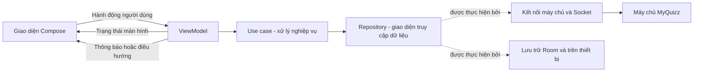
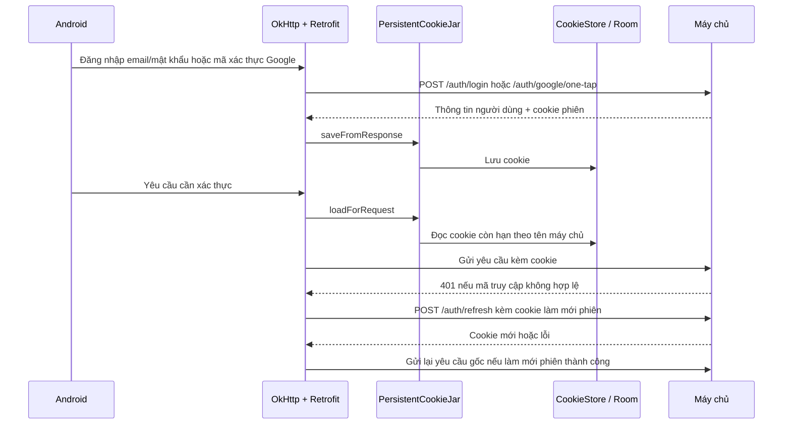
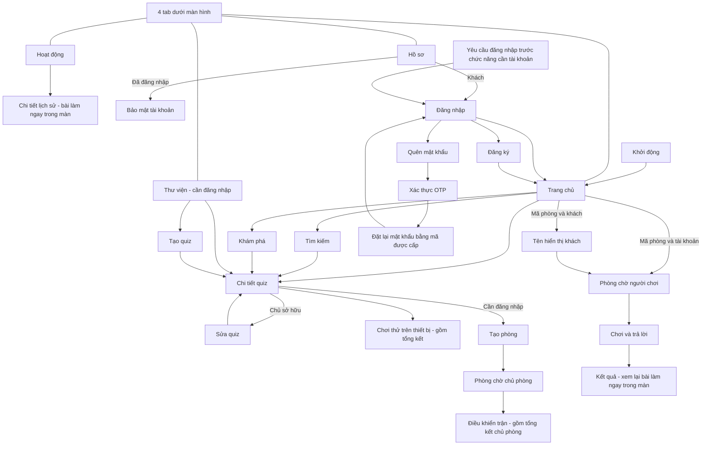

# MyQuizzApp — Ứng dụng Android cho MyQuizz

MyQuizzApp là ứng dụng được viết riêng cho Android, dùng để khám phá và quản lý bộ câu hỏi (quiz), tổ chức phòng chơi cập nhật theo thời gian thực, tham gia bằng tài khoản hoặc tư cách khách, chơi thử và xem lại kết quả/lịch sử. App **kết nối với máy chủ của hệ thống MyQuizz và dùng chung dữ liệu với bản web**. App không phải một hệ thống độc lập và không chỉ mở website bên trong ứng dụng.

> **Phạm vi tài liệu:** mô tả chức năng và kỹ thuật đã có trong mã nguồn, đồng thời chỉ rõ phần chưa hoàn thiện. Đối chiếu Android `main` tại `1affa0162e1a3c4e133d810fee94b358885220a6`, tài liệu `docs` tại `f09882604809c57767a0a73e628a45ec3b610bb6` và bản mã nguồn MyQuizz trên máy tại `7c103c87b4c78d817e8a7acf50fd0424edd16c79`, ngày 12/10/2026. Các mã phiên bản mã nguồn này **không xác định tệp APK đã cài trên thiết bị hoặc phiên bản máy chủ đang chạy**. Kiểm thử tích hợp các luồng tài khoản, quiz, phòng chơi và lịch sử mới hoàn tất một phần; việc đồng bộ/hoàn thiện giao diện vẫn đang thực hiện. Chưa thông qua bước nghiệm thu chức năng, chốt phạm vi tính năng và điều kiện sẵn sàng phát hành chính thức. Đã có APK bản dùng thử (debug) công bố trên GitHub Releases để cài thử; việc phân phối bản dùng thử không đồng nghĩa các lỗi/giới hạn kiểm thử đã được giải quyết.

## Mục lục

1. [Tổng quan sản phẩm](#1-tổng-quan-sản-phẩm)
2. [Chức năng và phạm vi hiện tại](#2-chức-năng-và-phạm-vi-hiện-tại)
3. [Công nghệ và kiến trúc](#3-công-nghệ-và-kiến-trúc)
4. [Kết nối với máy chủ](#4-kết-nối-với-máy-chủ)
5. [Biên dịch và chạy ứng dụng](#5-biên-dịch-và-chạy-ứng-dụng)
6. [Các vấn đề đặc thù trên điện thoại](#6-các-vấn-đề-đặc-thù-trên-điện-thoại)
7. [Giao diện và trải nghiệm](#7-giao-diện-và-trải-nghiệm)
8. [Kiểm thử và vấn đề còn mở](#8-kiểm-thử-và-vấn-đề-còn-mở)
9. [Mốc phát triển, bài học và hướng tiếp theo](#9-mốc-phát-triển-bài-học-và-hướng-tiếp-theo)

## 1. Tổng quan sản phẩm

### 1.1. Thông tin ứng dụng

| Thuộc tính | Giá trị hiện tại |
| --- | --- |
| Tên hiển thị | `MyQuizzApp` |
| Mã định danh ứng dụng (applicationId) | `android.kma.myquizzapp` |
| Phiên bản trong Gradle | `versionName = 1.0`, `versionCode = 1` — không đồng nghĩa đã phát hành v1.0 |
| Android tối thiểu | Android 8.0 / API 26 |
| Kho mã nguồn Android | [An-K4/MyQuizApp](https://github.com/An-K4/MyQuizApp) |
| Kho mã nguồn máy chủ và web | [Ntd1411/myquizz](https://github.com/Ntd1411/myquizz) |
| Tải APK dùng thử | [GitHub Releases — Latest Debug Build](https://github.com/An-K4/MyQuizApp/releases/tag/latest-debug), tệp `myquizapp-debug.apk` |
| Kênh phân phối | Đã công bố **bản dùng thử**, được GitHub đánh dấu pre-release; chưa có đường dẫn Google Play được xác minh |
| Trạng thái | Đang phát triển, tích hợp và hoàn thiện giao diện; đã phân phối APK dùng thử, chưa xác nhận bản phát hành chính thức sẵn sàng phát hành |

Nguồn cấu hình: [`app/build.gradle.kts`](app/build.gradle.kts), [`strings.xml`](app/src/main/res/values/strings.xml).

**Tải và cài thử:** mở [Latest Debug Build](https://github.com/An-K4/MyQuizApp/releases/tag/latest-debug), vào **Assets** và tải `myquizapp-debug.apk` để cài trên thiết bị Android API 26 trở lên. Trang GitHub Releases ghi đây là bản dùng thử được biên dịch tự động từ nhánh `main`, mã phiên bản nguồn `1affa01`. Tệp APK có dung lượng hiển thị 24.6 MB, chưa thu gọn mã và được ký bằng khóa thử nghiệm của máy chạy tự động. Dung lượng này là của bản dùng thử tại thời điểm kiểm tra, không phải của bản phát hành đã tối ưu.

Trang tải xuống cảnh báo khóa ký thử nghiệm được tạo lại trên máy chạy tự động mới, nên cài đè lên bản trước có thể bị báo chữ ký không khớp. Nếu gặp lỗi này, cần gỡ app cũ rồi cài lại. **Gỡ app có thể làm mất dữ liệu trên thiết bị, thông tin phiên đăng nhập, cài đặt và mã định danh khách; khi ứng dụng tạo mã khách mới, có thể không xem lại được lịch sử gắn với mã khách cũ.** Không dùng tài khoản/dữ liệu quan trọng chỉ để thử cài đặt. Trang `latest-debug` có thể được cập nhật bằng bản mới; khi báo lỗi hoặc làm báo cáo, ghi lại tệp APK và mã phiên bản nguồn đã dùng thay vì chỉ ghi tên trang tải xuống.

### 1.2. Đối tượng và mục tiêu

- Người học/người chơi muốn tìm quiz, tự luyện tập hoặc tham gia một phòng bằng mã.
- Người tạo nội dung/người tổ chức muốn soạn quiz, mở phòng, điều khiển trận và xem thống kê.
- Mục tiêu là đưa các luồng MyQuizz lên trải nghiệm dành riêng cho Android, hỗ trợ chơi theo thời gian thực và quản lý nội dung trên điện thoại. Khách được duyệt nội dung công khai và có thể chơi khi cấu hình phòng cho phép; quản lý quiz và tổ chức phòng cần tài khoản.

### 1.3. Quan hệ với hệ thống MyQuizz

Máy chủ (backend) dùng Express + TypeScript, Socket.IO, PostgreSQL, Redis và dịch vụ lưu ảnh. Android dùng lại tài khoản, dữ liệu quiz, quy tắc phòng chơi, cách chấm điểm và lịch sử của hệ thống này. API là các giao diện mà app gọi để gửi yêu cầu và nhận dữ liệu từ máy chủ.

**Phần viết lại cho Android:** giao diện Compose, điều hướng giữa các màn, quản lý trạng thái bằng ViewModel, gửi yêu cầu HTTP, giữ phiên đăng nhập, kết nối Socket.IO, lưu dữ liệu trên thiết bị, chọn ảnh bằng Photo Picker và đăng nhập Google bằng Credential Manager. Không dùng lại giao diện Vue/Pinia của web.

**Phần giữ ở máy chủ:** kiểm tra quyền truy cập, xác định chủ phòng/người chơi, áp dụng quy tắc trận, tính thời gian/điểm chính thức, lưu kết quả, lưu ảnh và xác thực tài khoản. App không được tự tính điểm chính thức hoặc tự cấp quyền thay máy chủ.

**Phần chưa đưa vào Android:** nhập quiz hàng loạt từ tệp, hồ sơ tác giả công khai và quản trị người dùng; một số tiện ích soạn câu hỏi như nhân bản/sắp xếp lại câu, tự lưu bản nháp và cắt ảnh. Đây là giới hạn phạm vi Android hiện tại, không phải các chức năng đã bị xóa khỏi hệ thống web/máy chủ.

## 2. Chức năng và phạm vi hiện tại

### 2.1. Cách đọc trạng thái

- **Đã triển khai:** đã có mã nguồn và có thao tác sử dụng trên app; không có nghĩa mọi tình huống đều đã được kiểm thử.
- **Một phần / còn giới hạn:** app đã hỗ trợ nhưng còn lỗi, thiếu khả năng từ máy chủ hoặc chưa kiểm thử đủ.
- **Chưa triển khai:** chưa có trong phạm vi chức năng Android hiện tại.

**Chủ phòng (Host)** tổ chức và điều khiển trận; **người chơi (Player)** tham gia trả lời. Đây là vai trò trong từng phòng, không phải hai loại tài khoản. **Khách** là người chưa đăng nhập; khách chỉ được vào phòng nếu chủ phòng cho phép.

### 2.2. Chức năng theo nhóm màn hình

| Nhóm | Đã có trong Android | Giới hạn / trạng thái cần lưu ý |
| --- | --- | --- |
| Khởi động và phiên đăng nhập | Màn khởi động, kiểm tra phiên, phân biệt chưa xác định/khách/đã đăng nhập, kiểm tra yêu cầu đăng nhập và đăng xuất | Mở app khi không có mạng còn lỗi chờ tải không kết thúc ở Hoạt động/Hồ sơ |
| Xác thực | Email/mật khẩu, đăng ký rồi tự đăng nhập, Google qua Credential Manager, chế độ khách | Điều tra lỗi phiên đăng nhập Google và tranh chấp cập nhật cookie đang tạm hoãn; chưa xác nhận đã xử lý hết |
| Quên mật khẩu | Gửi mã → xác thực OTP → đặt mật khẩu mới bằng mã cho phép đặt lại; chờ trước khi gửi lại mã; hỗ trợ mở từ liên kết email | Việc liên kết mở đúng app phụ thuộc tên miền/thiết bị; chưa kiểm thử lại đầy đủ ở bản giao diện mới |
| Trang chủ, Tìm kiếm, Khám phá | Danh sách quiz, nhập mã phòng trên Trang chủ, tìm kiếm/lọc/sắp xếp/tải thêm; Khám phá hiển thị 2 cột | Đã sửa lỗi danh sách thay đổi trong lúc hiển thị nhưng chưa xác nhận kiểm thử lại; không dựng điểm đánh giá hoặc tiến độ giả |
| Thư viện | Quiz của tôi, tìm kiếm/lọc/sắp xếp/tải thêm, tạo/sửa/xóa | Chưa có quiz đã lưu/bookmark; xóa quiz là xóa vĩnh viễn, không hoàn tác |
| Chi tiết quiz | Ảnh bìa, thông tin quiz, câu hỏi/ảnh, Chơi thử/Tạo phòng; chủ sở hữu có Sửa/Xóa | Câu hỏi mặc định mở; app không hiện đáp án đúng, nhưng dữ liệu máy chủ trả về vẫn có đáp án và còn cần xử lý việc bảo vệ dữ liệu này |
| Tạo/Sửa quiz | Form dùng chung, công khai/riêng tư, ảnh bìa/câu hỏi, 4 loại câu, gợi ý/giải thích, kiểm tra dữ liệu nhập, xác nhận trước khi bỏ thay đổi | Chưa có nhập từ tệp, sắp xếp/nhân bản câu hoặc tự lưu nháp; cần kiểm thử lưu → mở lại → sửa → mở lại |
| Chơi thử trên thiết bị | Đếm ngược, 4 loại câu, bỏ qua, nhận phản hồi, tự bấm chuyển câu, tổng kết/chơi lại; chủ sở hữu có lối sửa quiz | Điểm chỉ ước tính; không tạo phòng/kết nối trận, không ghi lịch sử hoặc tăng lượt chơi |
| Tạo phòng và phòng chờ chủ phòng | Lấy chế độ/cấu hình từ máy chủ, tạo phòng, nhận mã xác thực kết nối, danh sách người chơi cập nhật liên tục, sao chép mã/liên kết, sửa cấu hình, bắt đầu | Phải dùng cấu hình máy chủ xác nhận, không chỉ dùng giá trị nhập trên app; chưa có mã QR |
| Vào phòng và phòng chờ người chơi | Tra mã 6 ký tự, nhập tên cho khách, giữ mã khách ổn định, gửi yêu cầu tham gia và nhận cập nhật phòng | Quyền cho khách do máy chủ/cấu hình phòng quyết định; người đã đăng nhập bỏ qua màn nhập tên |
| Điều khiển trận của chủ phòng | Điều khiển Classic, tạm dừng/tiếp tục/kết thúc; theo dõi người chơi ở chế độ tự tiến câu và xem tổng kết | Cập nhật số mạng còn lại, chuỗi trả lời đúng, tiến độ và tình trạng kết nối còn phụ thuộc dữ liệu/sửa lỗi từ máy chủ |
| Chơi và trả lời | Classic, Solo, Survival, Marathon, Practice; 4 loại câu, xác nhận gửi đáp án, đồng hồ theo giờ máy chủ, kết nối lại/đồng bộ và xử lý kết thúc | Chưa kiểm thử đầy đủ cả 5 chế độ; Practice tạm dừng/tiếp tục, cấp lại mã xác thực và đồng bộ thứ tự câu còn vấn đề chưa giải quyết |
| Kết quả và xem lại bài làm | Kết quả cuối trận, bảng xếp hạng theo thiết lập phòng, thống kê từng câu, bài làm riêng; tải lại kết quả từ máy chủ nếu mất dữ liệu trong bộ nhớ | Ẩn bảng xếp hạng/đáp án trên app chưa đủ bảo vệ dữ liệu: máy chủ cũng phải kiểm tra quyền trước khi gửi. Chưa xác nhận mọi API đều làm đúng việc này |
| Hoạt động/lịch sử | Tài khoản có Đã chơi/Đã tổ chức; khách có Đã chơi; tải thêm riêng từng danh sách, chi tiết trận và bài làm | Lấy dữ liệu từ máy chủ, không phải lịch sử dùng được hoàn toàn khi mất mạng; chưa kiểm đủ việc đổi danh tính trong lúc yêu cầu đang chờ trả lời |
| Hồ sơ và bảo mật | Sửa thông tin/ảnh đại diện, Lượt tham gia/Quiz đã tạo từ máy chủ, tải lại/thử lại; đổi mật khẩu/vô hiệu hóa | Tài khoản chỉ dùng Google chưa hỗ trợ thao tác cần mật khẩu; vô hiệu hóa không phải xóa hẳn dữ liệu; đổi mật khẩu chưa bảo đảm đăng xuất mọi thiết bị |

Tên màn trong mã nguồn nằm ở [`Routes.kt`](app/src/main/java/android/kma/myquizzapp/navigation/Routes.kt). Xem lại bài làm nằm ngay trong màn kết quả hoặc chi tiết lịch sử; tổng kết Chơi thử nằm trong cùng màn Chơi thử. Đây không phải các màn điều hướng riêng.

### 2.3. Quy tắc soạn quiz và chơi thử

- Có 4 loại câu: chọn một, chọn nhiều, trả lời ngắn và trả lời dài.
- Câu lựa chọn có 2–4 phương án; câu chọn một có một đáp án đúng, câu chọn nhiều giữ đúng tập phương án được đánh dấu.
- Thời gian mỗi câu là 5–600 giây, với lựa chọn nhanh 10/20/30/60 và Khác. Trình soạn không cho gửi thời gian 0.
- Lưu quiz công khai/riêng tư là lưu trực tiếp theo `is_public`; nhãn “Lưu & xuất bản” không có nghĩa đã có bước lưu nháp rồi xuất bản riêng.
- Ảnh được chọn giữ trên thiết bị cho tới khi bấm lưu. Nếu tải ảnh thất bại, form giữ dữ liệu để thử lại. Chưa bảo đảm tự dọn hết ảnh đã tải lên nếu một bước sau đó thất bại.
- Chơi thử: câu chọn một chấm ngay khi chọn; các loại còn lại Gửi đáp án → nhận phản hồi → Câu tiếp theo. Nút X bỏ qua câu, nút quay lại thoát lượt có xác nhận. Không tự chuyển câu sau phản hồi.
- Chơi thử trên thiết bị khác chế độ Solo hoặc Practice của phòng thật; không dùng điểm chơi thử làm điểm trận nhiều người.

### 2.4. Khác biệt so với bản web

Đối chiếu với mã nguồn web trên máy tại `7c103c8`, không mặc định website đang chạy đúng phiên bản này.

| Khía cạnh | Android | Web trong mã nguồn đã đối chiếu |
| --- | --- | --- |
| Giao diện và điều hướng | Kotlin + Compose, 4 tab dưới màn hình; nhập mã ngay trên Trang chủ | Vue, điều hướng theo địa chỉ trang; có trang Vào phòng riêng |
| Chủ phòng/người chơi cập nhật theo thời gian thực | Có | Cũng có điều khiển trận, chơi Classic/tự tiến câu và kết quả; không phải tính năng độc quyền Android |
| Chơi thử không tạo phòng | Có | Cũng có; không phải độc quyền Android |
| Nhập nội dung hàng loạt | Chưa triển khai | Có nhập văn bản/CSV/XLSX/JSON; tạo câu hỏi bằng AI vẫn được đánh dấu sắp có và chưa bật |
| Hồ sơ tác giả công khai / quản trị người dùng | Chưa triển khai | Có trang tương ứng |
| Ảnh | Photo Picker chọn ảnh; tải ảnh bìa/câu hỏi; xem trước ảnh đại diện | Có thành phần cắt ảnh; Android chưa có chức năng cắt ảnh tương ứng |
| Giữ phiên và nhận diện khách | CookieJar + Room giữ cookie; DataStore giữ mã khách UUID | Cookie do trình duyệt quản lý; mã khách/phiên do phần lưu trữ của web quản lý |
| Google | Credential Manager lấy mã xác thực Google rồi gửi máy chủ | Có chuyển hướng OAuth và Google One Tap |

Nguồn web: [điều hướng](https://github.com/Ntd1411/myquizz/blob/7c103c87b4c78d817e8a7acf50fd0424edd16c79/frontend/src/router/index.js), [phòng người chơi](https://github.com/Ntd1411/myquizz/blob/7c103c87b4c78d817e8a7acf50fd0424edd16c79/frontend/src/pages/PlayerLobbyPage.vue), [phòng chủ phòng](https://github.com/Ntd1411/myquizz/blob/7c103c87b4c78d817e8a7acf50fd0424edd16c79/frontend/src/pages/HostLobbyPage.vue), [tạo quiz](https://github.com/Ntd1411/myquizz/blob/7c103c87b4c78d817e8a7acf50fd0424edd16c79/frontend/src/pages/CreateStartPage.vue).

## 3. Công nghệ và kiến trúc

### 3.1. Công nghệ và phiên bản

| Thành phần | Công nghệ / phiên bản cấu hình | Vai trò |
| --- | --- | --- |
| Ngôn ngữ | Kotlin 2.0.21 | Viết mã Android; không dùng Flutter, React Native hay KMP |
| UI | Jetpack Compose, Material 3, Compose BOM 2025.06.01 | Xây dựng giao diện theo trạng thái, bộ màu/kiểu chữ và thành phần dùng chung |
| Kiến trúc | MVI + Clean Architecture + multi-module Gradle | Tách trạng thái, hành động, phản hồi; phân chia giao diện, xử lý nghiệp vụ và truy cập dữ liệu |
| HTTP | Retrofit 2.11.0, OkHttp 4.12.0 | Gửi yêu cầu máy chủ, giữ phiên bằng cookie, làm mới phiên và tách kết nối theo mục đích |
| Serialization | kotlinx.serialization 1.7.3 | Đọc/ghi dữ liệu JSON và tên trường theo từng API |
| Kết nối thời gian thực | socket.io-client 2.1.1 | Kênh `/game`, thông báo trận và phản hồi xác nhận (ACK) |
| Cấp đối tượng dùng chung (DI) | Hilt 2.51.1, KSP 2.0.21-1.0.28 | Cấp các đối tượng phụ thuộc cho ViewModel và nối phần khai báo với phần thực hiện |
| Điều hướng | Navigation Compose 2.9.3 | Dùng kiểu dữ liệu Kotlin cho tên màn và tham số điều hướng |
| Tác vụ bất đồng bộ và trạng thái | Coroutines 1.9.0, Flow/StateFlow | Xử lý đọc/ghi dữ liệu, nhận thông báo và theo dõi thay đổi trạng thái |
| Cơ sở dữ liệu trên thiết bị | Room 2.6.1 | Lưu cookie và bản dữ liệu quiz đã tải |
| Tùy chọn và định danh | DataStore 1.1.2 | Lưu chế độ giao diện, tùy chọn và mã khách riêng |
| Tải danh sách theo từng phần | Paging 3.3.6 | Tải thêm từ vị trí máy chủ trả về, thay vì lấy toàn bộ danh sách một lần |
| Ảnh | Coil 2.7.0 | Tải ảnh qua các thành phần ảnh/ảnh đại diện dùng chung |
| Xác thực Google | Credentials 1.5.0, googleid 1.1.1 | Lấy thông tin xác thực Google trên Android |
| Nhật ký chẩn đoán | Timber 5.0.1 | Ghi nhật ký bản dùng thử; không bật DebugTree ở bản phát hành |
| Kiểm thử | JUnit 4, MockK, Coroutines Test, Turbine; AndroidX Test/Espresso/Hilt Testing | Kiểm thử từng phần và kiểm thử chạy trên thiết bị |

| Cấu hình biên dịch app | Giá trị |
| --- | --- |
| minSdk | 26 |
| targetSdk / compileSdk | 36 / 36 |
| Phiên bản Java/JVM tương thích | 17 |
| Gradle Wrapper | 8.13 |
| Android Gradle Plugin | 8.13.2 |

Nguồn: [`libs.versions.toml`](gradle/libs.versions.toml), [`gradle-wrapper.properties`](gradle/wrapper/gradle-wrapper.properties), [`app/build.gradle.kts`](app/build.gradle.kts). Bảng phiên bản này là cấu hình thư viện cần dùng; chưa phải báo cáo các phiên bản thực tế Gradle đã tải hoặc kết quả biên dịch thành công.

### 3.2. Cấu trúc chia thành nhiều module

Có 14 module ứng dụng/thư viện khai báo trong [`settings.gradle.kts`](settings.gradle.kts): `app`, 5 module `core` và 8 module `feature`. `build-logic` chứa cấu hình biên dịch dùng chung được Gradle nạp riêng.

```text
MyQuizApp/
├── app/                    # Điểm khởi động, điều hướng, giao diện và xử lý cấp ứng dụng
├── core/
│   ├── common/             # Mô hình nghiệp vụ, giao diện truy cập dữ liệu, kết quả/lỗi và kiểm tra đầu vào
│   ├── network/            # Kết nối máy chủ, mô hình dữ liệu gửi/nhận, cookie và Socket.IO
│   ├── database/           # Room, bảng/truy vấn, lưu cookie và bản quiz đã tải
│   ├── datastore/          # SettingsDataStore, GuestIdentityStore
│   └── ui/                 # Màu/kiểu chữ, thành phần giao diện dùng chung và form cấu hình
├── feature/
│   ├── auth/
│   ├── home/
│   ├── lobby/
│   ├── game-player/
│   ├── game-host/
│   ├── leaderboard/
│   ├── quiz-manage/
│   └── quiz-preview/
├── build-logic/            # Cấu hình biên dịch dùng chung
├── gradle/                 # Bảng phiên bản thư viện và công cụ chạy Gradle
├── .github/workflows/      # Kiểm tra và biên dịch tự động
└── server/myquizz/         # Mã nguồn máy chủ/web trên máy để đối chiếu
```

`server/myquizz/` không phải module Android và không được đóng gói vào APK. Đây là thư mục có trên máy đối chiếu; tải kho mã Android không có nghĩa luôn kèm sẵn mã nguồn máy chủ.

Cây thư mục rút gọn của app; dấu `...` biểu thị các tệp/thư mục không liệt kê:

```text
app/src/main/
├── AndroidManifest.xml
├── java/android/kma/myquizzapp/
│   ├── MyQuizzApplication.kt
│   ├── MainActivity.kt
│   ├── navigation/
│   │   ├── Routes.kt
│   │   ├── AppNavGraph.kt
│   │   ├── MainScaffold.kt
│   │   ├── AuthNavGraph.kt
│   │   ├── MainNavGraph.kt
│   │   ├── GameNavGraph.kt
│   │   ├── QuizManageNavGraph.kt
│   │   └── ...
│   ├── domain/
│   │   ├── profile/
│   │   └── ...
│   └── presentation/
│       ├── profile/
│       └── ...
└── res/
    ├── values/
    ├── xml/
    └── ...
```

Module tính năng thường tách `presentation` (giao diện), `domain` (nghiệp vụ) và `data` (truy cập dữ liệu); không bắt buộc module nào cũng đủ ba thư mục. Mô hình dữ liệu trao đổi với API (DTO) thuộc phần truy cập dữ liệu, không đưa trực tiếp thành trạng thái màn hình. Hồ sơ và các màn cấp ứng dụng có thể đặt trong `app`, không cần tạo module mới chỉ để có cùng cấu trúc.

### 3.3. Luồng kiến trúc



Quy ước dự án:

- `UiState` là trạng thái màn hình, `Intent` là hành động người dùng, `Effect` là phản hồi một lần như thông báo/đổi màn. Ba phần được tách file.
- Phần Screen nối ViewModel, nhận cập nhật và xử lý vòng đời/Android; phần Content chỉ hiển thị dữ liệu được truyền vào và gửi thao tác ra ngoài. Có thể xem trước Content bằng dữ liệu mẫu mà không gọi máy chủ.
- Phần mới phải đi qua ViewModel → Use case → Repository. Không để giao diện hoặc điều hướng tự gọi API hay xử lý nghiệp vụ.
- Khai báo chung đặt ở `core:common`; Hilt nối chúng với mã thực hiện ở network/database. `PersistentCookieJar` dùng `CookieStore` nên không cần biết cách Room lưu dữ liệu.
- Module tính năng không phụ thuộc trực tiếp module tính năng khác. Thành phần giao diện chung đặt ở `core:ui`, không dùng mô hình riêng của từng tính năng.
- `Result<T>` chứa dữ liệu thành công hoặc lỗi. Cấu hình và trạng thái trận đã được máy chủ xác nhận mới là dữ liệu app phải tuân theo.

**Giới hạn:** đây là kiến trúc đang hướng tới và áp dụng cho phần mới, không phải xác nhận toàn bộ mã nguồn đã tuân thủ. Báo cáo còn ghi nhận mã xác thực kết nối được truyền trong tham số màn hình/SavedStateHandle, một số chỗ phân chia trách nhiệm chưa đúng và mô hình trình soạn cần kiểm tra thêm.

## 4. Kết nối với máy chủ

### 4.1. Địa chỉ máy chủ và môi trường chạy

Nguồn duy nhất cho Android là [`core/network/build.gradle.kts`](core/network/build.gradle.kts):

| Mục | Giá trị hiện tại |
| --- | --- |
| Địa chỉ gốc cho yêu cầu API | `https://api.myquizz.dpdns.org/v1/` |
| Địa chỉ kết nối Socket | `https://api.myquizz.dpdns.org` |
| Kênh Socket | `/game` |
| Debug/release | Bản dùng thử và bản phát hành cùng dùng `defaultConfig`; chưa tách địa chỉ theo loại bản dựng |

`BuildConfig` ở đây thuộc **module `core:network`**, không phải `app`. Mã hiện tại không cho thấy việc tự đọc địa chỉ từ `.env` hoặc `local.properties`. Muốn đổi máy chủ phải sửa cấu hình kết nối tương ứng, không chỉ đổi biến ở module app.

Địa chỉ trong mã nguồn chưa đủ xác định đây là môi trường chính thức hay môi trường thử nghiệm, hoặc phiên bản máy chủ đang chạy. Việc kiểm tra tài liệu không gọi các API làm thay đổi dữ liệu thật chỉ để xác định môi trường.

### 4.2. Lưu phiên đăng nhập và làm mới phiên khi gặp lỗi 401

Máy chủ xác thực tài khoản bằng cookie HttpOnly: dữ liệu phiên được gửi kèm yêu cầu HTTP. App không dùng một mã Bearer gắn vào mọi yêu cầu thay cho cookie. HttpOnly hạn chế JavaScript đọc cookie trong trình duyệt, không ngăn ứng dụng Android nhận cookie.



- OkHttp nhận cookie từ máy chủ và lưu lại qua [`PersistentCookieJar`](core/network/src/main/java/android/kma/myquizzapp/core/network/cookie/PersistentCookieJar.kt). [`RoomCookieStore`](core/database/src/main/java/android/kma/myquizzapp/core/database/cookie/RoomCookieStore.kt) lưu tên, giá trị, tên miền, đường dẫn, hạn dùng và các cờ bảo vệ trong Room.
- [`TokenAuthenticator`](core/network/src/main/java/android/kma/myquizzapp/core/network/cookie/TokenAuthenticator.kt) gọi làm mới phiên khi yêu cầu bị trả lỗi 401. Nó không làm mới lỗi của chính `/auth/*`, giới hạn gửi lại để tránh lặp vô tận, và dùng khóa để các lần làm mới không chạy cùng lúc.
- Chỉ xóa cookie khi máy chủ xác nhận phiên không còn hợp lệ. Mất mạng hoặc máy chủ lỗi tạm thời thì giữ cookie; không coi đó là người dùng đã đăng xuất.
- `POST /auth/register` **không trả cookie**. Sau khi đăng ký thành công, `AuthRepositoryImpl.register` gọi đăng nhập để tạo phiên.
- `SessionRepository` giữ một trạng thái đăng nhập chung cho toàn app bằng `StateFlow<SessionState>`. Khi khởi động, app gọi `/users/me` để kiểm tra; có dữ liệu trên thiết bị không đủ chứng minh còn đăng nhập.
- App đánh dấu phiên và lần cập nhật để câu trả lời của yêu cầu cũ không ghi đè trạng thái phiên mới. Tuy nhiên **chưa xử lý đầy đủ việc yêu cầu cũ ghi lại hoặc xóa cookie của phiên mới**. Đây là rủi ro còn tồn tại, không phải lỗi đã sửa xong.

Access token là mã truy cập, refresh token là mã để làm mới phiên; chúng được giữ dưới dạng cookie, không lưu trong DataStore. Lưu cookie vào Room không tự bảo đảm dữ liệu đã được mã hóa hoặc loại khỏi bản sao lưu thiết bị. Các phần bảo vệ dữ liệu này còn cần kiểm tra.

### 4.3. Đăng nhập Google và đặt lại mật khẩu

- Android dùng Credential Manager/GetGoogleIdOption để lấy mã xác thực Google, gửi `{credential}` tới `POST /auth/google/one-tap`; máy chủ trả thông tin người dùng và cookie phiên.
- Không dùng WebView chuyển hướng `/auth/google` như luồng website để đăng nhập Android.
- Mã nhận diện ứng dụng với Google (Server Client ID) đang đặt trực tiếp trong [`LoginScreen.kt`](feature/auth/src/main/java/android/kma/myquizzapp/feature/auth/presentation/login/LoginScreen.kt); chưa tách cấu hình theo từng loại bản dựng.
- Quên mật khẩu: máy chủ kiểm tra OTP hoặc mã trong liên kết email, rồi cấp **ticket — mã cho phép đặt lại mật khẩu**. App dùng ticket để đặt mật khẩu mới; chỉ truyền email hoặc OTP giữa các màn không tự cấp quyền đặt lại.
- Manifest khai liên kết `https://myquizz.dpdns.org/reset-password` có thể mở app. Để Android xác minh liên kết, tên miền/chữ ký app và thiết bị phải được cấu hình phù hợp; chỉ khai báo trong app chưa đủ bảo đảm mọi liên kết sẽ mở đúng app.

### 4.4. Xác thực kết nối Socket và cập nhật trận theo thời gian thực

Socket.IO giữ kết nối để máy chủ gửi cập nhật phòng/trận tới app mà không cần app liên tục hỏi lại. Mã xác thực kết nối (`socketToken`) xác định quyền chủ phòng hoặc người chơi.

Khai báo API nằm ở [`GameApiService.kt`](core/network/src/main/java/android/kma/myquizzapp/core/network/api/GameApiService.kt):

| Thao tác | Yêu cầu và dữ liệu sử dụng |
| --- | --- |
| Tạo phòng | `GET /games/game-modes` → `POST /games` |
| Lấy mã xác thực chủ phòng | **`POST /games/{id}/host-token`** |
| Tra phòng | `GET /games/{code}`; dùng mã phòng, không phải ID số |
| Người chơi vào phòng | `POST /games/{code}/join` → nhận `socketToken` |
| Mở kết nối Socket | Kết nối kênh `/game`, gửi mã xác thực trong `auth.token` |
| Sau khi kết nối/kết nối lại | Gửi yêu cầu tham gia lại phòng; người chơi còn lấy lại trạng thái/tiến độ từ máy chủ |

[`GameSocketClient`](core/network/src/main/java/android/kma/myquizzapp/core/network/socket/GameSocketClient.kt) dùng WebSocket và `forceNew = true`, tách đối tượng kết nối chủ phòng/người chơi để tránh dùng nhầm mã xác thực. `callbackFlow` đưa thông báo Socket vào luồng dữ liệu Kotlin; khi ngừng theo dõi luồng, `awaitClose` gỡ các hàm nhận thông báo, ngừng theo dõi mạng và đóng kết nối.

App cấu hình tối đa 5 lần tự kết nối lại, khoảng chờ ban đầu 1 giây; theo dõi mạng đã được Android xác nhận có Internet (`VALIDATED`). Khi hết số lần thử, có trạng thái lỗi và nút Thử lại. **Kết nối Socket trở lại chưa đồng nghĩa đã vào lại phòng**: app phải gửi `lobby:join`, rồi người chơi lấy lại trạng thái trận. Thử kết nối lại không phải tự gửi lại đáp án.

- Mất kết nối do mạng: thử kết nối lại, khóa thao tác cần thiết và chờ đồng bộ.
- Máy chủ chủ động ngắt hoặc xác nhận không được tiếp tục: xử lý thoát/dọn trạng thái, không chờ kết nối lại vô hạn.
- `question:answer` và `lobby:config-update` có phản hồi xác nhận (ACK). Chờ quá 5 giây mà chưa nhận ACK nghĩa là **chưa biết máy chủ đã xử lý hay chưa**, không đồng nghĩa thao tác thất bại.
- Khi chưa chắc đáp án đã được nhận, khóa ô trả lời và hỏi lại trạng thái từ máy chủ, tránh gửi đáp án hai lần.
- `game:start` không có ACK riêng; app chờ thông báo `game:started` để xác nhận trận bắt đầu, có giới hạn thời gian chờ.
- Đã có làm mới mã kết nối cho chủ phòng. Cấp lại mã cho người chơi và tiếp tục trận khi Android đã đóng tiến trình app còn phụ thuộc khả năng máy chủ chưa hoàn chỉnh.

### 4.5. Mã lỗi và thông báo cho người dùng

Lỗi API có dạng `{success:false,error:{code}}`: máy chủ chỉ gửi mã lỗi, không gửi sẵn câu `error.message` hay `error.details` để hiển thị. Lỗi Socket dùng `{event,code}`; lỗi trong phản hồi xác nhận dùng `{error:{code}}`.

- Phần kết nối đọc dữ liệu JSON và chuyển thành `Result<T>` / `AppError`.
- App ưu tiên mã `error.code` để xác định lỗi. Nếu dữ liệu lỗi thiếu/hỏng, dùng mã trạng thái HTTP làm phương án thay thế.
- [`AppErrorExt.kt`](core/common/src/main/java/android/kma/myquizzapp/core/common/error/AppErrorExt.kt) đổi mã lỗi thành **câu thông báo tiếng Việt**; mã chưa biết dùng câu chung.
- Các câu hiện được viết trong Kotlin; chưa có bộ dịch và đổi ngôn ngữ hoàn chỉnh.
- Quiz đã bị xóa phải bỏ bản lưu cũ, không lấy từ Room rồi hiển thị như vẫn tồn tại. Mất mạng hoặc lỗi máy chủ 5xx không được hiểu là phiên đăng nhập đã hết.

### 4.6. Nhận diện người chơi khách

[`GuestIdentityStore`](core/datastore/src/main/java/android/kma/myquizzapp/core/datastore/GuestIdentityStore.kt) sinh UUID — mã định danh khách — lần đầu cần vào phòng và lưu trong DataStore riêng `guest_identity`, khóa `guest_id`.

- Khách vào phòng gửi tên hiển thị và `player_guest_id`; tài khoản đã đăng nhập được máy chủ nhận diện từ cookie.
- Lịch sử, tổng quan trận và bài làm của khách gửi mã trong trường HTTP **`x-guest-id`**; tài khoản dùng cookie. Không tự gắn mã khách cho mọi API.
- Khi mở lịch sử, app đọc mã hiện có; chưa từng chơi thì không tự sinh mã mới.
- Mã giữ ổn định giữa các lần mở app khi dữ liệu còn được giữ trên thiết bị. Không bảo đảm dùng chung trên nhiều thiết bị hoặc giữ nguyên sau khi gỡ app/xóa dữ liệu.
- Mã khách được lưu riêng với cài đặt, để đặt lại tùy chọn không làm mất mã trong thiết kế lưu trữ.

### 4.7. Tải ảnh lên máy chủ lưu trữ

Ảnh bìa/câu hỏi dùng **presigned URL — địa chỉ tải lên có quyền tạm thời do máy chủ cấp**:

1. App gọi `POST /storage/presign`, có cookie đăng nhập, để xin địa chỉ.
2. App gửi dữ liệu ảnh bằng PUT tới địa chỉ lưu trữ, kèm đúng `Content-Type` (loại nội dung), bằng kết nối OkHttp riêng **không gửi cookie hoặc thông tin đăng nhập của máy chủ MyQuizz**.
3. App đưa địa chỉ/mã ảnh được cấp vào dữ liệu tạo hoặc sửa quiz.

[`StorageRepositoryImpl`](core/network/src/main/java/android/kma/myquizzapp/core/network/repository/StorageRepositoryImpl.kt) tách bước xin quyền và tải ảnh. Bộ chuyển đổi JSON cho API ảnh giữ đúng tên trường mà máy chủ yêu cầu; không đổi tất cả sang SnakeCase. Tải ảnh thất bại thì không báo quiz đã lưu.

Ảnh đại diện dùng yêu cầu **multipart `PATCH /users/me/avatar` riêng** để gửi tệp, không dùng presigned URL. Nếu chưa biết thao tác lưu ảnh đã thành công hay chưa, phải kiểm tra lại dữ liệu máy chủ trước khi gửi lại.

### 4.8. Kết quả và lịch sử

- Ưu tiên kết quả máy chủ đã gửi qua `game:ended` và dữ liệu đang có trong bộ nhớ. Chỉ tải từ `/games/{id}/results` khi cần khôi phục kết quả đã mất khỏi bộ nhớ.
- Xem lại bài làm sau trận dùng `x-socket-token` ở API riêng. Kết nối này được tách để mã trận hết hạn không bị hiểu nhầm là tài khoản đã đăng xuất.
- Chi tiết lịch sử dùng cookie/mã UUID khách với `/summary` và `/my-answers`, không cần mã kết nối Socket cũ.
- Tài khoản có hai danh sách `played` (đã chơi) và `hosted` (đã tổ chức), mỗi danh sách giữ vị trí tải tiếp riêng. Khách chỉ có đã chơi; không gộp hai vị trí tải tiếp để tạo tab “Tất cả”.
- App loại bảng xếp hạng/đáp án không được phép hiển thị trước khi đưa lên màn hình. **Máy chủ vẫn phải kiểm tra quyền trước khi gửi dữ liệu**: nếu người không có quyền vẫn tải được dữ liệu từ API, chỉ ẩn trên app không ngăn được việc lộ dữ liệu.

## 5. Biên dịch và chạy ứng dụng

Biên dịch (build) là bước chuyển mã nguồn thành ứng dụng cài đặt được. Phần này dành cho người cần tự chạy dự án; nếu chỉ dùng thử, tải APK ở mục 1.1.

### 5.1. Công cụ cần có

- Android Studio hỗ trợ Android Gradle Plugin (AGP) 8.13.2; chưa ghi nhận chính xác phiên bản Android Studio nhóm đã dùng.
- JDK 17, được chọn làm Gradle JDK trong Android Studio. Hệ thống kiểm tra tự động hiện dùng Temurin 17.
- Android SDK Platform API 36, platform-tools và SDK Build Tools tương thích AGP.
- Điện thoại Android 8.0/API 26 trở lên hoặc máy ảo Android hoạt động. Đăng nhập Google cần dịch vụ Google và cấu hình OAuth phù hợp.
- Mạng để tải thư viện và kết nối máy chủ. Có Internet không bảo đảm máy chủ, dịch vụ ảnh và Google đều đang hoạt động.

### 5.2. Cấu hình trên máy phát triển

1. Tải kho mã nguồn Android và mở thư mục gốc chứa `settings.gradle.kts`.
2. Android Studio tạo `local.properties` chứa đường dẫn SDK. Không đưa tệp này lên Git hoặc sao chép đường dẫn của máy khác.
3. Kiểm tra BASE_URL/SOCKET_URL trong `core/network/build.gradle.kts` nếu dùng máy chủ thử nghiệm riêng.
4. Đồng bộ Gradle, chọn module `app`, chọn thiết bị và bấm Run.

Ví dụ đường dẫn SDK Windows; thay bằng đường dẫn thật trên máy:

```properties
sdk.dir=C\:\\Users\\<user>\\AppData\\Local\\Android\\Sdk
```

Mã hiện tại không yêu cầu Google Services Gradle plugin/Firebase để biên dịch; **không cần `google-services.json` chỉ để build app**. Đăng nhập Google dùng Server Client ID ở LoginScreen và phải khớp cấu hình OAuth của máy chủ. Khi dùng dự án Google khác, phải đăng ký mã định danh/chữ ký Android và mã ứng dụng web phù hợp. Không đưa khóa bí mật Google vào APK.

Chưa thấy yêu cầu dùng `.env` cho Android; không tự tạo khóa cấu hình mà mã nguồn không đọc.

### 5.3. Biên dịch bản dùng thử và cài đặt

Windows PowerShell, chạy tại gốc kho mã:

```powershell
.\gradlew.bat :app:assembleDebug
.\gradlew.bat :app:installDebug
```

Linux/macOS:

```bash
chmod +x gradlew
./gradlew :app:assembleDebug
./gradlew :app:installDebug
```

APK dùng thử mặc định ở `app/build/outputs/apk/debug/app-debug.apk`. `installDebug` cần điện thoại/máy ảo kết nối; cũng có thể dùng `adb install -r` để cài APK. Bản debug được ký bằng khóa thử nghiệm của môi trường biên dịch, không phải khóa phát hành chính thức.

### 5.4. Biên dịch bản release để kiểm tra trên máy

Release là loại bản dựng dùng cấu hình phát hành. Các lệnh sau là hướng dẫn biên dịch, **không phải xác nhận đã chạy thành công hoặc đã có quy trình phát hành hoàn chỉnh**:

```powershell
.\gradlew.bat :app:assembleRelease
.\gradlew.bat :app:bundleRelease
```

```bash
./gradlew :app:assembleRelease
./gradlew :app:bundleRelease
```

`app/build.gradle.kts` đã bật R8 để thu gọn/tối ưu mã, với `proguard-android-optimize.txt` và `app/proguard-rules.pro`. Tệp này chưa có cấu hình khóa ký bản release (`signingConfig`); không coi tệp tạo ra tự động là bản đã ký sẵn để cài/phát hành. Kiểm tra kết quả trong `app/build/outputs/apk/release/` hoặc `app/build/outputs/bundle/release/` sau biên dịch.

Nếu cần APK có chữ ký để thử nghiệm, dùng **Build → Generate Signed Bundle / APK** trong Android Studio với tệp khóa ký do nhóm quản lý. Không đưa tệp khóa, mật khẩu hoặc cấu hình riêng vào README/kho mã. Chưa xác minh việc ký bản release, kiểm thử lại bản này hoặc phân phối trên cửa hàng ứng dụng.

### 5.5. Chuẩn bị dữ liệu để thử chức năng

- Ít nhất hai thiết bị hoặc ứng dụng cho một lượt chủ phòng/người chơi. Web có thể hỗ trợ thử phòng nhiều người, nhưng không thay việc kiểm giao diện/kết nối lại trên Android.
- Tài khoản thử nhận được OTP; không dùng tài khoản cá nhân để đổi/đặt lại mật khẩu hoặc vô hiệu hóa.
- Quiz công khai của người khác và quiz của mình, đủ 4 loại câu, ảnh, gợi ý/giải thích.
- Phòng Classic ngắn cho khách; các chế độ người chơi tự tiến câu cần dữ liệu/phòng thử riêng.
- Tài khoản/khách có lịch sử để kiểm danh sách và chi tiết; tài khoản mới chỉ kiểm được trạng thái chưa có dữ liệu.

Không sửa mã xác thực/cơ sở dữ liệu hoặc cố tạo lỗi trên máy chủ phục vụ người thật để tìm lỗi xảy ra đồng thời. Các phép thử tạo/sửa/xóa dữ liệu cần môi trường và dữ liệu được phép thay đổi.

## 6. Các vấn đề đặc thù trên điện thoại

### 6.1. Xoay màn hình, tạo lại màn hình và app bị hệ thống đóng

ViewModel giữ trạng thái theo vòng đời màn hình. Dữ liệu cần giữ khi Android tạo lại màn dùng `rememberSaveable`/SavedStateHandle ở những chỗ phù hợp, ví dụ bản sửa Hồ sơ, danh sách câu hỏi đã thu gọn ở Chi tiết và câu/ảnh đang được Photo Picker xử lý.

Xoay màn hình không giống việc Android đóng hẳn tiến trình app. Kết quả trận có thể tải lại từ máy chủ nếu mất khỏi bộ nhớ, nhưng **tiếp tục trận đang chơi sau khi app bị đóng chưa hoàn chỉnh**: còn thiếu khả năng tìm trận đang hoạt động, cấp lại mã kết nối và đồng bộ tiến độ/thứ tự câu hỏi. Một số màn cũ vẫn truyền mã xác thực qua tham số điều hướng/SavedStateHandle; cách giữ mã này còn cần xem lại về bảo mật và phân chia trách nhiệm.

Chưa có bằng chứng mọi bản nháp hoặc mọi trạng thái đều được giữ đúng sau khi xoay màn hình/app bị đóng. Cần thử riêng từng luồng, nhất là chọn ảnh, đang tải ảnh và mất kết nối giữa trận.

### 6.2. Chuyển app ra nền và vòng đời kết nối

Kết nối Socket tồn tại theo luồng dữ liệu mà ViewModel đang theo dõi. Chưa có dịch vụ chạy nền ưu tiên (foreground service) bảo đảm giữ trận khi app ra nền. Android có thể hạn chế mạng hoặc đóng tiến trình, dù ViewModel chưa bị xóa ngay lúc chuyển app.

Khi trở lại app, giao diện phải cho biết trạng thái kết nối và lấy lại dữ liệu trận từ máy chủ nếu đã kết nối lại. `awaitClose` dọn các hàm nhận thông báo/kết nối khi ngừng theo dõi luồng. Cần kiểm thử trên máy thật việc để app ở nền lâu, giới hạn pin và app bị hệ thống đóng; không bảo đảm cập nhật liên tục trong nền.

### 6.3. Mạng yếu, thử lại và thao tác chưa rõ kết quả

- Theo dõi mạng đã được Android xác nhận có Internet (`VALIDATED`), không chỉ thấy đang kết nối Wi-Fi/dữ liệu di động.
- Các màn gọi API có trạng thái đang tải/lỗi/thử lại và thông báo mất mạng chung. Màn chơi dùng thông báo kết nối riêng để tránh hai cảnh báo chồng nhau.
- Số lần tự kết nối lại có giới hạn, sau đó có nút Thử lại; không mặc định chờ vô hạn.
- Hết thời gian chờ không chứng minh máy chủ chưa lưu dữ liệu. Không tự gửi lại đáp án/ảnh đại diện hoặc báo thành công khi chưa xác nhận.
- Tìm kiếm bị lỗi lúc tải thêm thì giữ danh sách và vị trí tải tiếp, chờ người dùng bấm Thử lại. Tải trang đầu và tải thêm là hai tình huống khác nhau.
- Bản quiz lưu trong Room chỉ là phương án đọc lại khi mạng/máy chủ lỗi tạm thời. **App không được thiết kế để dùng đầy đủ khi mất mạng**; chưa có chơi nhiều người không cần mạng hoặc lưu thao tác ngoại tuyến rồi đồng bộ lên sau.

### 6.4. Đồng hồ và tính điểm

GameViewModel đọc giờ máy chủ `serverTime` từ thông báo/ phản hồi xác nhận và tính:

```text
serverOffsetMs = serverTimeMs - deviceNowMs
estimatedServerNow = deviceNowMs + serverOffsetMs
remainingMs = deadlineMs - estimatedServerNow
```

Nói đơn giản: app tính chênh lệch giữa giờ máy chủ và giờ điện thoại, dùng chênh lệch đó để ước lượng giờ máy chủ và thời gian còn lại. Chênh lệch được cập nhật khi nhận giờ mới. Chế độ tự tiến câu có hạn giờ riêng từng người; Classic dùng hạn giờ theo giai đoạn chung.

Đồng hồ trên app chỉ phục vụ hiển thị; máy chủ quyết định thời gian và điểm chính thức. Độ trễ mạng và việc chỉnh đồng hồ điện thoại vẫn cần thử nghiệm; đây không phải đồng bộ giờ bảo đảm sai số bằng 0. Chơi thử trên thiết bị có đồng hồ/cách tính điểm ước lượng riêng, không thay điểm của trận thật.

### 6.5. Quyền truy cập và dữ liệu thiết bị

[`AndroidManifest.xml`](app/src/main/AndroidManifest.xml) hiện khai:

- `INTERNET` — gửi yêu cầu máy chủ, kết nối Socket và tải ảnh.
- `ACCESS_NETWORK_STATE` — theo dõi trạng thái mạng.

Hai quyền này không cần hộp thoại xin quyền khi chạy. Chọn ảnh dùng Photo Picker của Android; hiện chưa khai quyền camera, quyền đọc toàn bộ ảnh hoặc thông báo. Chưa có chụp ảnh trực tiếp bằng camera hay thông báo đẩy.

Manifest cho phép sao lưu, nhưng các XML quy định dữ liệu sao lưu còn là mẫu. Cần kiểm tra thêm cookie có được bảo vệ hoặc loại khỏi bản sao lưu hay không; HttpOnly không tự bảo vệ dữ liệu cookie lưu trên ổ đĩa.

### 6.6. Hiệu năng

App dùng danh sách/lưới chỉ dựng các phần cần hiển thị, tải dữ liệu từng phần, lưu lại quiz bằng Room và tải ảnh bằng Coil. Khi danh sách thay đổi, Paging phải dùng cùng một bản dữ liệu cho số phần tử, mã phần tử và nội dung hiển thị, tránh đọc lệch dữ liệu rồi lỗi truy cập vị trí không còn tồn tại. Cơ chế tải trước phần tiếp theo vẫn cần kiểm tra vị trí hợp lệ.

Chưa có số đo đáng tin cậy về thời gian khởi động, RAM/pin hoặc độ trễ nhận câu hỏi. Trang tải xuống có dung lượng APK dùng thử ở mục 1.1, không phải đo hiệu năng/bản release tối ưu. Chưa có kết quả đo hiệu năng hoặc kiểm tra rò rỉ bộ nhớ toàn app; có danh sách tối ưu và lưu tạm dữ liệu không thay thế kết quả đo.

## 7. Giao diện và trải nghiệm

### 7.1. Bộ quy chuẩn giao diện hiện tại

- Compose Material 3; bộ màu/kiểu chữ dùng chung ở `core:ui`.
- Font Inter: thường, vừa, đậm vừa và đậm; giấy phép trong `core/ui/licenses/Inter-LICENSE.txt`.
- Màu sáng: tím thương hiệu `#7B61FF`, chữ chính `#0F0E17`, nền trắng, thành công `#10B981`, lỗi/nguy hiểm `#EF4444`, thông tin `#3B82F6`.
- Thành phần dùng chung: nút chính/phụ/nguy hiểm, ô mã 6 ký tự, lựa chọn đáp án, ảnh/ảnh đại diện, thẻ quiz theo mục đích và hộp thoại xác nhận. Tên mã nguồn gồm AnswerOptionItem, Avatar/RemoteImage/QuestionImage và AppConfirmDialog.
- Có giao diện sáng/tối và bản xem trước màn hẹp/chữ lớn. **Giao diện tối còn dùng màu thay thế theo Material và chưa được duyệt đầy đủ toàn app**. Có hàm xem trước không chứng minh đã hiển thị hoặc kiểm thử thành công trên thiết bị.
- Đã chỉnh Xác thực, Trang chủ/Tìm kiếm/Khám phá, Thư viện/Chi tiết, Chơi thử, trình soạn và Hồ sơ; các màn khác và việc đồng bộ toàn app còn đang thực hiện.

### 7.2. Kích thước màn hình, khả năng tiếp cận và ngôn ngữ

- Tập trung điện thoại. Một số màn có xem trước ở màn hẹp/chữ lớn; chưa xác nhận toàn app có bố cục phù hợp máy tính bảng/điện thoại gập.
- Một số thành phần có nhãn/mô tả cho công cụ đọc màn hình và thông tin về trạng thái tương tác. Còn cần kiểm TalkBack, độ tương phản, kích thước vùng bấm, bàn phím và cỡ chữ trong toàn luồng.
- Giao diện chủ yếu tiếng Việt, nhiều câu viết trực tiếp trong mã. Chưa xác nhận đổi ngôn ngữ toàn app; trường `language` của quiz là ngôn ngữ nội dung, không phải ngôn ngữ giao diện.

### 7.3. Điều hướng chính

Thanh dưới chỉ hiện ở **Trang chủ / Thư viện / Hoạt động / Hồ sơ**. Thư viện là quiz của tôi, không phải kho công khai khác. Tìm kiếm/Khám phá/Chi tiết/trình soạn và các màn trận là màn con, không thêm tab vào thanh dưới.



Sơ đồ là luồng chính, không liệt kê mọi tình huống quay lại/lỗi/khôi phục. AuthGraph/MainGraph chỉ là nhóm điều hướng, không phải màn hiển thị. Sửa Hồ sơ/ảnh đại diện là hộp thoại; cấu hình phòng chờ chủ phòng là bảng mở từ dưới màn hình. Không tạo thêm màn điều hướng chỉ để mô tả những phần này.

## 8. Kiểm thử và vấn đề còn mở

### 8.1. Các loại kiểm thử

| Loại | Hiện trạng |
| --- | --- |
| Kiểm thử từng phần (unit test) | Có ở app/core/features: kiểm tra đầu vào, chuyển đổi dữ liệu, điểm chơi thử, truy cập dữ liệu, xử lý nghiệp vụ, ViewModel và bảo vệ trạng thái phiên |
| Kiểm thử chạy trên thiết bị | Có `app/src/androidTest/.../auth/AuthIntegrationTest.kt` và HiltTestRunner; cần máy chủ/tài khoản thử được chuẩn bị riêng |
| Kiểm thử giao diện Compose tự động | Chưa xác minh có bộ kiểm thử bao phủ các màn chính; `@Preview` chỉ là xem trước, không phải phép thử |
| Kiểm thử thủ công toàn luồng | Có danh sách/báo cáo trên nhánh docs; mới hoàn tất một phần. Tách rõ: đạt, đạt một phần, chưa chạy, bị chặn vì thiếu điều kiện/khả năng từ máy chủ và tạm hoãn |
| Tỷ lệ mã được kiểm thử | Chưa có báo cáo phần trăm đã xác minh; không suy ra từ số lượng test |

AuthIntegrationTest có trường hợp cho phép đăng nhập thất bại hoặc kết thúc sớm khi thiếu tài khoản thử. Vì vậy kết quả không báo lỗi chưa chứng minh đã thực sự kiểm được luồng đăng nhập thành công. Chú thích trong test từng dùng máy ảo gọi máy chủ trên máy phát triển; chú thích đó không tự thay địa chỉ BASE_URL hiện tại.

### 8.2. Lệnh kiểm tra

Windows:

```powershell
.\gradlew.bat lint --continue
.\gradlew.bat testDebugUnitTest
.\gradlew.bat :app:connectedDebugAndroidTest
```

Linux/macOS:

```bash
./gradlew lint --continue
./gradlew testDebugUnitTest
./gradlew :app:connectedDebugAndroidTest
```

Báo cáo kiểm thử từng phần thường ở `<module>/build/reports/tests/testDebugUnitTest/`, XML ở `<module>/build/test-results/testDebugUnitTest/`. Báo cáo kiểm thử trên thiết bị và kiểm tra mã nằm trong thư mục báo cáo biên dịch của module tương ứng.

**Không mặc định chạy bộ kiểm thử xác thực trên máy chủ đang phục vụ dữ liệu thật.** Bộ này có thao tác tạo tài khoản/đăng nhập/đăng xuất; cần môi trường, dữ liệu thử và sự cho phép phù hợp trước khi chạy.

### 8.3. Kiểm tra và biên dịch tự động (CI)

[`.github/workflows/android-ci.yml`](.github/workflows/android-ci.yml) chạy khi đẩy mã hoặc tạo yêu cầu gộp mã vào `main`:

1. Chuẩn bị JDK 17, Android SDK và bộ nhớ đệm Gradle.
2. `./gradlew lint --continue` — kiểm tra vấn đề trong mã/cấu hình.
3. `./gradlew testDebugUnitTest` — kiểm thử từng phần.
4. `./gradlew assembleDebug` — tạo APK dùng thử.
5. Tải lên `**/build/reports/` nếu lượt chạy thất bại.

Tệp đã đọc không có bước chạy kiểm thử trên thiết bị hoặc tải APK/cập nhật GitHub Release. Tuy vậy, [GitHub Releases đã có APK dùng thử](https://github.com/An-K4/MyQuizApp/releases/tag/latest-debug), tác giả `github-actions[bot]`, được mô tả là biên dịch tự động từ main. Chưa đối chiếu việc xuất bản APK với một cấu hình/lượt chạy cụ thể, nên không suy ra cơ chế phát hành từ tệp CI này hoặc khẳng định quy trình phát hành chính thức đã hoàn thiện. Tệp CI đã đọc không kích hoạt với nhánh docs. Có cấu hình tự động và có APK tải xuống không thay thế kết quả kiểm thử của lượt chạy mới nhất.

### 8.4. Bằng chứng kiểm thử hiện có và giới hạn

- Báo cáo hoàn thiện giao diện ghi 10 XML trên máy: 28 phép thử quiz-preview, 44 quiz-manage và 16 kiểm tra dữ liệu trình soạn đều đạt, thời gian ghi 11/10/2026. XML không ghi mã phiên bản nguồn/mã lượt chạy; không đại diện toàn bộ kiểm thử hoặc toàn luồng ứng dụng.
- Đọc thêm XML `LoadProfileStatsUseCaseTest` (2 phép thử) và `ProfileViewModelTest` (7 phép thử): không ghi thất bại/lỗi/bỏ qua, thời gian 11/10/2026 khoảng 16:17 UTC. Đây là báo cáo đã lưu, không phải chạy lại khi viết README, và chưa chứng minh tệp APK đã dùng được tạo từ đúng phiên bản mã nguồn nào.
- Báo cáo thủ công ghi chủ phòng dùng Samsung Galaxy A21s, người chơi dùng Vsmart Live 4, ứng dụng thứ ba là web. Chưa ghi phiên bản Android; không coi là kiểm trên ba Android hoặc đã kiểm mọi phiên bản hệ điều hành.
- Duyệt giao diện, thử nhanh, biên dịch thành công, kiểm thử từng phần đạt và kiểm toàn luồng là các loại bằng chứng khác nhau.
- Chưa xác minh đầy đủ biên dịch/kiểm tra mã/CI, thử lưu-mở lại của trình soạn mới, kiểm lại lỗi danh sách Khám phá hoặc ký bản release cho phiên bản nguồn hiện tại.

### 8.5. Lỗi đã biết và công việc còn phải kiểm tra

| Nhóm vấn đề / công việc cần xử lý | Trạng thái / ảnh hưởng |
| --- | --- |
| Mở app khi không có mạng | Người dùng quan sát Hoạt động/Hồ sơ chờ tải không kết thúc; chưa xác minh nguyên nhân hoặc bản sửa |
| Tạm dừng/tiếp tục Practice | Có lượt thử vẫn nhảy về câu đầu; chờ sửa phía máy chủ, đưa bản sửa lên và kiểm lại |
| Trạng thái kết nối khi vào lại phòng | Kết nối cũ/mới có thể ghi đè tình trạng người chơi; không dùng chờ trễ hoặc vào phòng hai lần để che lỗi |
| Theo dõi người chơi tự tiến câu | Chủ phòng còn thiếu cập nhật số mạng còn lại, chuỗi trả lời đúng, hết giờ hoặc kết nối; cần bổ sung dữ liệu máy chủ hoặc kiểm thử thêm |
| Khôi phục phiên và tiến độ người chơi | Cấp lại mã kết nối, tiến độ và thứ tự câu đã xáo trộn còn chưa xử lý hoàn chỉnh |
| Tiếp tục trận đang hoạt động | Chưa có cách giao tiếp đầy đủ với máy chủ để tìm và tiếp tục trận theo mục tiêu |
| Quyền xem kết quả/đáp án | Ẩn dữ liệu trên màn hình chưa đủ: API cũng phải từ chối gửi dữ liệu cho người không có quyền. API kết quả công khai và dữ liệu chứa đáp án còn cần xử lý |
| Phiên Google và cập nhật cookie | Điều tra/sửa đang tạm hoãn; hai phép thử mô phỏng từng phát hiện việc cookie cũ ảnh hưởng phiên mới, không được tính là kiểm thử đạt |
| Danh sách Khám phá | Đã lưu bản sửa, chưa xác nhận thử lại tải thêm, đổi lọc/sắp xếp, quay lại/mở lại |
| Ảnh và lưu quiz | Cần kiểm lưu rồi mở lại; xóa ảnh bìa và dọn ảnh đã tải khi lưu thất bại từng bước còn giới hạn |
| Bảo mật/phân chia mã | Mã kết nối trong tham số màn hình/SavedStateHandle, một số chỗ phụ thuộc sai tầng và quy định sao lưu còn cần xử lý |
| Nhật ký bản dùng thử | Mã AuthRepositoryImpl còn ghi email khi quên mật khẩu; chưa thể nói mọi nhật ký đã loại dữ liệu cá nhân |
| Tình huống chưa kiểm đủ | Quyền xem dữ liệu, đổi phiên khi yêu cầu còn đang chờ, không rõ đáp án đã gửi hay chưa, máy chủ buộc ngắt kết nối và Marathon |

Bảng phân biệt lỗi đã thấy với rủi ro hoặc thiếu bằng chứng; không mặc định tất cả đều đã xảy ra trên máy chủ hiện tại. Thêm thống kê/chỉnh giao diện Hồ sơ không tự sửa lỗi mở app mất mạng hoặc cookie cũ ảnh hưởng phiên mới.

## 9. Mốc phát triển, bài học và hướng tiếp theo

### 9.1. Mốc chính

Các giai đoạn dưới đây mô tả công việc thực tế. Lộ trình ban đầu chia thành 50 ngày công việc, không có nghĩa dự án hoàn thành trong đúng 50 ngày lịch. Có mã triển khai không thay thế nghiệm thu chức năng hoặc xác nhận sẵn sàng phát hành.

| Thời gian / giai đoạn công việc | Nội dung đã ghi nhận |
| --- | --- |
| Tháng 8/2026 — Nền tảng, xác thực và quản lý quiz | Chia module, giữ phiên bằng cookie, điều hướng, khám phá/chi tiết/tạo-sửa-xóa quiz, tải ảnh bằng quyền tạm thời và chỉnh API đặt lại mật khẩu/mã lỗi/tải thêm |
| Cuối tháng 8–9/2026 — Phòng chơi và trận thời gian thực | Tạo/cấu hình phòng, Socket/phòng chờ, thanh điều hướng dưới và trạng thái đăng nhập chung, chủ phòng/người chơi Classic và tự tiến câu; còn vấn đề phải xử lý ở máy chủ |
| Đầu tháng 10/2026 — Kết quả, lịch sử và tài khoản | Xem lại bài làm, khôi phục kết quả/thống kê, xử lý lỗi/kết nối, lịch sử/chi tiết, ảnh câu hỏi, chơi thử, Hồ sơ/ảnh đại diện và bảo mật tài khoản |
| 08/10/2026 — Kiểm thử tích hợp các luồng chính | Thử tài khoản/đổi phiên, quiz, chủ phòng/người chơi, kết quả/lịch sử mới đạt một phần; ghi lỗi và trường hợp chưa đủ bằng chứng, sau đó chuyển trọng tâm sang hoàn thiện giao diện |
| Hoàn thiện giao diện đến `7178588` | Màu/kiểu chữ và thành phần chung, Xác thực/Trang chủ/Tìm kiếm/Khám phá, Thư viện/Chi tiết, Chơi thử tự bấm chuyển câu và form tạo/sửa dùng chung |
| Sau `7178588`, main `1affa01` | Thống kê Hồ sơ từ máy chủ, chỉnh giao diện Hồ sơ và sửa điều kiện kiểm tra trong test; tài liệu tiến độ chưa cập nhật phần này |

Chưa xác minh phân công thành viên; không suy ra vai trò/đóng góp chỉ từ tên người tạo lần thay đổi mã. Chưa có số liệu người dùng thử hoặc khảo sát định lượng.

### 9.2. Khó khăn và bài học kỹ thuật

| Khó khăn | Cách xử lý / bài học |
| --- | --- |
| App định gửi mã Bearer nhưng máy chủ chỉ nhận cookie | Dùng CookieJar + Room để giữ cookie và Authenticator để làm mới phiên. Đăng ký xong cần đăng nhập vì API đăng ký không cấp cookie |
| Tài liệu khác mã máy chủ thật | Đọc các phần nhận yêu cầu, xử lý và gửi dữ liệu trước khi sửa app. Tên biến trong một hàm chưa đủ xác định cấu trúc dữ liệu thực trả về |
| Thư viện JSON đổi sai tên trường | Tách cách chuyển đổi theo API, giữ đúng tên trường và tên thay thế. Không ép mọi API dùng một quy tắc đổi tên |
| Thông tin đăng nhập bị gửi nhầm tới dịch vụ ảnh | Tách kết nối tải ảnh; xin quyền tải có xác thực, nhưng gửi ảnh tới địa chỉ lưu trữ không mang cookie MyQuizz |
| Kết nối lại Socket nhưng không nhận cập nhật phòng | Gửi yêu cầu vào lại phòng rồi lấy trạng thái trận. Phân biệt mất mạng với máy chủ chủ động ngắt |
| Không nhận xác nhận nhưng đáp án có thể đã được lưu | Khóa ô trả lời và hỏi lại trạng thái máy chủ, không tự gửi đáp án hai lần |
| Dữ liệu cũ làm màn chơi lùi hoặc cho trả lời lại | Giữ đúng giai đoạn/câu hỏi và trạng thái đã gửi. Biện pháp trên app không thay sửa lỗi nhận diện kết nối cũ/mới ở máy chủ |
| Đổi tài khoản nhưng yêu cầu cũ cập nhật giao diện | Dùng trạng thái phiên chung và mã đánh dấu phiên/lần cập nhật. Bảo vệ giao diện không tự ngăn cookie của yêu cầu cũ ghi vào phiên mới |
| Danh sách đổi độ dài trong lúc hiển thị | Số phần tử, mã và nội dung phải đọc cùng bản dữ liệu; kiểm vị trí trước khi tải trước. Vẫn cần thử trên thiết bị |
| Xóa phương án nhưng đáp án còn chỉ vào vị trí cũ | Bắt buộc điền mọi phương án; bỏ khoảng trắng không đổi thứ tự, xóa phương án phải chỉnh lại vị trí đáp án đúng |
| Xem trước/biên dịch được bị hiểu là chức năng đã xong | Ghi riêng mã đã triển khai, kết quả xem trước, kiểm từng phần, thử toàn luồng và phiên bản máy chủ. Không xác nhận sẵn sàng phát hành khi thiếu bằng chứng |

### 9.3. Hướng tiếp theo

Ưu tiên trước khi phát hành chính thức:

1. Hoàn thiện từng màn đã duyệt, đồng bộ màu/thành phần/bố cục và trạng thái đang tải/lỗi/không có dữ liệu. Kiểm giao diện tối, hỗ trợ đọc màn hình/cỡ chữ; thử lại Tìm kiếm/Khám phá/trình soạn để tránh lỗi sau thay đổi.
2. Xử lý mở app khi mất mạng, quyền xem dữ liệu, phiên/cookie và các vấn đề kết nối/khôi phục trận phía máy chủ, với đúng phiên bản mã đang chạy.
3. Thu thập kết quả đầy đủ của biên dịch, kiểm tra mã và kiểm thử tự động/thủ công. Ghi phiên bản APK/máy chủ, thiết bị/hệ điều hành và kiểm các tình huống còn thiếu.
4. Chỉ đánh giá sẵn sàng phát hành khi đã quyết định cách xử lý lỗi nghiêm trọng còn tồn tại; chỉnh đẹp giao diện hoặc kiểm từng phần đạt không thay thế bước này.

Các chức năng mở rộng đã ghi: nhập quiz từ tệp, nhân bản/sắp xếp câu, tự lưu nháp, ảnh bìa mặc định/cắt ảnh, hồ sơ tác giả công khai và quản trị trên mobile. Thông báo đẩy, chế độ không cần mạng hoặc tiện ích trên màn hình chính chỉ là khả năng tương lai, **chưa phải chức năng hay lộ trình đã chốt**.

### 9.4. Nguồn tài liệu và quy ước kho mã

- Mã nguồn/cấu hình/kiểm thử Android ở `main`; tài liệu phát triển chi tiết ở `docs`. README gốc là tài liệu công khai trên main.
- [AGENTS.md](https://github.com/An-K4/MyQuizApp/blob/docs/AGENTS.md): quy ước làm việc và bài học.
- [Lộ trình phát triển và đánh giá máy chủ](https://github.com/An-K4/MyQuizApp/blob/docs/myquizz-review-backend-ke-hoach-50-ngay.md): từng bước triển khai, tiến độ và vấn đề cản trở nghiệm thu.
- [Tài liệu thiết kế v2](https://github.com/An-K4/MyQuizApp/blob/docs/quiz-app-android-design-document-v2.md): thiết kế/cách giao tiếp tham khảo; cần đối chiếu mã nguồn, không coi mọi ví dụ đã được triển khai đúng như mô tả.
- [Cấu trúc dự án](https://github.com/An-K4/MyQuizApp/blob/docs/project_structure.md): trách nhiệm từng module và cách chia mã.
- [Báo cáo kiểm thử tích hợp các luồng chính](https://github.com/An-K4/MyQuizApp/blob/docs/N44_E2E_REPORT.md), [Tiến độ hoàn thiện giao diện theo từng màn](https://github.com/An-K4/MyQuizApp/blob/docs/N46_UI_PROGRESS.md): bằng chứng kiểm thử, giới hạn và công việc còn mở.

Liên kết nhánh phục vụ đọc tiếp và có thể thay đổi khi mã được cập nhật; mốc đối chiếu ở đầu README giúp xác định tài liệu đang nói về phiên bản nào. Không đưa email thật, mật khẩu, OTP/liên kết đặt lại, mã xác thực Socket, cookie, khóa ký APK hoặc dữ liệu người dùng thật vào báo cáo công khai.

